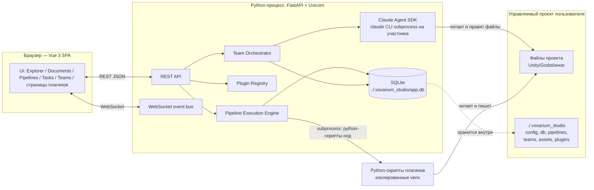
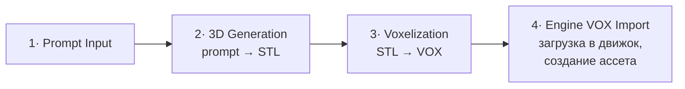
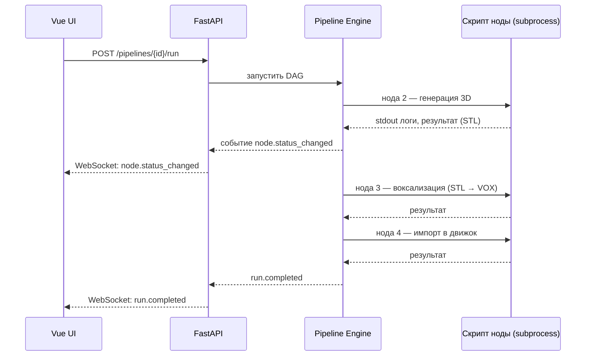
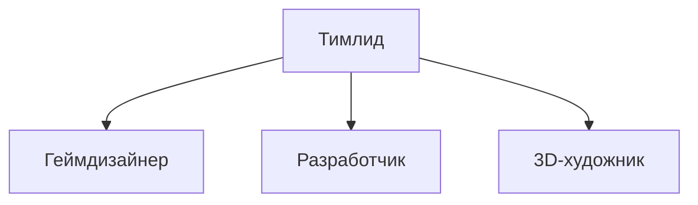

# Voxarium Studio — документ по разработке

> **Статус:** черновик v0.1 · **Дата:** 31 июля 2026
> **Назначение:** единая техническая спецификация для передачи в Claude Code как основа реализации. Название «Voxarium Studio» — рабочее.
> Технические термины, имена библиотек, код и пути оставлены на английском — это стандартная практика.

---

## 0. TL;DR — стек одним взглядом

| Слой | Технология | Кратко почему |
|---|---|---|
| Backend framework | **Python 3.12 + FastAPI + Uvicorn** | async‑нативный, WebSocket из коробки, Pydantic-схемы отлично ложатся на схемы нод плагинов |
| Очередь асинхронных задач | **Свой движок на asyncio** (не Celery) | локальный однопроцессный инструмент — не нужен брокер (Redis/RabbitMQ) |
| Запуск python-скриптов нод | `asyncio.create_subprocess_exec`, изолированные venv на плагин (**uv**) | у разных плагинов могут быть конфликтующие зависимости (torch и т.д.) |
| БД | **SQLite** (`./.voxarium_studio/app.db`) через **SQLModel** | файл внутри проекта — портативно, ноль конфигурации, совпадает с моделью «данные хранятся в папке проекта» |
| Real-time | **WebSocket** (нативно в FastAPI/Starlette) | статусы нод, логи, сообщения агентов — стриминг в обе стороны |
| Frontend framework | **Vue 3 + `<script setup>` + TypeScript + Vite** | заявлено в ТЗ; TS важен для типобезопасного API плагинов |
| Стейт-менеджмент | **Pinia** | стандарт для Vue 3 |
| Канвас пайплайнов | **Vue Flow** (`@vue-flow/core`) | де-факто стандарт нод-редакторов на Vue 3, активно поддерживается (см. §2.6) |
| Стилизация/дизайн-система | **Tailwind CSS v4** (CSS-first, `@theme`) поверх слоя CSS custom properties + **Reka UI** (headless) | v4 нативно превращает токены в CSS-переменные во время выполнения — то, что нужно для темизации «всего приложения и отдельных элементов» (см. §7) |
| Иконки | `lucide-vue-next` | согласовано с остальной экосистемой |
| Оркестрация агентов Teams | **Claude Agent SDK для Python** (`claude-agent-sdk`) + собственный оркестратор поверх него | см. подробное обоснование в §10 — нативная experimental-фича Claude Code «Agent Teams» для этого не подходит |
| Упаковка/запуск | pip/uvx-пакет с встроенным CLI (`voxarium_studio run <path>`), фронтенд собирается Vite и раздаётся тем же FastAPI-процессом | один процесс, один порт — просто как локально, так и на сервере |

---

## 1. Обзор и терминология

**Voxarium Studio** — локальный/серверный веб-хаб для AI-геймдев разработки: строит и запускает AI-пайплайны (генерация 3D, кода и т.д.), поддерживает плагины на новые типы нод и страниц, а также оркестрирует «команду» AI-агентов с ролями и иерархией.

Термин «проект» в разговоре о таком приложении неизбежно перегружен, поэтому фиксируем три разных понятия:

| Термин | Что это |
|---|---|
| **Voxarium Studio** (далее — **Студия**) **/ приложение** | То, что мы разрабатываем (этот документ описывает именно его) |
| **Управляемый проект** | Папка, на которую пользователь указывает Студии при запуске (например, Unity/Godot/Unreal-проект или просто папка ассетов). Explorer показывает именно её. Внутри неё создаётся `./.voxarium_studio` |
| **Репозиторий Студии** | Кодовая база самого приложения (то, что будет писать Claude Code по этому документу) — отдельно от управляемого проекта |

Данные работы над проектом хранятся **внутри управляемого проекта**, в `./.voxarium_studio`. Глобальные настройки приложения принадлежат пользователю и хранятся отдельно, рядом с реестром установленных плагинов и списком недавних проектов (§5.1).

---

## 2. Технологический стек и обоснование

### 2.1 Backend

- **Python 3.12+, FastAPI, Uvicorn (ASGI).** FastAPI выбран потому что: (a) async/await нативно — а бэкенд по ТЗ должен параллельно вести множество асинхронных веб-задач; (b) WebSocket-эндпоинты есть из коробки; (c) Pydantic v2-схемы — естественный способ описывать входы/выходы нод плагинов и валидировать конфиги пайплайнов; (d) автогенерация OpenAPI полезна и для дебага, и потенциально для типизации фронтенда.
- **Задачи и очереди — свой движок на `asyncio`, а не Celery/RQ/Dramatiq.** Эти инструменты требуют брокер (Redis/RabbitMQ) — лишняя инфраструктурная зависимость для инструмента, который должен «запускаться локально». Вместо этого — внутренний Job Engine (см. §8.2) на `asyncio.Task`/`asyncio.Queue`, с состоянием, персистентным в SQLite (переживает перезапуск). Если в будущем понадобится распределённое исполнение на нескольких машинах — движок спроектирован так, чтобы за тем же внутренним интерфейсом можно было подставить Celery/Arq, не переписывая API и UI.
- **Запуск python-скриптов нод — через subprocess, а не в процессе бэкенда.** `asyncio.create_subprocess_exec` даёт: изоляцию зависимостей (у ноды генерации 3D может быть torch+diffusers, у другой — конфликтующая версия), стриминг stdout/stderr как логов в реальном времени, возможность отмены (kill процесса) и то, что тяжёлые синхронные ML-библиотеки не блокируют event loop FastAPI.
- **Изоляция окружений плагинов — через `uv`.** У каждого плагина может быть свой `requirements.txt`/`pyproject.toml` и своё venv (`./.voxarium_studio/plugins/<id>/.venv`), создаваемое `uv venv` + `uv pip install` — это на порядок быстрее обычного `venv`+`pip`, что важно, потому что окружения собираются сами, пока пользователь работает: при открытии проекта, при включении плагина и после изменения его зависимостей (§9.4).
- **БД — SQLite через SQLModel** (или чистый SQLAlchemy 2.0 async + `aiosqlite`, если нужен больший контроль). SQLite — файл `./.voxarium_studio/app.db`, что идеально ложится на требование «хранит все данные для себя в папке проекта»: не нужен отдельный сервер БД, файл переносится вместе с проектом. SQLModel выбран, так как написан автором FastAPI и позволяет одной моделью описывать и Pydantic-схему API, и таблицу БД — меньше дублирования.
- **Определения (pipelines, ноды команд, роли) — YAML/JSON-файлы, а не только БД.** Человекочитаемые, диффуемые в git конфиги для вещей, которые пользователь осознанно редактирует (пайплайны, состав команды), тогда как рантайм-состояние (статусы запусков, логи, история) — в SQLite. Подробности структуры — §5.

### 2.2 Frontend

- **Vue 3 (`<script setup>`, Composition API) + TypeScript + Vite.** TypeScript особенно важен здесь, потому что система плагинов подразумевает публичный API (типы нод, страниц) — без типов сторонним/будущим плагинам будет сложно интегрироваться корректно.
- **Pinia** — стейт-менеджмент (стандарт для Vue 3, замена Vuex).
- **Vue Router** — навигация между Explorer/Pipelines/страницами плагинов.
- **Vue Flow (`@vue-flow/core`)** — канвас для редактора пайплайнов. Актуальность на июль 2026 подтверждена: активно поддерживаемая библиотека (~5.2k★, регулярные релизы), MIT-лицензия, поддерживает кастомные ноды/рёбра, composable API (`useVueFlow`), минимапу, панели — то есть закрывает ровно тот кейс, который описан в ТЗ («последовательность из асинхронных нод»). Прямой Vue-аналог React Flow.
- **`@vueuse/core`** — готовые composables (`useWebSocket`, `useLocalStorage`-аналоги и т.д.), стандартный компаньон Vue 3, экономит время на инфраструктурном коде.

### 2.3 Стилизация — см. отдельный §7 (система стилизации была явно запрошена в ТЗ, поэтому разобрана подробно).

### 2.4 Коммуникация

- **REST (JSON)** для CRUD-операций: пайплайны, плагины, команды, файлы Explorer.
- **WebSocket** — единый мультиплексированный канал событий (статусы нод, логи выполнения, сообщения агентов Teams, изменения файлов). Выбран вместо Server-Sent Events, так как в будущем вероятна необходимость двусторонней связи (например, ответ пользователя агенту прямо во время выполнения). Таксономия событий — §11.2.

### 2.5 Упаковка и запуск

- Приложение — устанавливаемый pip/uvx-пакет с CLI-командой (например `voxarium_studio run /path/to/project`). Фронтенд собирается Vite в статику и раздаётся тем же FastAPI-процессом (`StaticFiles`) — то есть **один процесс, один порт**, что одинаково просто разворачивать и локально, и на сервере.
- Dev-режим — два процесса (Vite dev server с HMR на одном порту, FastAPI на другом, проксирование `/api` и `/ws`), чтобы не терять hot-reload при разработке.
- Для серверного режима — **обязательна** аутентификация: приложение исполняет произвольный python-код и управляет AI-агентами с доступом к инструментам (файлы, bash) — открытый порт без авторизации на сервере является реальным риском. Рекомендация: простой bearer-токен/пароль (переменная окружения или `--token`), по умолчанию бинд на `127.0.0.1`, бинд на `0.0.0.0` — только с явно заданным токеном (fail-closed, а не по умолчанию открыто). Полноценные аккаунты/RBAC — вне рамок v1 (см. §14).
- REST и WebSocket проверяют браузерный `Origin`: только origin самого Studio и явно включённые Vite origins. В локальном режиме без токена `Host` обязан быть loopback — защита от DNS rebinding; CORS не заменяет эту проверку. Небраузерные клиенты могут не передавать `Origin`. Пользовательские файлы раздаются с `nosniff` и CSP `sandbox`, а вложения кроме растровых изображений — как скачивание: HTML/SVG не должны получать доступ к API и токену Studio.
- Docker/Compose — как опциональный способ поставки для серверного режима (volume = управляемый проект), приоритет ниже CLI-варианта. Это про саму Студию и по-прежнему не сделано; в Docker поставляется другой, отдельный сервер — remote для онлайн-синхронизации (§16).

**Согласованность версий.** Единая версия оболочки, backend и frontend берётся из тега
текущего коммита (например, `v5.2.0` нормализуется в `5.2.0`); без тега используется
сокращённый хеш текущего коммита. Номер пакета — резерв только при отсутствии и git,
и сохранённого build stamp. Версия сохраняется в wheel stamp, встраивается в JavaScript
и записывается в `static/studio-version.json`. Сборка frontend включает её в ключ кеша:
добавление/снятие тега без правок исходников требует пересборки. При загрузке, возврате в окно
и переподключении WebSocket интерфейс сравнивает его с версией работающего backend
из `GET /api/project`. Несовпадение показывает отдельную ошибку с обеими версиями и
останавливает доступ к рабочим страницам до восстановления.

Восстановление автоматическое: `POST /api/runtime/recover` проверяет файлы на диске
и через штатный relauncher / `run.ps1` заменяет устаревший процесс и его дочерние процессы,
сохраняя проект, порт, dev-режим и токен. Остановка выполняется и при активной работе:
это явное правило восстановления несовместимых версий. Git pull, установка зависимостей
и сборка при этом не запускаются. Если устарела только вкладка, перезагружается интерфейс.
Клиент ждёт именно ожидаемую версию в `/healthz`, а не просто доступность порта.
Перезапуск общий для всех вкладок; повтор той же пары версий после перезагрузки
не вызывает бесконечный цикл. Несогласованные файлы на диске, неподдерживаемый старый
API или ошибка запуска оставляют видимую ошибку с ручным повтором. Проверяется строгое
равенство версий сборки; изменения без нового коммита/тега сами по себе версию не меняют.
Разные хеши не упорядочиваются как релизы: HTTP-восстановление не заменяет такой сервер
автоматически. При запуске desktop пользователь может явно выбрать его сборку (§2.7).

### 2.6 Проверка актуальности (на дату документа)

Перед реализацией стоит свериться с текущей документацией — версии меняются быстро. На момент написания:
- Vue Flow: последняя версия `1.48.2`, активно развивается, 121+ проектов используют `@vue-flow/core` по данным npm.
- Tailwind CSS v4: CSS-first конфигурация (`@theme`) — стабильный текущий мейнстрим, а не бета; v3-стиль `tailwind.config.js` — legacy-путь.
- Claude Agent SDK — активно развивающийся продукт Anthropic; конкретные факты по нему (см. §10) проверены по официальной документации на дату этого черновика и **подлежат повторной проверке** перед реализацией — Anthropic может поменять API SDK за время разработки.

---

### 2.7 Устанавливаемое desktop-приложение (Electron)

Логотип приложения (2026-10-31) — фиолетовая буква S из кубиков на скруглённой
тёмной плитке. Исходник хранится в `desktop/assets/logo.png`; из него команда
`npm run icons` в `desktop/` создаёт иконки Windows, трея и web-версии. Один знак
используется в заголовке, переключателе проекта, экране запуска, вкладке браузера,
исполняемом файле, ярлыках и установщике.

Имя продукта — **Voxarium Studio** (переименование 2026-10-29). Технические имена
пакета/CLI `voxarium_studio` и Electron appId сохраняются для совместимости.
Существующий Chromium-профиль также сохраняется. Имя установщика берётся из build stamp
включённого backend, как и версия в интерфейсе: `Voxarium Studio Setup v4.1.exe`.
Для числовых метаданных Windows/Electron тег `v4.1` нормализуется в `4.1.0`; для сборки
без тега имя содержит отображаемый хеш коммита. Сборка не использует фиксированную
версию из desktop/package.json в качестве имени релиза.

Windows x64 поставляется также как NSIS-установщик Electron. Vue SPA и FastAPI остаются
общими с web-версией. Комплект содержит автономный Python 3.12, установленное wheel
`voxarium_studio[teams]`, встроенные плагины, собранную SPA, Node.js и npm. Python и Node.js
на машине пользователя не требуются; внешние инструменты проектов (Git, движки,
отдельные CLI провайдеров) и их авторизация устанавливаются отдельно. Вместе с Teams
поставляется встроенный в Claude Agent SDK исполняемый файл Claude Code. Из языковых
пакетов Electron включаются только en-US и ru, соответствующие языкам интерфейса (§6.4).

Комплект собирается внутри checkout, а работает на чужих машинах, поэтому в нём не
остаётся путей машины сборки: в таком пути может оказаться имя пользователя. После сборки
runtime `desktop/scripts/strip-build-paths.py` удаляет `direct_url.json` с локальным
`file:`-адресом и launcher'ы консольных команд в `python\Scripts` — в них зашит
интерпретатор сборки, и на другой машине они не запускаются; настоящие исполняемые файлы
(`uv.exe`) остаются. Байткод всей `python\Lib` компилируется этим же шагом с путями
исходников относительно каталога Python, поэтому `--compile-bytecode` у uv не используется.
Последним действием читается каждый файл комплекта: если в нём остался путь checkout или
домашнего каталога сборщика, сборка завершается ошибкой со списком таких файлов.

Electron загружает `http://127.0.0.1:8765`; сервер запускается только через `run.cmd`
с `-Desktop -NoOpen`. Этот режим отказывается занимать уже занятый порт и не убивает
чужие процессы. Уже запущенный Studio с идентификатором `service: voxarium_studio` в healthz
может быть подключён без владения его процессом, только если его версия строго совпадает
с версией оболочки (тег или сокращённый хеш, §2.5). Она сохраняется в `package.json.studioVersion`
оболочки из того же wheel stamp, а в checkout читается из git. Для Electron/NSIS, которым
нужен SemVer, техническое поле версии установщика без тега использует числовой номер пакета;
оно не подменяет сравниваемую или отображаемую версию Studio. Текст NSIS-установщика
(включая нижнюю подпись и страницу обновления), а также `DisplayVersion` и `DisplayName`
в списке установленных приложений Windows используют метку из того же wheel stamp:
тег текущего коммита либо его сокращённый хеш. Следующее обновление читает эту метку
из `DisplayVersion`; для старых установок доступно ранее записанное значение.
Проверка сборки требует совпадения версии исходников, установленного wheel и встроенного
frontend до упаковки установщика.
Ошибки запуска оболочки и сравниваемые версии записываются в `run/desktop.log`
рядом с журналами launcher и backend.
Если backend старее, Electron показывает несовпадение, читает текущий проект и запускает
штатный `run.ps1` без `-Desktop`, чтобы заменить старый процесс даже при отсутствии нового
API восстановления. Более новый backend не заменяется старой копией desktop; неизвестная
версия, другой сервис на порту и недоступный текущий проект завершаются ошибкой.
Если отличается хеш коммита (в том числе при переключении между коммитом и SemVer-релизом),
Electron показывает обе версии и предлагает переключиться на сборку запускаемой оболочки,
предупреждая об остановке задач и пайплайнов. Хеши не сортируются. Отмена выбрана по умолчанию
и закрывает запуск без ошибки и без остановки сервера. Только после подтверждения оболочка
читает текущий проект, повторно проверяет идентичность работающего backend и запускает свой
runtime через тот же `run.ps1`. После запуска по-прежнему требуется точное совпадение версий.
Второе окно приложения фокусирует первое.
При выходе завершается только backend, запущенный этим экземпляром Electron,
с проверкой случайного идентификатора в healthz. Выход требует подтверждения остановки
задач. Подключённый независимо запущенный сервер продолжает работу.

Backend этого экземпляра входит в Windows Job Object с `KILL_ON_JOB_CLOSE`:
выход и аварийное завершение убирают всех его потомков, включая инструменты агентов
и процессы, чей непосредственный родитель уже завершился. При штатном выходе серверу
даётся до 15 секунд на сохранение состояния; зависшее завершение останавливает весь job.
Electron ждёт завершения процесса по сохранённым PID и времени создания, а не исчезновения
`/healthz`; повторное использование PID не даёт права завершать чужой процесс.
Исключение — relauncher обновления (§12.1), явно выходящий из job перед перезапуском.

Отдельная кнопка «Свернуть в системный трей» в заголовке скрывает окно, сохраняя
backend, задачи и состояние страницы. Обычная кнопка сворачивания оставляет окно
на панели задач; крестик сохраняет подтверждение выхода. Нажатие на значок трея,
пункт «Открыть Voxarium Studio» или повторный запуск приложения возвращают то же окно.
Меню трея следует выбранному языку интерфейса; «Выйти» сначала показывает окно,
затем проходит через тот же диалог остановки задач. При выходе и установке обновления
значок удаляется.

Ручной запуск нового NSIS-установщика находит существующую установку по стабильному
appId, показывает установленную версию, версию устанавливаемой сборки и каталог. «Обновить»
сохраняет область установки (пользователь / все пользователи) и
точный путь; повторный выбор каталога не предлагается. Та же версия допускает
переустановку. Профиль Chromium, настройки и проекты сохраняются; файлы приложения
заменяет штатная транзакция electron-builder. Пока из каталога установки работают
процессы, включая скрытое в трее окно или завершающийся backend, замена файлов
блокируется. Установщик предлагает завершить процессы этой установки и продолжить,
повторить проверку после самостоятельного выхода или отменить установку. Перед
принудительным завершением явно предупреждает о прерывании задач и потере несохранённых
изменений; завершение выполняется только после выбора «Да». Процессы определяются по
полному пути внутри каталога установки, включая встроенные Python/Node, без затрагивания
других копий Studio и самого установщика. После завершения каталог проверяется повторно;
ошибка не разрешает замену файлов. Тихий установщик не завершает процессы без диалога
и при занятой установке возвращает ненулевой код. Запуск из автообновления
ждёт завершения процессов до 15 секунд и не показывает дополнительную страницу
ручного обновления. Новая установка сохраняет выбор каталога.

Renderer изолирован: Node integration выключен, context isolation и sandbox включены,
произвольного IPC нет. Узкий preload API позволяет только свернуть (в том числе в трей), развернуть,
восстановить и закрыть собственное окно, передать язык en/ru для нативного меню, прочитать его состояние и подписаться на
изменения. Main process проверяет отправителя, главный frame и origin каждого вызова.
Нативная рамка скрыта; Vue рисует панель высотой 38px в цветах текущей темы, заголовок
точно по центру окна и четыре кнопки справа (трей, свернуть, развернуть, закрыть). Панель позволяет перетаскивать окно;
кнопки исключены из drag-области. Панель доступна и на экранах загрузки/ошибки/входа,
в обычном браузере не отображается. Закрытие проходит через общее подтверждение выхода.
Навигация внутри окна ограничена origin Studio; внешние HTTP(S)
и mailto ссылки передаются системному браузеру. Остальные протоколы блокируются.
Разрешения браузера запрещены, кроме записи в буфер обмена (`clipboard-sanitized-write`)
из главного frame собственного окна с origin Studio: это обеспечивает копирование
путей в Explorer и текста в других разделах. Чтение буфера остаётся запрещённым.
Нативные сообщения берутся из `desktop` в общих en/ru локалях; до загрузки UI язык
определяется системой, при выходе — выбором в Settings.

Данные проектов по-прежнему находятся в их `.voxarium_studio/`; каталог установки содержит
только приложение. Chromium хранит профиль, настройки UI и кэш в Electron userData,
там же расположены журналы запуска. Это дополнительное машинное состояние desktop
оболочки к §5.1, не хранилище данных проектов. Удаление программы не удаляет проекты.
Обновление desktop загружает установщик прямо из приложения (§12.1); git-обновление
для wheel остаётся недоступным. Подпись установщика требует отдельного сертификата издателя.

## 3. Архитектура верхнего уровня



Ключевая мысль архитектуры: **движок исполнения пайплайнов и оркестратор команд разделяют одну и ту же async-инфраструктуру** (тот же Job Engine, тот же event bus в WebSocket, та же модель «состояние в SQLite + стриминг статусов»). Задача участника команды технически — это тоже асинхронная задача с потоковым логом, просто её «исполнитель» — не python-скрипт, а Claude Code сессия через Agent SDK. Это не только экономит код, но и даёт единый UX: и ноды пайплайна, и работа тимлида/разработчика в Teams выглядят в интерфейсе одинаково (статус, лог, отмена).

---

## 4. Структура репозитория приложения

```
voxarium_studio-studio/
├── backend/
│   ├── app/
│   │   ├── main.py                 # точка входа FastAPI
│   │   ├── api/                    # REST-роуты
│   │   ├── ws/                     # WebSocket-эндпоинт(ы), event bus
│   │   ├── engine/                 # Job Engine + DAG-исполнение пайплайнов
│   │   ├── plugins/                # загрузчик, реестр, манифесты
│   │   ├── teams/                  # оркестратор команд, обёртка над Agent SDK
│   │   ├── explorer/               # файловый браузер управляемого проекта
│   │   ├── models/                 # SQLModel-модели (БД)
│   │   ├── schemas/                # Pydantic-схемы API/нод
│   │   └── core/                   # конфиг, инициализация ./.voxarium_studio, логирование
│   ├── plugins_builtin/            # встроенные ноды (core.prompt_input и т.д.)
│   ├── pyproject.toml
│   └── cli.py                      # `voxarium_studio run`, `voxarium_studio init`
├── frontend/
│   ├── src/
│   │   ├── components/
│   │   ├── views/                  # ExplorerView, PipelinesView, TeamsView
│   │   ├── stores/                 # pinia: usePipelinesStore, useThemeStore...
│   │   ├── styles/                 # design tokens, theme.css, tailwind config
│   │   ├── plugin-runtime/         # динамическая загрузка UI плагинов
│   │   └── node-renderer/          # generic-рендер нод по JSON-схеме
│   ├── package.json
│   └── vite.config.ts
└── docs/
    └── voxarium-studio-dev-spec.md  # этот документ
```

---

## 5. Структура данных проекта (`./.voxarium_studio`)

```
<managed-project>/
├── ignore.conf              # правила Plastic для /.voxarium_studio/; см. ниже
└── .voxarium_studio/
    ├── config.yaml          # активные плагины, акцент, настройки проекта и агентов
    ├── app.db                # SQLite: запуски, задачи, история, сессии агентов
    ├── pipelines/             # ЧИТАЕМЫЕ человеком, git-friendly
    │   └── prompt-to-voxel-asset.yaml
    ├── teams/
    │   └── default-team.yaml # состав команды, роли, иерархия
    ├── docs/                   # общая документация команды (спеки, тест-планы) — §10.4
    │   └── features/dash.md
    ├── skills/                 # скиллы агентов: папка на скилл с SKILL.md; никому не выданы — §10.10
    │   └── level-prototyping/SKILL.md
    ├── memory/                 # память проекта: файл на запись, индекс видит каждый агент — §10.12
    │   └── build-uses-ue-5-4.md
    ├── automations.yaml        # что проект делает сам: триггер → действие — §6.5
    ├── plugins/               # опциональные project-local плагины/оверрайды
    ├── assets/                 # кэш сгенерированных артефактов (STL, VOX, текстуры...)
    ├── attachments/            # файлы, приложенные к комментарию ревью, папка на задачу — §10.4; в .gitignore
    ├── runs/                    # логи/транскрипты запусков и агентских сессий
    ├── temp/                    # временные рабочие файлы задач, удаляются при Done — §10.4
    │   └── TASK-1/              # отдельная папка по неизменному номеру задачи
    └── .gitignore               # см. ниже
```

**Контроль версий:** `app.db`, `pipelines/`, `teams/`, `docs/`, `skills/`, `memory/`, `automations.yaml`, `config.yaml` стоит **коммитить** — это состояние и описание AI-воркфлоу проекта, ценное для истории и совместной работы команды. `assets/`, `attachments/`, `runs/`, `temp/`, `worktrees/`, `plugins/*/.venv/` и служебные файлы SQLite `app.db-wal`, `app.db-shm` **игнорируются**. Базу следует фиксировать после остановки Studio, когда SQLite перенесла изменения из WAL в `app.db`.

При открытии проекта или вызове `voxarium_studio init` Studio переименовывает существующий каталог `voxarium_studio/` в `.voxarium_studio/` перед чтением конфигурации и открытием базы. Просмотр каталогов и списка недавних проектов распознаёт оба имени без переименования. Если заняты оба пути, открытие останавливается с ошибкой и оба каталога сохраняются.

При первом запуске сервисов Studio обновляет в SQLite пути к файлам задач, логам и артефактам пайплайнов. Обновление путей и отметка о миграции фиксируются одной транзакцией. Для подключённых рабочих копий задач Git восстанавливает привязку к новому расположению. Пользовательская конфигурация приложения сохраняет путь из §5.1.

При инициализации создаётся `./.voxarium_studio/.gitignore`. При повторной инициализации (включая открытие проекта) из ранее сгенерированного Studio файла удаляется точная строка `app.db`, а отсутствующее правило `temp/` дописывается; остальные правила сохраняются. Полностью пользовательский `.gitignore` не переписывается.

Для Plastic создаётся `ignore.conf` в корне управляемого проекта (корне workspace): все правила ограничены путями `/.voxarium_studio/...` и не исключают `app.db`. В существующий файл дописываются только отсутствующие правила Studio, без удаления пользовательских записей. Это дополнительный файл вне `.voxarium_studio/`, необходимый из-за формата конфигурации Plastic.

### 5.1 Смена открытого проекта на лету

В выпадающем меню проектов в шапке у каждого недавнего проекта показаны две строки мелким
шрифтом: `N in progress` и `N needs review` (с переводом на язык интерфейса). В нижней левой
панели статуса счётчики задач не дублируются: там показана готовность бэкендов (§6.1).
Считаются задачи всех команд только в статусах `in_progress` и `needs_review`; нули видны.
Данные читаются из существующей БД проекта без запуска его контекста или миграций и не
сохраняются в глобальном списке недавних. При недоступной БД вместо числа показан прочерк.
Текущий проект обновляется по событиям задач и при восстановлении соединения; дополнительно
счётчики перечитываются каждые 15 секунд, для остальных проектов — пока открыто меню.

Интерфейс Studio в каждый момент времени показывает один управляемый проект. Кроме
`voxarium_studio run <path>` проект можно выбрать прямо из UI: `POST /api/project/open`
строит отдельный `AppContext` для впервые открываемой папки, а при возврате использует уже
работающий контекст. Переключение **не отменяет задачи**: агентские сессии, чаты, пайплайны,
ожидания лимитов, плагины и автоматизации продолжают работу со своей БД и файлами.
Контексты открытых проектов сохраняются в памяти до остановки сервера; при остановке
завершаются все, включая фоновые. Защита обновления от перезапуска учитывает задачи всех
этих проектов. Это не восстановление сессий после перезапуска процесса.
Изменять контекст на месте нельзя: неудача оставила бы систему в полусмененном состоянии.

Два правила, без которых это не работает:

- Новый контекст **поднимается до** смены выбранного проекта. Непарсящийся `config.yaml` или
  неимпортируемый плагин должны оставить Studio на том проекте, который уже открыт.
- Шина браузеров **сохраняется** при переключении: открытые сокеты продолжают получать
  `project.opened`. У каждого контекста своя локальная шина для плагинов и автоматизаций;
  в браузер пересылаются только события выбранного проекта. При переключении история
  повтора браузерной шины очищается, но последовательность номеров событий не сбрасывается.

Папка без `.voxarium_studio/` инициализируется при открытии — это ровно то, что делает `voxarium_studio init`,
только из GUI. UI спрашивает подтверждение, потому что тот же клик по соседней строке иначе
рассыпал бы `.voxarium_studio/` по чужим каталогам.

**Выбор папки.** Браузер не может отдать бэкенду путь: File System Access API возвращает
непрозрачный handle, а не путь, с которым можно открыть проект. Поэтому системный диалог
выбора папки поднимает **бэкенд** (подпроцесс с `FolderBrowserDialog` на Windows, `tkinter`
в остальных случаях), а ответ возвращается по REST. Диалог предлагается только при бинде на
loopback — на Studio, открытой в сеть, окно появилось бы на рабочем столе сервера, а не у
того, кто нажал кнопку. Запасной путь, работающий всегда, — встроенный обозреватель папок
(`GET /api/fs/browse`), который отдаёт **только имена каталогов**, без содержимого файлов.

**Какой проект открывается при старте.** Путь в командной строке — первый выбор и
единственное, что Studio не решает сама. Без пути открывается тот проект, который был открыт
последним: это верх того же списка недавних, а запись, которой больше нет на диске,
пропускается — переехавший проект не должен держать Studio на каждом следующем запуске.
Открывать нечего (первый запуск, либо все недавние проекты переехали) — открывается
**встроенный демо-проект**. Текущий каталог не используется никогда: то, где оказалась
оболочка, — факт про оболочку, а не утверждение о том, какой проект инициализировать.

Демо-проект — обычный управляемый проект, и встроенное в нём только место: он создаётся при
первом таком старте рядом с реестром плагинов и списком недавних (`$VOXARIUM_STUDIO_HOME/demo-project`)
и содержит пример пайплайна и команды от `voxarium_studio init` плюс приветственный документ. Studio
ничего оттуда не перечитывает, так что папку можно править и удалять — следующий запуск,
которому нечего открыть, создаст её заново.

**Состояние вне проекта.** Реестр плагинов (§9.4), список недавних проектов (только пути
и имена) и пользовательские настройки приложения находятся в `user_config_dir()`:
на Windows — `%APPDATA%/voxarium_studio`, на остальных системах —
`$XDG_CONFIG_HOME/voxarium_studio` либо `~/.config/voxarium_studio`.
`$VOXARIUM_STUDIO_HOME` переопределяет этот каталог целиком. Там же может находиться
встроенный демо-проект, но его данные по-прежнему принадлежат самому проекту.

### 5.2 Глобальные и проектные настройки (2026-11-05)

Пользовательский `config.yaml`
содержит `theme` без `accent`, `language`, `show_data_dir`, `node_cache_enabled`
и `updates`. Эти значения общие для всех управляемых проектов и редактируются только
на странице Settings (§6.1). Автозапуск Windows также настраивается там, но хранится
средствами ОС. `theme.accent`, `teams`, `concurrency`, `project_code` и остальные
проектные параметры остаются в `<managed-project>/.voxarium_studio/config.yaml`.
`explorer.ignore`, например, относится к дереву конкретного проекта. В эффективном
`AppConfig` глобальный `show_data_dir` доступен как `explorer.show_data_dir`.

При первом открытии, если пользовательского конфига ещё нет, глобальные значения
переносятся из успешно прочитанного прежнего конфига проекта. Диагностическое чтение
(включая CLI `info`) ничего не записывает; отсутствующий или нечитаемый проектный
конфиг не запускает миграцию. После этого другие проекты
не перезаписывают выбор пользователя; очередное сохранение конфига проекта убирает
из него глобальные поля. Для runtime и `GET /api/project` используется единый
эффективный `AppConfig`: глобальные значения объединены с данными текущего проекта.
Сохранение глобальных настроек применяется и к уже открытым фоновым контекстам (§5.1)
и синхронизировано с открытием проекта, чтобы новый контекст не получил старые значения.
`PUT /api/settings/application` принимает только глобальные поля; проектные поля
в этом запросе отклоняются. Глобальное сохранение не изменяет файл проекта. Прежний
`PUT /api/settings` сохраняет совместимость, распределяя переданные поля между
пользовательским и проектным файлами.

---

## 6. UI/UX структура приложения

### 6.1 Общий layout

Слева — узкое вертикальное меню (иконки + подписи), справа — рабочая зона на всю оставшуюся ширину. Пункты меню верхнего уровня:

| Пункт меню | Что происходит в рабочей зоне |
|---|---|
| **Explorer** | Дерево файлов управляемого проекта + панель предпросмотра |
| **Documents** | Документы команды в блочном редакторе (block-editor spec). Стоит сразу под Explorer: оба пункта — про файлы проекта, дерево всего и затем то, что команда пишет сама |
| **Graph** | Граф связей документов. Самостоятельный пункт сразу после Documents, с теми же отступами, размером иконки и текста, что у остальных страниц |
| **Chats** | Полноэкранные чаты с участниками (§10.9): список слева, диалог справа. Стоит после Graph |
| **Pipelines** | Список пайплайнов → клик открывает канвас конкретного пайплайна. В меню без приставки «AI»: она не различает ничего, здесь всё про агентов. Иконка использует цвет Automations (`--vxs-nav-automations`) |
| **Automations** | Автоматизации проекта: «триггер → действие», их журнал и настройка уведомлений (§6.5). Стоит сразу после Pipelines; обе иконки одного цвета |
| **Tasks** | Доска задач и карточка задачи с транскриптом (§10.4) |
| **Teams** | Оргструктура команды и настройки участников (§10.2) |
| **Statistics** | Две колонки: токены слева, API Cost справа. В каждой итоги, теплокарта активности, накопленный расход и средний расход на завершённую задачу по дням, разбивки по участникам и моделям — с учётом архива (§10.4) |
| **Version Control**, **Skills**, **MCP Servers**, **Plugins** | Конфигурация проекта — под чем он лежит (§9.6), какие скиллы есть у команды и кому они выданы (§10.10), какие MCP-серверы доступны агентам (§10.7), что подключено (§9). Skills стоит над MCP Servers: и то и другое — чем оснащён агент, но скилл выдаётся участнику поимённо, а сервер получает каждая сессия |
| **Project Settings** | Настройки текущего проекта (`/project-settings`), сразу под Plugins: Project с Accent Color и сведениями о проекте, AI agents, Tasks, очистка проектного кэша и действующие лимиты выполнения |
| *(плагины)* | Каждая страница, зарегистрированная плагином, добавляется в меню ниже встроенных пунктов — см. §9.3 |
| **Settings** | Глобальные пользовательские настройки (`/settings`), отдельный пункт внизу меню: автозапуск, Language, Appearance без акцента, Explorer, Execution (переиспользование кэша), Studio updates. Проектные настройки на этой странице не дублируются |

Под именем проекта в рейле — **поле поиска** (`Ctrl+K`). Студия сама ничего не индексирует:
поле появляется только когда какой-то плагин зарегистрировал *поискового провайдера* (§9.7),
и каждое нажатие клавиши уходит всем провайдерам сразу; результаты открывают файл в Explorer,
а Enter без выделенной строки запрашивает у провайдера «глубокий» ответ — для графа кода это
обход `graphify query`, показанный текстом под результатами. Встроенный плагин `graphify` —
первый провайдер.

Внизу меню, рядом с индикатором состояния WebSocket-соединения, показывается версия
приложения: тег, если он стоит **ровно на этом** коммите (`v0.2.0`), иначе — короткий хэш
самого коммита (`c3fd2b1`); звёздочка означает сборку из дерева с незакоммиченными
изменениями. Номер из `__version__` — только запасной вариант, когда коммит неизвестен
вовсе: он правится руками и называет линию релизов, а не сборку. Оба индикатора отвечают
на один вопрос — «то ли сейчас перед глазами, что я только что менял»: лампочка говорит,
что события идут, версия — какой именно сборкой они отдаются. Источник — `GET /api/project`,
поле `version` (там же полный хэш, ветка, тег и дата — они уходят в тултип); коммит
штампуется в колесо на этапе сборки (§2.5), а в дереве исходников берётся из git.

В той же панели статуса над VCS находятся три строки: Claude Code, Codex и Qwen Code.
Каждая показывает название и монохромную иконку своего бэкенда вместо кружка: зелёную
при `available=true`, красную при `available=false`, жёлтую до получения статуса, при
ошибке его обновления или отсутствии соединения со Studio. Источник — `agent_backends`
из `GET /api/status`; проверка выполняется при подключении и каждые 15 секунд. Полное
сообщение `reason` отображается в тултипе при наведении на всю строку; неизвестный статус
объясняется локализованным сообщением. В режиме панели без подписей иконки и тултипы
сохраняются. Это доступность локального бэкенда, а не индикатор выполняемой задачи:
например, для Qwen проверяется наличие CLI, а авторизация — только при запуске, что
уточняется в сообщении статуса.

### 6.2 Explorer (v1 scope)

- **PDF (2026-10-29):** встроенный плагин `pdf_preview` заявляет `.pdf` через ту же точку расширения previewer. Получает байты через `runtime.rawFileBytes` с авторизацией и передаёт локальный Blob штатному PDF-просмотрщику браузера в панели Explorer; страницы и масштаб управляются средствами просмотрщика. При закрытии освобождает Blob. Если встроенный просмотр отключён или недоступен, предлагает скачать файл. Сообщения плагина — на английском и русском; сторонних библиотек и сетевых сервисов не требуется.

- Дерево файлов управляемого проекта (без `./.voxarium_studio` по умолчанию, с опцией показать).
- Предпросмотр текстовых файлов и изображений; для остальных типов — базовые метаданные (размер, дата).
- **Текстовым считается то, что текстом является, а не то, у чего знакомое расширение.** Список суффиксов остался быстрым путём для листинга каталога (`classify()` — подсказка, он не читает файлы), но `preview()` нюхает содержимое: BOM → NUL → строгий UTF-8 → однобайтовая кодировка, и только если декодированная выборка почти целиком печатаемая. Поэтому файл вообще без расширения (`LICENSE`, `Makefile`) и файл с незнакомым суффиксом открываются как текст, а использованная кодировка возвращается в поле `encoding` и показывается в шапке панели.
- **Для настоящих бинарников — hex-дамп** (`hexdump -C`, первые `min(MAX_PREVIEW_BYTES, 64 KiB)`), а не надпись «предпросмотр недоступен». Формируется на бэкенде целиком, фронтенд его только рисует.
- **Потолок предпросмотра — настройка приложения, а не проекта** (`MAX_PREVIEW_BYTES` в `explorer/service.py`, 20 MiB; изменено 2026-09-08 по просьбе пользователя). Сколько данных не жалко прогнать в браузер — свойство Студии и машины, у игрового проекта мнения на этот счёт нет, а `.voxarium_studio/config.yaml` коммитится и разъезжается по всей команде (§5). Был полем `ExplorerConfig`, и это давало вторую проблему: `save_config` пишет все поля, поэтому новый дефолт не доходил до уже существующего проекта. Правила `ignore` остаются в конфиге проекта; `show_data_dir` с 2026-11-05 хранится в пользовательском конфиге и редактируется в Settings → Explorer (§5.2). Старый ключ в чужом `config.yaml` просто игнорируется и исчезает при следующем сохранении; миграции нет намеренно — правило «поднять старый дефолт» не отличило бы «никто не выбирал» от «выбрали 512 KiB» и переписывало бы осознанный выбор при каждой загрузке.
- **Подсветка синтаксиса** — Shiki с грамматиками TextMate, тот же формат, которым красит VS Code. Движок Oniguruma (не JS-транслятор), потому что грамматики приходят от плагинов и должны работать без правок; токенизация даёт **токены, а не HTML** — `v-html` на содержимом файла запрещён (§7 и правила фронтенда). Всё это грузится динамически: ни Shiki, ни WASM, ни одна грамматика не входят в начальный чанк, а до готовности подсветки виден обычный `<pre>` — первая отрисовка никогда её не ждёт. Файлы больше 300 КБ или 5000 строк показываются моноширинным текстом без подсветки.
- **Точка расширения «грамматика языка».** Плагин заявляет `frontend.grammars[]` в манифесте (либо зовёт `registry.add_syntax_grammar()`) и кладёт рядом обычный `.tmLanguage.json`; `GET /api/plugins/grammars` отдаёт список со штампованными URL, фронтенд подтягивает грамматику по требованию. Встроенные языки выигрывают у плагинных при споре за расширение — иначе плагин, заявивший `.json`, забрал бы JSON у всего проекта. Первый потребитель — плагин `angelscript` (`.as`): сейчас он даёт только подсветку, дальше вырастет в остальные возможности языка.
- **«Open in system explorer»** — показать файл или папку в файловом менеджере машины (`POST /api/explorer/reveal`). Файл открывается **выделенным в своей папке**, папка — сама собой. Правила те же, что у системного диалога выбора папки (§5.1): только loopback — окно появляется на рабочем столе того, кто запустил сервер, поэтому у сетевой Студии endpoint отвечает 409 с объяснением, а не молча ничего не делает; и никогда не строка для шелла — путь идёт вектором аргументов, потому что в дереве ассетов пробелы, амперсанды и не-ASCII это норма, а не атака. `explorer.exe /select,<путь>` — один токен: пробел после запятой заставляет его открыть «Документы», и это выглядит как выбор не той папки. Код возврата `explorer.exe` игнорируется — он отдаёт 1 при полном успехе.
- **Окно выводится на передний план.** Windows не отдаёт фокус процессу, который не получал последнего ввода: его получил браузер, а бэкенд запущен отдельно, — поэтому окно открывается **позади всего**, и клик выглядит как «ничего не произошло». Ровно та же поломка, что была у диалога выбора папки, и там она дорого далась при диагностике: окно всё это время было на экране. Диалог решает её владением (§5.1, off-screen topmost owner); здесь окно чужое — им владеет оболочка, — поэтому его надо **найти и поднять**. Ищется по пути через `Shell.Application` (не «какое окно появилось новым»: в Windows 11 показ может открыться **вкладкой** в уже существующем окне, и нового не появляется вовсе — на машине разработчика две открытые папки давали один HWND), поднимается через `AttachThreadInput` + `SetForegroundWindow`, свёрнутое предварительно разворачивается. Всё это фоновой задачей: ответ HTTP не ждёт, потому что от него на странице ничего не зависит. На macOS и Linux не нужно — `open` сам активирует Finder, а freedesktop-менеджер поднимает своё окно сам.
- **Операции над файлами.** Контекстное меню по правой кнопке на файле и на папке: создать файл/папку, переименовать (`F2`), дублировать, вырезать/копировать/вставить, скопировать путь, удалить (`Del`, всегда с подтверждением — операция необратима и рекурсивна). Есть множественное выделение (`Ctrl`/`Shift`+клик). REST: `POST /api/explorer/{create,rename,move,copy,delete}`, каждый путь — через `ExplorerService.resolve()`, корень проекта и сам каталог `.voxarium_studio/` защищены и как источник, и как вычисленная цель. Ни одна операция не рассылает событий сама: изменение видит watcher, и дерево сходится тем же путём, каким сходится на правку извне.
- **Цвет статуса в дереве** из активного `VcsBackend` (§9.6): зелёный — добавлен/непроиндексирован, жёлтый — изменён, красный — удалён, конфликт — красным и жирным. Папка, внутри которой что-то менялось, помечается точкой, а в её подсказке — сколько файлов внутри изменено: свёрнутая папка это единственное место, где дерево прячет изменение целиком. Цвет не единственный сигнал — в конце строки стоит буква статуса (`A`, `M`, `D`, `U`, `R`, `C`, `!`) с подсказкой словом, иначе для дальтоника разметки нет. **Это единственное место в UI, где показывается состояние отдельного файла** (§9.6): цвета и буквы берутся из одного словаря `VCS_MARKS`, а не собираются заново на каждой поверхности. Статус приходит одним ответом `GET /api/vcs/status` на всё дерево и обновляется тем же `explorer.file_changed`, что и само дерево, — запроса на строку нет ни одного. Проект вне всякой VCS — обычное состояние: ответ приходит с `backend: null`, дерево рисуется без разметки и без ошибок.
- Живое обновление дерева при внешних изменениях файлов (`watchfiles` на бэкенде → событие `explorer.file_changed` по WebSocket).
- **Точка расширения «previewer для типа файла» — реализована.** Плагин заявляет набор расширений и ES-модуль своего компонента (секция `frontend.previewers[]` в манифесте либо вызов `registry.add_file_previewer()`), `GET /api/explorer/file` возвращает подходящий previewer вместе с метаданными файла, и Explorer монтирует его вместо встроенной панели. Если тип никем не заявлен — как и раньше, показываются базовые метаданные.
- Само ядро Студии 3D по-прежнему не умеет и 3D-библиотеку не тянет: предпросмотр `.vox` и `.fbx` дают встроенные плагины `vox_preview` и `fbx_preview`, где разбор формата и WebGL-рендер целиком на стороне плагина. Это и есть проверка extension point на реальной задаче — клик по артефакту, сгенерированному нодой пайплайна, открывает его прямо в Explorer.

### 6.3 Pipelines (workspace)

- Открытие пайплайна → канвас Vue Flow: ноды, соединения, зум/пан, миникарта.
- Тулбар: добавить ноду (палитра, сгруппированная по категориям/плагинам — поиск по названию), запустить пайплайн, запустить с конкретной ноды, сохранить, история запусков.
- Клик по ноде → боковая панель конфигурации (поля из JSON-схемы ноды, см. §8.1).
- Статус ноды во время выполнения — цвет рамки/иконка (idle/running/success/error), лог стримится в панель снизу или в модалку по клику.
- **Важная UX-деталь для итеративной работы:** повторный запуск одной ноды должен уметь переиспользовать закэшированные выходы вышестоящих нод (не гонять весь пайплайн заново, если, например, нужно перегенерировать только 3D-модель с новым seed) — подробнее в §8.2.

### 6.4 Язык интерфейса (2026-09-16, по просьбе пользователя)

- **Интерфейс переводится.** Английский — исходный язык, русский — первый перевод. Переключатель находится в Settings → **Language**. Выбор хранится в пользовательском конфиге приложения (§5.2), одинаков для всех проектов этого пользователя и не записывается в конфиг управляемого проекта. `localStorage` (`voxarium_studio.locale`) остаётся кэшем для старта и работы без соединения; после загрузки приоритет у `config.language` с сервера. Пока глобальный язык не выбран (`null`), сохраняется прежний выбор браузера. `<html lang>` следует действующему языку.
- **Строки — в одном файле на язык**: `frontend/src/locales/en.json` и `ru.json`, разложенные по разделам (`tasks`, `docs`, `settings`…). Английский — источник: из него выводится тип ключа (`MessageKey`), поэтому опечатка в ключе ломает `vue-tsc`; другой язык скачивается отдельным чанком только тогда, когда его выбрали, и недостающее в нём сообщение показывается по-английски, а не ключом. `src/i18n/locales.spec.ts` держит языки согласованными: те же ключи, те же плейсхолдеры, формы множественного числа ровно по `Intl.PluralRules` языка.
- **Свой модуль (`src/i18n/`), а не vue-i18n.** В текстах Студии полно символов, которые vue-i18n считает синтаксисом, — `{graph}` в подсказках о промптах, `|` в «may not contain |», `@` в путях, — и каждый пришлось бы экранировать в каждом языке. Правил у сообщения два: `{name}` подставляется, только если параметр с таким именем передан, любая другая фигурная скобка — просто текст; сообщение, зависящее от числа, — объект с текстом на каждую категорию `Intl.PluralRules` (`one`/`other` в английском, `one`/`few`/`many`/`other` в русском), выбираемый параметром `count`, который заодно печатается с разрядами языка. Фраза с разметкой внутри (путь в `<code>`, ссылка, кнопка) — компонент `I18nT` со слотами, чтобы её не резали на куски, которые переводчик не сможет переставить. `t()` — обычная функция над реактивным состоянием, поэтому таблицы подписей хранят ключи и разрешают их при отрисовке: строка, вычисленная один раз при загрузке модуля, осталась бы на прежнем языке.
- **Даты, числа, длительности и размеры** форматируются на языке интерфейса (`formatDate`, `formatNumber` и форматтеры `lib/status.ts`), а не на языке операционной системы.
- **Плагины** получают `runtime.i18n` (§9.3) — текущий язык и `translator(messages)` в том же формате сообщений. Переводы плагин несёт в своём модуле: добавить ключи в файлы Студии он не может. Страницы, ноды и превьюеры встроенных плагинов переведены.
- **Не переводится то, что приходит данными**: названия и описания плагинов и типов нод из манифестов (`NodeTypeSchema`, подписи и описания портов), заголовки страниц плагинов в рейле, тексты ошибок бэкенда, логи прогонов, транскрипты и промпты агентов, имена участников и задач, содержимое документов. Перевод манифестов — отдельная задача: ей нужен формат переводов в `plugin.yaml` / `NodeTypeSchema`, и она не начата.

### 6.5 Автоматизации (2026-09-18, по просьбе пользователя)

Страница **Automations** настраивает, что проект делает сам. Автоматизация — это **один триггер
и одно действие**, и читается она предложением, каким её произнёс бы автор: *On task → Status
changed to: Needs review → Send notification*; *On task → Status changed to: Done → Graphify
Update*; *On directory → ./models/ updated → Execute pipeline «pipeline 1»*. Условий, ветвлений
и цепочек действий нет намеренно: для этого есть пайплайн, и автоматизация умеет его запустить.

- **Хранение — `.voxarium_studio/automations.yaml`**, коммитится вместе с проектом (§5): что проект делает
  сам при закрытии задачи — часть того, как проект работает, и место этому в диффе, как
  пайплайнам и составу команды. Файл чужой не меньше, чем страницы, — его правят руками,
  мержат, пишет более новая Студия, — поэтому чтение снисходительно, а запись осторожна, как с
  `.mcp.json` (§10.7): запись, не прошедшая валидацию, **показывается** на странице как
  нечитаемая, ничего не запускает и **сохраняется дословно** при любой записи; документ,
  который не парсится, не перезаписывается вообще (409), а форма над ним не предлагается.
  Ручная правка подхватывается без перезапуска — движок перечитывает файл по его
  `mtime`/размеру, страница — по `explorer.file_changed`.
- **Триггеры** (закрытый набор): `task.status_changed` — статус задачи изменился на указанный
  (или на любой); `task.created`; `path.changed` — что-то изменилось в папке управляемого
  проекта (или в одном файле), с необязательной маской (`*.fbx` — по имени файла, с `/` — по
  пути внутри папки; без учёта регистра) и выбором видов изменений (`added` / `modified` /
  `deleted`); `run.finished` — запуск пайплайна завершился (любого или конкретного; любым
  образом, успешно или с ошибкой — отменённый запуск попадает только под «любым»). Путь
  хранится относительным, без `./` (`models`), показывается как `./models/`; выйти из проекта
  он не может (422). Папки может ещё не быть: «когда что-то появится в `Export/`» — законная
  просьба до первого экспорта. В диалоге When выбирается **в два шага**, как читается
  предложение: сначала категория — сегментный переключатель Task / Directory / Pipeline, — затем
  событие в ней (Status changed / Created; Files changed; Run finished). Файл по-прежнему хранит
  один `kind`, категория выводится из него. Переход между категориями ничего не стирает: пока
  диалог открыт, каждое событие возвращается таким, каким его оставили.
- **Действия**: `notify` — уведомление (ниже); `pipeline.run` — запуск пайплайна тем же
  `PipelineRunner.start`, что и кнопка Run (`Run.trigger = "automation"`, `created_by =
  "automation:<id>"`); `plugin.action` — действие, которое **предложил плагин** (§9.7,
  `registry.add_automation_action`). Это отдельный список, а не `actions` плагина: те —
  эндпоинты его страницы настроек (у `graphify` среди них `reset`, удаляющий индекс), и что
  можно запускать без присмотра, плагин говорит поимённо. `graphify` предлагает **Graphify
  Update** — тот же инкрементальный прогон, что Index now.
- **Срабатывание длится столько, сколько его работа** (2026-09-18, по просьбе пользователя:
  «продолжительные задачи, такие как Graphify Update, должны показываться как in progress»).
  Действие закончено, когда закончено то, что оно запустило, — запуск пайплайна, обновление
  графа, — а не когда его попросили: журнал не говорит «готово» о работе, которая ещё идёт.
  Действие, не закончившееся за 0,3 с, записывается в журнал *в работе* (`running`,
  событие `automation.fired`) и дописывается, когда кончится (`automation.run_updated`, тот же
  `id`); быстрое пишется один раз. `pipeline.run` ждёт конца своего запуска: успех — `ok`,
  ошибка запуска — `error` с его причиной, отмена — `cancelled`; строка с самого начала
  держит id запуска для ссылки, даже если запуск стартовал позже записи. Обработчик плагина
  возвращает управление, когда работа сделана (§9.7); Graphify Update ждёт **тот прогон,
  который его покрывает**: первый *начавшийся* после запроса — свой, следующий за идущим
  или тот, что начался по тому же поводу. «Задача → Done» слышат и собственная настройка
  плагина `index_on_task_done`, и автоматизация; второй запрос присоединяется к прогону
  первого, а не ставит в очередь повтор — один прогон на событие. Кнопка Run now отвечает,
  как только у срабатывания появилась строка, не держа запрос всю работу; Clear журнала
  оставляет строки, что ещё в работе. Строку, под которой остановилась Студия, срабатывание
  закрывает само — `cancelled` с пометкой «прервано», — а если процесс умер без этого,
  её закрывает следующий старт.
- **Движок — подписчик шины событий** (`backend/voxarium_studio/automations/engine.py`), рядом с
  помпой хуков плагинов (§9.7). Своих сигналов он не изобретает: автоматизация реагирует
  только на то, что Студия и так объявляет, и делает только то, что сделал бы клик. Четыре
  вещи в нём — предохранители, потому что срабатывание может стоить времени GPU или вызова
  модели, а за ним никто не следит:
  - *Статус — это изменение, а не событие.* `team.task.status_changed` публикуется повторно,
    когда к задаче с тем же статусом приходит итог; в событие добавлено поле `previous`, и
    триггер срабатывает только при `previous != status`.
  - *Папка должна затихнуть.* Триггер по пути ждёт две секунды тишины и срабатывает один раз,
    называя всё изменившееся: экспорт двухсот файлов — одно срабатывание, а не двести.
  - *Автоматизация не слышит собственный запуск.* Пайплайн, запущенный изменением `./models/`
    и пишущий в `./models/`, иначе запускал бы себя вечно: изменения, пришедшие, пока его
    запуск жив, и ещё полторы секунды после (watcher сообщает о последних записях с
    задержкой), отбрасываются.
  - *Цепочки и потоки конечны.* Запуск, начатый автоматизацией, несёт глубину; `run.finished`
    отказывается продолжать цепочку глубже трёх. Любая автоматизация, сработавшая больше
    десяти раз за минуту, пропускается — с одной записью в журнале на всплеск.
  Во время смены проекта (§5.1) два контекста недолго делят одну шину, поэтому
  `explorer.file_changed` несёт `root`, а событие о задаче или запуске, которых нет в базе
  этого проекта, игнорируется. Выключенная автоматизация не выполняется, но **Run now** на
  странице работает и для неё: попробовать до включения — в этом и смысл кнопки.
- **Уведомление — это событие `automation.notification`**, а не письмо и не запись в базе: его
  видит тот, у кого Студия открыта. В окне это карточка в правом верхнем углу поверх любого
  раздела и диалога (стопка до четырёх, восемь секунд, под курсором не гаснет); клик ведёт к
  месту — задаче (`/tasks?task=<id>`), файлу в Explorer, пайплайну. По желанию читателя браузер
  поднимает ещё и **системное уведомление** — только пока окно Студии не активно, иначе это одна
  новость дважды; выбор хранится в `localStorage` (`voxarium_studio.notifications.desktop`):
  он относится к разрешениям этого браузера, а не к проекту. Тег уведомления — `seq` события, так что две вкладки
  одной Студии дают один системный баннер. Заголовок и текст автоматизации принимают
  плейсхолдеры (`{task}`, `{title}`, `{status}`, `{previous}`, `{assignee}`; `{path}`,
  `{paths}`, `{count}`, `{folder}`; `{pipeline}`, `{outcome}`, `{error}`), подставляемые той же
  `fill`, что и промпты (§10.3): неизвестная скобка остаётся текстом. **Пустые тексты бэкенд
  не заполняет** — событие несёт вид триггера и его значения, и окно формулирует уведомление
  само, на своём языке (§6.4: бэкенд не пишет интерфейсных строк).
- **Журнал** — таблица `automation_run` в `app.db`: что сработало, от чего (`DP-04 →
  needs_review`, `3 files under ./models/`), где оно сейчас (`running`) и чем кончилось
  (`ok` / `error` / `cancelled` / `skipped` — последнее значит отказ предохранителя, а не сбой
  действия). На странице статус — та же пилюля, что у задач и запусков (§7): «В работе»
  дышит, пока работа идёт, а та же строка, пришедшая к «Готово», один раз вспыхивает. Это
  лог, а не состояние, поэтому
  хранятся последние 500 строк. Упавшее действие — запись с ошибкой, а не упавший движок.
  Чего нельзя выполнить уже сейчас — удалённый пайплайн, выключенный плагин — страница
  говорит строкой под карточкой при чтении, а не отказом при сохранении: пайплайн удаляют
  сильно позже, и узнать об этом стоит именно здесь.

---

## 7. Система стилизации / темизации

ТЗ явно просит заложить систему стилизации заранее — «для всего приложения и отдельных элементов». Решение — двухуровневая система дизайн-токенов:

**Уровень 1 — глобальные токены (CSS custom properties).** Единый файл `frontend/src/styles/tokens.css` объявляет примитивы (`--color-slate-900`, `--space-4`, `--radius-md`, `--shadow-sm`...) и семантические токены поверх них (`--color-bg-surface`, `--color-accent`, `--color-text-muted`...). Переключение темы (light/dark/кастомный акцент) — это просто смена набора значений семантических токенов на `:root`/`[data-theme]`, без пересборки.

**Уровень 2 — Tailwind CSS v4 как слой утилит поверх тех же токенов.** В v4 конфигурация темы делается прямо в CSS через `@theme`, и все токены автоматически становятся нативными CSS-переменными, доступными в рантайме — то есть `bg-accent`, `text-muted` и подобные Tailwind-классы резолвятся в те же переменные, что и ручной CSS. Один источник истины, а не два параллельных набора значений (JS-конфиг vs CSS) как было в Tailwind v3.

**Уровень 3 — стилизация отдельных элементов (то, что явно запрошено).** Компонентно-скоуп­ленные CSS-переменные для конкретных сущностей:
- У каждой **категории нод** (регистрируется плагином, см. §9.1) — свой акцентный цвет и иконка, применяются через `style="--node-accent: ..."` на обёртке ноды в Vue Flow — не нужно генерировать классы на лету.
- Пользовательские настройки темы хранятся в глобальном `config.yaml` (§5.2), кроме `theme.accent`: он принадлежит проекту и редактируется в Project Settings → Project → Accent Color. Объединённая тема применяется стором `useThemeStore` (Pinia) при старте приложения. Каждая ручка становится атрибутом на `<html>` (`data-theme`, `data-sidebar`, `data-font`, `data-mono`, `data-status-palette`), а значения атрибутов — блоками в `tokens.css`; сам стор пишет только сид акцента (`--vxs-accent-seed`; `:root` направляет на него `--vxs-accent`), тон заголовка ноды и, если он выбран, размер текста. Ручки (Settings → Appearance): **mode** (dark / light / system); **text_size** — размер текста в px или `null`, то есть «размер самого приложения» — та же договорённость, что у `docs.font_size`; **font** и **mono_font** (Google Sans / Inter / IBM Plex Sans / Roboto / системный; Cascadia Code / JetBrains Mono (по умолчанию) / Fira Code / системный — недостающее начертание подгружается с Google Fonts по запросу и только тогда); **sidebar** (labels / icons / auto — рейл с подписями, 48px только с иконками, или иконки, разъезжающиеся поверх страницы по наведению, не сдвигая её); **canvas_grid** (dots / lines / none) и **node_tint** — сила заливки заголовка ноды цветом категории; **status_palette** — `accessible` меняет всю палитру статусов разом, доску, канвас и метки VCS, на различимые для дальтоника оттенки Okabe–Ito, потому что доска и канвас, расходящиеся в цвете «running», хуже любой из палитр; **custom_tokens** — сырые переопределения любых `--vxs-*`, применяются последними, редактируются таблицей на той же странице; глобальная тема экспортируется и импортируется файлом JSON, без проектного `accent`; старое поле `accent` при импорте не меняет акцент текущего проекта. Импорт проверяет поля по тем же закрытым множествам, что и бэкенд. Проектный акцент по умолчанию — `#a394e8`, фиолетовый дизайна Graphite.
- **Редизайн 2026-09.** Формы направления «Warm studio» на палитре Graphite и Google Sans. Три из выбранных им дефолтов пережили себя как ручки: `radius: round` и `density: comfortable` зафиксированы в `:root` 2026-09-11, а `surfaces: tonal` исчез вместе с самой ручкой (см. «Две темы»). Рейл 192px без рамки, активный пункт — пилюля с текстом в цвет акцента (единственное место, где рейл пишет акцентом); шапки страниц без нижней линии, заголовок `--vxs-title-size` (17px на comfortable); статусы колонок доски — те же пилюли, что бейдж задачи, у серых статусов слово в цвете текста, а не статуса, потому что серым по тонированному было не прочитать; карточки на `--vxs-card-shadow` с рамкой `--vxs-card-border`; основная кнопка (`.vxs-btn-primary`) — пилюля с градиентом из оттенков акцента. Хром читает свои токены — `--vxs-pane-border`, `--vxs-card-border`, `--vxs-card-shadow`, `--vxs-column-border` — а не `--vxs-border` напрямую: это и есть то, что одна ручка `surfaces` включает и выключает. Перенос старых дефолтов (`radius: default → round`, `density: default → comfortable` по признаку отсутствия ключа `surfaces`) жил в `_upgrade_theme` и удалён вместе с этими полями 2026-09-11.
- **`surfaces: lens` (2026-09, удалён 2026-09-11).** Третий ответ на тот же вопрос — не линии и не слои, а материал, из которого сделан хром. Читается как стекло, а не как размытая панель, потому что собственного цвета у слоя почти нет: значение несёт проход по подложке (`--vxs-lens-pass`: blur, затем saturate и brightness того, что позади). Слой поэтому берёт светлоту у контента, а не у `data-theme`, и своей палитры `lens` не требует — работает поверх graphite, slate и warm без изменений; переопределяют его только светлая тема (поднимать и без того светлую подложку дальше нельзя) и высококонтрастная палитра, где материал выключается совсем. Поверхностей ровно две — глобальные классы `.vxs-pane` и `.vxs-card` (`base.css`): рейл, шапки страниц, боковые панели, рамка диалога, панели настроек и всплывающие меню. Карточка доски, нода канваса и строка дерева остаются непрозрачными: это контент, сквозь который материал смотрит, а стекло по стеклу читается как туман; это же и бюджет производительности — слой размытия на строку непозволителен, шесть на приложение — да. Структурная половина ручки: **рейл всплывает** — абсолютно позиционируется внутри своего же слота, со скруглением и отступом, а `.vxs-main` подтягивается назад на `--vxs-lens-tuck`, чтобы контент действительно уходил под стекло, а не останавливался рядом с ним: материал, под которым ничего не проходит, — просто панель. Шапка страницы, живущая *внутри* скроллера, дополнительно становится `sticky`; там, где она — строка над отдельным скроллером, правило ничего не делает, и это осознанно: одно правило вместо ветки на каждый экран. `--vxs-lens-tuck` обнуляется вместе с материалом — и по палитре `contrast`, и по `prefers-reduced-transparency` — потому что прятать контент можно только под слоем, сквозь который видно. Само значение `lens` удалено вместе с ручкой `surfaces`: его структурная половина — всплывающий рейл, липкие шапки, зазор и подворот — осталась и принадлежит теперь теме Frutiger Glass, а матовый материал нет.
- **Материал темы Frutiger Glass — Liquid Glass (2026-09-11, тема удалена 2026-09-16).** Пришёл как четвёртое значение ручки `surfaces` и пережил её: структура `lens` целиком — плавающий рейл, липкие шапки, `--vxs-lens-gap` и `--vxs-lens-tuck` — под другим материалом, перенесённым из «Liquid Glass Switcher» Вадима Матвеева (codepen.io/fooontic/pen/KwpRaGr, MIT). Материал собран из трёх вещей, и все три — токены `--vxs-glass-*` в `tokens.css`: **заливка** — собственный цвет стекла (`--vxs-glass`, по умолчанию нейтральный, а палитры slate и warm подкрашивают его в свой оттенок) через `color-mix` при малой непрозрачности; **проход по подложке** — blur, затем saturate, а между ними в Chromium — SVG-фильтр с картой смещений (`feDisplacementMap`, `LiquidGlassDefs.vue` монтируется один раз в `AppShell`), который преломляет то, что проходит под кромкой; **кромка** — стопка из десяти `inset box-shadow`, имитирующих свет на краю толстого стекла, яркость которых масштабируют два множителя (`--vxs-glass-reflex-light` / `-dark`: в тёмной теме блики приглушены, тени удвоены, в светлой оба равны единице). Фильтров два, потому что сила карты задана в долях от размера элемента (`primitiveUnits="objectBoundingBox"`): пилюля берёт значения оригинала, панели и карточки — вчетверо тише, иначе шапка шириной в окно гнула бы подложку на сотню пикселей. Ссылка `url(#…)` в `backdrop-filter` понимает только Chromium, поэтому она добавляется под `@supports`; остальные движки получают тот же blur, оттенок и кромку без искажения. Поверхности — те же `.vxs-pane` и `.vxs-card`, и ровно по тем же причинам, плюс два элемента **контента**, ради которых оригинал и написан: основная кнопка (`.vxs-btn-primary`) становится акцентом, залитым в стекло, с преломлением пилюли — она одна на страницу, — а сегмент-контрол (`.vxs-segmented`) получает дорожку и бегунок свитчера, но только тенями, без прохода по подложке: на странице настроек их десять внутри одной стеклянной карточки. Оба правила действуют лишь там, где материал включён — палитра `contrast` и `prefers-reduced-transparency` гасят его так же, как у `lens`, и кнопка с контролом остаются обычными. И четвёртое, что не материал, а то, ради чего он: **стеклу нужно, чтобы под ним что-то было**. На ровном холсте оно читается как тонированная плашка с кромкой — размывать и преломлять нечего, и именно так выглядела первая сборка. Поэтому под `liquid` оболочка (`.vxs-shell`) красится в холст плюс три мягких цветных пятна `--vxs-glass-ambient` — акцент и два статусных оттенка, так что смена акцента двигает и их, — а `.vxs-main` перестаёт закрашивать холст поверх. Непрозрачный контент (колонки, карточки, редактор) закрывает пятна там, где он есть; видны они в зазорах и сквозь хром — рейл, шапки и всплывающие панели смотрят именно на них. Пятна гаснут вместе с материалом (`contrast`, `prefers-reduced-transparency`). Две поправки по итогам первой сборки, обе про то, что стекло без содержимого под ним — не стекло. **Форма пятен решает, полосит ли тёмная тема.** Chromium растеризует CSS-градиент в восемь бит без дизеринга, так что градиент показывает по полосе на уровень цвета, шириной в длину перехода, делённую на число уровней. Первые пятна были бледной размывкой — цвет в треть силы, гаснущий на семистах пикселях, — то есть на почти чёрном холсте пятьдесят уровней на семьсот пикселей: полосы по пятнадцать пикселей в тех тонах, где один уровень — пятипроцентный шаг. Наложенный шум (два подхода, до ±6 уровней) полос не спрятал и читался как грязь — убран по просьбе пользователя. Работает то, что делает оригинал: яркие диски фиксированного пиксельного радиуса с коротким мягким краем (плато до 55%, спад на последних 150–180px, цвет в половину силы и выше в тёмной теме), где перепад в ~150 уровней укладывается в ~100px и ни одна полоса не шире пикселя. Расположены под хромом и в зазорах: левый верхний угол, правый край, правый низ. **Преломление — линза из «Liquid Glass» Михаила Беспалова** (codepen.io/Mikhail-Bespalov/pen/MYwrMNy; 2026-09-11, по просьбе пользователя). Она заменила и снимок пилюли свитчера, и нарисованные по нему карты кромок — сказанное выше о двух фильтрах и силе в долях элемента этим отменено. Фильтр пена — три примитива: `feImage` с картой-линзой, `feGaussianBlur` на 2% элемента и `feDisplacementMap` со `scale="1"`; `lib/glass-maps.ts` берёт все три, а профиль линзы снят с PNG самого пена (четыре полуоси сходятся до байта, поле радиально до тысячной). Меняется только размер, потому что у линзы он есть и шапка в 45px не может делить его с диалогом в 900px. Фильтров шесть: **bar** (шапки, линза 45px), **column** (рейл и боковые панели, 188px), **dialog** (`.vxs-card[role='dialog']`, 360px), **panel** (остальные `.vxs-card` — карточки настроек, меню, подсказки графиков, 80px), **tile** (карточки доски, 100px) и **pill** (основная кнопка, 29px); кто есть кто, решает `base.css`. Карта раздельная — красный меняется только по x, зелёный только по y, то есть это профиль пена по его двум осям: поперёк короткой стороны класса линза целиком, вдоль длинной — край пена у каждого торца и значение центра между ними, как у капсулы. Четыре измеренных факта, а не выбора. **Chromium читает карту смещений через `color-interpolation-filters: linearRGB`**, то есть байты сначала декодируются из sRGB: нейтральный байт — 188, а не 128 (ровные 128 сдвигают всё на 29% масштаба). Поэтому пен на экране — линза, сдвинутая вверх-влево, которая у верхней и левой кромок заворачивает фон на себя, а у нижней и правой только сжимает; именно эту отрисованную линзу выбрал пользователь, и она сохранена. **Но фильтры работают в `sRGB`**, а каждый байт карты хранится таким, каким его делало это декодирование: `linearRGB` не только декодирует карту, но и прогоняет размытие и смещение по линейной 8-битной копии подложки, а в линейных восьми битах у тёмного градиента всего несколько уровней. Измерено через canvas на тёмной фиолетовой подложке: на входе 1885 различных тёмных цветов, на выходе 368, ступени до 9 уровней (до 18 через всю цепочку линзы) там, где вход шагал по одному, — те самые полосы в каждой панели, которые дизеринг в ±1 скрыть не мог. В `sRGB` тот же фильтр возвращает 1887 цветов с шагом в один уровень (прежние карты кромок считали нейтральным 128 при значении по умолчанию и сдвигали всё на четверть своего масштаба). **`primitiveUnits="userSpaceOnUse"`, а не `objectBoundingBox` пена**: Chromium считает `objectBoundingBox`-масштаб от *ширины* элемента по обеим осям, и на шапке высотой 45px это были бы сдвиги до 450px; в пространстве пользователя масштаб и размытие — пиксели, а карта всё равно ложится на элемент целиком, потому что `feImage` без собственных `x`/`y`/`width`/`height` берёт за подобласть область фильтра (проверено в браузере на двух ширинах). **Размер линзы класса задаёт его самый маленький элемент**: линза берёт выборку внутри элемента, пока тот не меньше примерно двух третей её диаметра, иначе дотягивается за дальний край и размазывает последний пиксель подложки; крупные элементы получают более пологую линзу, а не более сильную — кромка всё равно заворачивается, — поэтому у диалогов свой класс. И **над гладкой подложкой линза невидима**, как настоящее стекло: размытой фотографии под рейлом и карточками нечего гнуть, а `--vxs-glass-blur` (10px) стирает всё мельче ~50px до того, как линза это увидит. Видна она там, где под стеклом проходит контент, — диалог задачи над доской, меню над карточками, прокрученная страница под шапкой, — а прозрачное стекло самого пена — это `--vxs-glass-blur: 0px` в пользовательских токенах проекта. Область фильтра по-прежнему прижата к `0 0 1 1`, потому что карта растягивается на неё, и CSS-`blur()` по-прежнему стоит *перед* `url()`. **Скроллер под шапкой** (`vxs-scroll`): на большинстве страниц контент скроллится в контейнере *под* шапкой, а не сквозь неё, и шапка над пустой полосой — просто панель. Страница называет свой основной скроллер классом `vxs-scroll`; под обоими материалами следующий за шапкой элемент подтягивается вверх на высоту шапки, а скроллер отбивает содержимое вниз на ту же высоту плюс зазор (и `scroll-padding-top`, чтобы прыжок к заголовку не прятал его под шапкой). Высоту — `--vxs-page-header-h` на `.vxs-main` — измеряет `usePageHeaderHeight` в `AppShell`, потому что стилям высота соседа недоступна. Названы: скроллер редактора и панель оглавления в Documents, превью файла в Explorer, списки Pipelines и Plugins. Не названы сознательно доска задач и оба канваса (их верхний край занят тулбаром) и страницы, у которых шапка и так внутри скроллера. Дефолт по-прежнему `tonal`, миграции на `liquid` нет.
- **Две темы (2026-09-11; ручка `look` удалена 2026-09-16).** `palette` и `surfaces` слиты в одну ручку **look** с двумя значениями, а `radius`, `density` и `reduce_motion` убраны совсем. **Flat** — палитра `contrast` и `bordered`: высокий контраст, линии между рейлом, шапками и панелями, никакого материала. **Frutiger Glass** — палитра `slate` и `liquid`: жидкое стекло поверх цветного света, и это дефолт нового проекта (новый проект начинает с зелёного акцента). Тема — *композиция*: палитра, материал и акцент вместе, поэтому `look` задан один раз в `lib/appearance.ts`, стор стампит из него `data-palette` и `data-surfaces` (блоки `tokens.css` остаются на тех же селекторах, а не дублируются под каждую тему), а акцент **применяется вместе с темой** Flat и дальше принадлежит проекту — строка Accent под выбором продолжает работать. Frutiger с 2026-09-11 акцент не трогает (по просьбе пользователя: выбор темы сбрасывал акцент на зелёный), так что акцент проекта переживает переключение на неё. Зелёный несёт не только акцентные элементы: он ведущий из трёх источников `--vxs-glass-ambient`, и стекло палитры `slate` подкрашено в его сторону (`--vxs-glass`). Убранное не стало настройкой в другом месте: `radius` и `density` зафиксированы в `:root` на тех значениях, что выбрал редизайн 2026-09 (`round` → обычная шкала скруглений, `comfortable` → шкала плотности целиком), а `reduce_motion` вернулся к системной настройке — `@media (prefers-reduced-motion: reduce)` теперь делает всё, что делал атрибут, включая обнуление переходов. Миграции нет и не будет: pydantic игнорирует поля, которых у модели нет, поэтому старый `config.yaml` читается на дефолтной теме, сохраняя акцент, шрифты и токены, а первый же `save_config` пишет файл без исчезнувших ключей — правило переноса требует признака, который перестаёт срабатывать, а «в файле есть `palette`» срабатывало бы вечно.
- **Фотография под стеклом и стеклянная доска задач (2026-09-11, удалено 2026-09-16).** Три цветных пятна `--vxs-glass-ambient` заменены фотографией, своей для каждой темы, — обе с Unsplash, и обе лежат в `src/assets/`, так что сборка ничего не берёт извне репозитория: для тёмной — глянцевая чёрная «жидкость» Павла Червиньски (`frutiger-backdrop-dark.jpg`, 2048×1365, ~112 КБ, уменьшена с 2400px; в тот же день заменила фиолетовые капли Ирен Деметри), для светлой — сиренево-персиковая «жидкость» Ирен Деметри (`frutiger-backdrop.jpg`, 2048px, ~175 КБ). `--vxs-glass-backdrop` называет одну из них, и она рисуется псевдоэлементом `.vxs-shell::before` под всем интерфейсом, размытая CSS-фильтром на `--vxs-glass-backdrop-blur` (токен, а не запечённое в файл размытие, чтобы величину можно было крутить) и приглушённая `--vxs-glass-backdrop-scrim` (в тёмной теме — 30% цвета холста поверх картинки, которая и так чёрная: прежние 62% над более светлыми картинками не оставляли стеклу, сквозь что смотреть; в светлой — треть белого). Слой выступает за оболочку на два радиуса размытия: blur ничего не берёт за пределами своего бокса и иначе гас бы к цвету холста вдоль каждого края окна. Всё, что было сказано о полосатости градиентов, ушло вместе с пятнами — фотография непрерывна по тону, а плоская вуаль полосить не может. Картинка гаснет вместе с материалом (`contrast`, `prefers-reduced-transparency`), и псевдоэлемент там `display: none`, а не проход размытия, потраченный на закраску холста цветом холста. По просьбе пользователя доска задач стала единственным исключением из правила «карточка — контент, а не стекло»: колонки — `.vxs-sheet`, *плоское* стекло (матовый проход, более лёгкая тонировка, одна световая линия по краю, без кромки — кромка и есть «толщина»), карточки — `.vxs-tile`, маленькие *толстые* стекляшки с полной кромкой `--vxs-glass-edge` и линзой в размер карточки (`vxs-refract-tile`: 100px поперёк высоты, край линзы у торцов); `.vxs-tile-active` — выбранная карточка, акцент на рамке и пятая часть акцента в стекле. Диалог задачи и так был `.vxs-card`; чтобы он читался как стекло, с его содержимого снят непрозрачный `bg-surface`, вуаль под ним стала тоньше (`.vxs-veil`, 38% холста вместо 70%), а *внутри* `.vxs-card` токены `--vxs-bg-*` и `--vxs-border*`, которые читают утилиты формы, перенаправлены на стеклянные значения (`--vxs-glass-inset` / `-lift` / `-hover` / `-active` / `-line`; `--vxs-bg-surface` — в прозрачность), так что `bg-inset` на поле ввода и `border-line` между секциями сами становятся стеклом. Текст на стекле поднят на уровень контраста: внутри любой стеклянной поверхности `--vxs-text-faint` берёт цвет muted, а `--vxs-text-muted` — secondary, потому что серый средней светлоты на фотографии средней светлоты — это подпись, которую не прочесть. Оба блока живут под тем же условием, что кнопка и сегмент-контрол: под палитрой `contrast` перенаправление указывало бы на те же токены, которые заменяет, — цикл, обесценивающий оба. Три вещи, которые при этом ломаются и починены: `backdrop-filter` делает элемент containing block для `position: fixed` потомков, так что подложка click-away меню карточки сжалась до самой карточки и заменена одним слушателем `pointerdown` на документ; стеклянный элемент — *backdrop root*, так что стеклянное меню, свисающее за край стеклянной карточки, ничего за этим краем не размывает и текст следующей карточки читался сквозь него — меню телепортировано в `<body>` и ставится от своей кнопки (закрывается при любом скролле, потому что ставится один раз); и каждая стеклянная поверхность — stacking context, так что подсветка колонки-цели при перетаскивании стала `outline`, потому что `ring` — это box-shadow, который принадлежит материалу.
- **(Удалено 2026-09-16.) Документ на той же светлой подложке, что и сообщение в чате задачи, и второстепенный текст светлой темы на ступень темнее (2026-09-11, по просьбе пользователя).** В диалоге задачи сообщение (`text`, `note`) — это `bg-elevated` с рамкой `border-line-subtle`, а внутри стеклянной карточки это `--vxs-glass-lift` и `--vxs-glass-line-subtle`; документ в Documents стоял прямо на фотографии. Теперь под `liquid` колонка редактора (`.block-editor-column`) — та же подложка, со скруглением панелей, с теми же перенаправленными `--vxs-bg-*` / `--vxs-border*` и тем же подъёмом подписей, что внутри `.vxs-card`; гаттер живёт в её боковом отступе, то есть на подложке, а скроллер держит `--vxs-glass-gap` по бокам, чтобы подложка не упиралась в соседние панели. Запас прокрутки в 40vh после последней строки переехал из нижнего отступа колонки в нижний отступ скроллера: места столько же при любой теме, но подложка, тянущаяся на 40vh за последней строкой, — лист, отрезанный слишком длинным. В светлой палитре `slate` второстепенный текст стал на ступень темнее — `--vxs-text-secondary` / `-muted` / `-faint` теперь `#313948` / `#55606d` / `#727c8b` (светлота OKLCH −0.04 / −0.06 / −0.07, тон и насыщенность те же), потому что подписи, которые читают чаще всего, — исполнитель на карточке, строки статуса и VCS в рейле — лежат на светлом стекле поверх фотографии, где прежний muted давал 3.2:1, а теперь 4.1–4.4:1.
- **Стекло с дизерингом (2026-09-11, по просьбе пользователя: «градиенты расслаиваются»; удалено 2026-09-16).** Chromium смешивает размытую фотографию, её вуаль и `blur()` / `saturate()` каждой панели по восемь бит на канал, поэтому плавный градиент ложится на целые уровни, и тёмная фиолетовая подложка под вуалью в 62% показывала их полосами. Никакое цветовое пространство и никакой `color-interpolation` квантованный результат не исправят — исправляет шум меньше уровня. Под `liquid` поверх всего лежит `body::after` с `--vxs-glass-grain` — тайл 128×128 из белых и чёрных пикселей с альфой 1/255: значение ниже середины получает не больше уровня, выше — теряет не больше уровня, то есть ±1 младший разряд. Это минимальный дизеринг, который прячет ступень в один уровень, и в шесть раз слабее зерна до ±6 уровней, от которого эта тема уже отказалась как от «грязи». На `body`, а не на оболочке, потому что диалоги и меню телепортированы из неё и тоже стеклянные; `pointer-events: none`; там, где материала нет, токен — `none`. Тайл сгенерирован, а не нарисован: сид `20260911`, каждый пиксель — белый или чёрный с альфой 1. Полосы, о которых сообщил пользователь, он не убрал и убрать не мог: это была постеризация фильтров линзы в линейных восьми битах — ступени от 2 до 18 уровней, см. про `sRGB` в абзаце о преломлении, — исправленная в тот же день в причине. Дизеринг оставлен для ступеней в один уровень, которые 8-битный конвейер всё равно даёт; при масштабе экрана не 100% тайл пересэмплируется и шум частично усредняется — источник на `feTurbulence`, рисуемый в разрешении устройства, этого бы не делал.
- **Дымчатое стекло в тёмной теме (2026-09-11, по просьбе пользователя, в два шага; удалено 2026-09-16).** Зеленоватый `#b8c8be` при 18% отливал на тёмной подложке белым, как матовое стекло; сменивший его чёрный при 30% оказался слишком чёрным, когда и подложка стала чёрной «жидкостью». Теперь в палитре `slate` тёмной темы `--vxs-glass` — нейтральный холодный серый `#8b929c` при 18%: панель чуть светлее того, над чем лежит, — а `--vxs-glass-reflex-light` поднят до 0.55 против тёмных 0.3, так что отлив лежит на кромке. Светлая тема сохраняет `#b8c8be` при 22% и кромку 1 и переобъявляет все три токена в `[data-theme='light'][data-palette='slate']`, потому что блок тёмной палитры идёт в файле позже. Подложки внутри карточек (`--vxs-glass-lift` и соседи) не менялись, поэтому подложка документа и сообщения в чате задачи по-прежнему светлые.
- **Тема Material (2026-09-11, удалена 2026-09-16).** Третье значение `look` — Material Design 3 (m3.material.io) на тех же двух атрибутах: палитра `material` и материал `material`, и выбор темы применяет вместе с собой сид `#6750a4` (базовый M3) и шрифт Roboto — оба потом меняются строками Accent и Fonts, как у Flat её акцент (`lookPatch()` в `lib/appearance.ts` собирает этот патч; `font` — новое необязательное поле композиции). **Палитра — цветовая система M3 с акцентом проекта в роли сида.** M3 строит схему из одного цвета: тональные палитры в его оттенке (primary с его насыщенностью, secondary — с третью, два нейтральных — со следом) и по одному *тону* из каждой на роль, причём тёмная и светлая темы берут разные тона одних палитр, а не разные цвета. Токены приложения ложатся на роли: canvas / surface / elevated / inset — surface и ступени surface-container (low / high / highest); текст — on-surface → on-surface-variant → outline; рамки — outline-variant и outline; `--vxs-accent` — primary (тон 80 в тёмной, 40 в светлой), `--vxs-text-on-accent` — on-primary (тон 20 в тёмной, белый в светлой), `--vxs-accent-soft` — primary-container; hover / active — слой состояния, on-surface при 8% и 12%, полупрозрачный, чтобы работал и на карточке, и на строке. По два блока на режим: базовая схема M3 (эталонные тона сида `#6750a4`, фиксированные hex) и под `@supports` та же схема, вычисленная из `--vxs-accent-seed` относительным синтаксисом цвета — `oklch(from var(--vxs-accent-seed) 0.828 c h)` есть тон 80 в оттенке и насыщенности сида, потому что тон HCT — это CIE L\*, а для серых это `(L* + 16) / 116` в OKLCH. Именно поэтому стор пишет *сид*, а не акцент: строка Accent перекрашивает всю схему, как динамический цвет M3, а кнопки в тёмной теме — более светлый тон того, что показывает колодец цвета. Статусные и авторские цвета текста палитра не трогает. Два токена заведены ради неё и всюду, кроме неё, — алиасы: `--vxs-accent-container` / `--vxs-text-on-accent-container` (secondary-container и его текст под Material, `--vxs-accent-soft` / `--vxs-accent` под остальными) — их читают активный пункт рейла и выбранный сегмент контрола, потому что индикатор навигации в M3 лежит в *secondary*-контейнере: это не призыв к действию; и `--vxs-nav-item-radius` — скругление пункта рейла, `--vxs-radius-md` в `:root` и пилюля под Material, чтобы в `SideNav.vue` не было ветки. **Поверхности — тональные, без линии даже у карточки** (`[data-surfaces='material']`): `--vxs-card-border` прозрачна, тень уровня 1, `--vxs-radius-xl` — 28px extra-large из шкалы форм M3 (её носит диалог; у всех шапок диалогов отступ ≥ 12px, так что в срезанный угол ничего не попадает). `base.css` под тем же атрибутом перерисовывает: `.vxs-btn-primary` как filled button (плоский primary, текст on-primary, слой состояния и уровень 1 по наведению, on-surface 12% / 38% в disabled), `.vxs-segmented` как segmented buttons M3 (один контур, разделители, выбранный сегмент в secondary-контейнере, крайние сегменты скругляют только внешние углы), диалог на уровне 3 — контейнер оставлен surface-container-low карточки, а не -high по M3, потому что диалог задачи кладёт внутрь себя сообщения `bg-elevated`, которые на -high-рамке пропали бы, — и карточку доски как elevated card, уровень 2 под указателем и без растущего контура. Всё остальное — полоса рейла, шапки, карточки настроек, поля, ноды канваса — читает токены и правил не требует. Материала в стеклянном смысле здесь нет: ни `backdrop-filter`, ни слоя на панель, поэтому список перекрашенного может быть длиннее стеклянного.
- **Frutiger Glass двигается (с 2026-09-16 — всё приложение, без темы; такты, подъём кнопок, рост иконок рейла и появление диалога в тот же день пересмотрены — см. «Моторика Graphite» ниже; 2026-09-13, по просьбе пользователя: «плавные анимации для всех взаимодействий с элементами UI и эффекты на hover»).** Движение — свойство темы, а не приложения: все правила стоят под `[data-surfaces='liquid']`, атрибутом, на который `base.css` ключует эту тему, так что Flat и Material отвечают мгновенно, как раньше; и ничего из этого не стоит в покое — `transition` бездействует, пока свойство не меняется, а каждый `translate` / `scale` ниже — это hover или нажатие. Такты и кривые — токены на `:root`: `--vxs-motion-fast` (130 мс — цвет, рамка, прозрачность), `-base` (220 мс — тень и перемещение), `-slow` (320 мс — диалог), `-press` (60 мс — только вход в нажатие; правила `:active` ставят одно это, так что обратный путь идёт тактом того правила, которое нажатие прервало), `--vxs-ease-out` и `--vxs-ease-spring` — второй с небольшим перелётом и только для того, что «садится»: галочки, ползунка переключателя, порта на канвасе, никогда для цвета. Три идеи. **Каждый элемент управления переходит между состояниями, а не переключается**: одно правило перечисляет интерактивное (`button`, `a`, `label`, поля, используемые ARIA-роли, `.vxs-tile`, `.resize-handle`) и `[class*='hover:']` — строка дерева это `div` с hover-утилитой и ничем, что можно назвать тегом, а Tailwind v4 оставляет класс в разметке; переходят цвет, рамка, прозрачность, фильтр, тень и *отдельные* свойства `translate` / `scale` / `rotate`, никогда `transform` (утилиты Tailwind `rotate-90` и `-translate-x-1/2` ставят отдельные свойства, Vue Flow ставит порты через `transform`, и отдельные свойства складываются с обоими там, где `transform` их бы заменил) и никогда свойства раскладки. **То, что можно нажать, приподнимается и проседает**: кнопка с рамкой (`button.rounded-md.border` — так написана каждая второстепенная кнопка) поднимается на 1px с `--vxs-shadow-md`, карточка доски (`.vxs-tile`) на 2px поверх своей кромки, основная кнопка светится акцентом (в стеклянном блоке, потому что свечение лежит второй тенью за кромкой), а нажатие уменьшает элемент; пункты меню, иконки-кнопки и варианты сегментного переключателя сознательно не поднимаются — строка, выезжающая из своего меню, читается как поломка, и они уже отвечают цветом. **Панель появляется**: вуаль проявляется, диалог (любой `[role='dialog']` / `[role='alertdialog']`, так что подсказки Explorer приходят так же, как диалог задачи) вырастает из своего центра, меню (`.vxs-card` с `role='menu'` или `data-task-menu`) разворачивается из угла, в котором открылось; только вход — `v-if` убирает элемент раньше, чем сыграл бы выход. **Ползунок сегментного переключателя — один кусок стекла, который скользит**: `SegmentedControl` измеряет отмеченный вариант (`offsetLeft` и соседи — значения раскладки, так что сжатие нажатия в полёте не уменьшает замер) и публикует `--vxs-thumb-x/y/w/h` на группе вместе с `data-thumb` (уровень 3 стилизации); `base.css` рисует ползунок как `::before` группы под вариантами и двигает его пружиной; до атрибута ползунок не рисуется — появившемуся элементу нечего переходить, так что при монтировании ничего не растёт из нуля. **Чекбокс, радиокнопка и слайдер нарисованы заново** (`appearance: none`), потому что платформенные не анимируются: стеклянный квадрат 15px на `--vxs-bg-inset` (внутри карточки это стеклянный inset), галочка которого — маска цветом `--vxs-text-on-accent`, а не запечённый белый — садится пружиной; радио так же с точкой; слайдер — дорожка 4px и бегунок, растущий под курсором. Слайдер теряет в Chromium закраску дорожки слева от бегунка — псевдоэлемента для неё нет, а значение знает только компонент; Firefox сохраняет свою через `::-moz-range-progress`. Текстовые поля берут на `:focus-visible` кольцо 3px `--vxs-accent-soft` вместо контура, который не умеет проявляться. `prefers-reduced-motion` гасит всё: блок в конце `base.css` обнуляет длительность переходов у элементов *и* псевдоэлементов (`*` не достаёт до `::before`, ползунка и `::-webkit-slider-thumb`) и перечисляет все три анимации, так что новая обязана туда вписаться.
- **Плашка статуса вдавлена в стекло (удалено 2026-09-16; 2026-09-13, по просьбе пользователя: «токены статусов должны выглядеть как вдавленность на стекле и обладать светлой подложкой, чтобы их цветность лучше читалась»).** `StatusBadge` и сложенные шапки колонок доски (Waiting, Archived) несут класс `vxs-badge`, а цвет статуса передают элементу как `--vxs-badge` (уровень 3 стилизации); `base.css` красит плашку из него — плоский тон 14% в покое и под `liquid` *колодец*: `--vxs-glass-well-fill` — свет стекла при 12% в тёмной теме и 55% в светлой (там цвета статусов затемнённые, и им нужна почти белая плашка), тон статуса поверх подложки отдельным слоем градиента на `--vxs-glass-well-tint` (28%, вдвое больше плоского, потому что половина уходит на подложку), и `--vxs-glass-well` — свет кромки, пущенный в обратную сторону: тень под верхней кромкой, где поверхность уходит вниз, её волосяная линия на самой кромке, линия света вдоль нижней кромки, где поверхность поднимается обратно, и блик на губе под плашкой; всё масштабируется теми же двумя множителями отлива, что и кромка, так что один набор служит обеим темам. Тон лежит слоем градиента поверх подложки, а не смешан с ней в один цвет, чтобы подложка была одна под любым статусом и между двумя плашками отличался только цвет статуса. `vxs-badge-plain` — сложенная шапка, колодец без тона; `vxs-badge-bare` — точка без плашки. Ради этого краска ушла из inline-`background` компонента в таблицу стилей: inline-стиль — единственное, что ни одна тема не смогла бы перекрасить. Правила стоят в том же охраняемом блоке, что кнопка и переключатель, так что там, где материал выключен, плашка остаётся плоским тоном.
- **Преломление убрано (2026-09-13, по просьбе пользователя: «убрать сложный эффект преломления у стекла, сделать простую прозрачность + блюр»).** Материал Frutiger Glass — снова три вещи: заливка (`--vxs-glass-fill`), проход по подложке (`--vxs-glass-pass` — blur, затем saturate; `--vxs-glass-pass-pill` — то же с меньшим размытием для основной кнопки) и кромка (`--vxs-glass-edge` / `-thumb`). Линза Беспалова — шесть SVG-фильтров `feDisplacementMap` в `LiquidGlassDefs.vue` с картами из `lib/glass-maps.ts`, стоявшие между blur и saturate за `@supports (backdrop-filter: url(…))`, — удалена, а не выключена: компонент, карты, их тест и блок `@supports`; проходы по классам хрома (`-bar`, `-column`, `-panel`, `-dialog`, `-sheet`, `-tile`) схлопнуты в один, потому что отличались только размером линзы, и три правила `base.css`, выбиравшие проход по форме элемента, ушли с ними. Заливка, кромка, материалы доски, фотография под стеклом и дизеринг не тронуты. Четыре измеренных факта о том, как Chromium читает карту смещений, остаются в истории и в записях `spec-conformance.md` от 2026-09-11; один стоит помнить: `url()` внутри `backdrop-filter` умеет только Chromium, и без `@supports` в других движках отбрасывается всё объявление, включая blur.
- **Диалог плотнее панели (удалено 2026-09-16; 2026-09-13, по просьбе пользователя: «при раскрытии задачи на фон давать больше tint'а, прозрачность popup сделать немного меньше, блюр чуть усилить»).** Транскрипт задачи читают минутами, и доска, просвечивавшая сквозь диалог с тем же тоном, что у шапки, спорила с текстом. Три токена в блоке `liquid`: `--vxs-glass-veil` — вуаль под диалогом, 55% цвета холста вместо прежних 38% (правило `.vxs-veil` читает токен, а не число); `--vxs-glass-fill-dialog` — заливка панели, стекло при 1.75× тона панели; `--vxs-glass-pass-dialog` — проход с размытием в 1.5× `--vxs-glass-blur`. `.vxs-card[role='dialog']` в `base.css` берёт оба — единственный кусок хрома со своей заливкой и своим проходом после схлопывания проходов в тот же день; это не линза, а сила размытия. Под палитрой contrast и при reduced transparency оба уходят в непрозрачную поверхность и `none`, как остальные. Вуаль сознательно без собственного размытия: blur на весь экран — ещё один полноэкранный слой на всё время, пока диалог открыт, а то, что под диалогом, он размывает сам. Касается всех диалогов на `ModalDialog` — композера, changelog, обновления, выбора проекта.
- **Новая фотография под светлым стеклом (2026-09-13, по просьбе пользователя; удалено 2026-09-16).** `src/assets/frutiger-backdrop.jpg` — теперь глянцевый салатовый интерьер в духе Frutiger Aero (потолочные окна, растения, аквариум на стене; файл `photo-1789217564369-1c1d3b2684a7.avif` с Unsplash из загрузок пользователя, автор в метаданных файла не записан), уменьшенный Pillow с 2532×1424 до 2048×1152 и сохранённый JPEG с качеством 80 (~270 КБ): под размытием `--vxs-glass-backdrop-blur` в 28px никакая деталь не выживает, так что качество выше — это только байты. Заменил сиренево-персиковую «жидкость» Ирен Деметри; тёмная тема оставила чёрную «жидкость» Павла Червиньски. Токены, вуаль и правило `.vxs-shell::before` не менялись — файл лежит под тем же именем.
- **Тема Graphite (2026-09-16, по канвасу «Studio Redesign» из Claude Design) — единственная тема приложения.** Пришла четвёртым значением `look` и в тот же день осталась одна (см. следующий пункт), поэтому её палитра — это просто корень `tokens.css` (`:root` и `[data-theme='light']`), а правила — в `base.css` и в компонентах, которым они принадлежат. **Правило палитры: хром — чистый серый** (R=G=B, ни следа оттенка), **а цвет тратится ровно на две вещи**: индикацию — общий словарь статусов, точку соединения, прогресс прогона, тепловую карту и линию стоимости — и иконки: у каждого раздела рейла свой оттенок (`--vxs-nav-explorer` … `--vxs-nav-plugins`, `--vxs-nav-plugin-page`, `--vxs-nav-update`; `SideNav.vue` ставит их на иконку), а участник команды и так нарисован своим `avatar_color`. Акцент — *метка*, а не заливка: кольцо фокуса, выбранная нода и карточка, иконка папки, ссылка; `--vxs-accent-soft`, `-border`, `-container` и `-gradient` — серые ступени, а там, где акцент нужен тоном (выделение текста, кольцо фокуса поля), он подмешивается `color-mix`. Всё, что носило акцент как заливку, стало серой основной кнопкой с подсвеченной кромкой и углом кнопки (`.vxs-btn-primary`): Connect на экране токена, Open в выборе проекта, подтверждение без опасности, Send в чате, Save на страницах плагинов, а Run/Continue редактора пайплайна и круглая кнопка чата повторяют её в своей форме (иконка кнопки чата остаётся в акценте). **Плашка статуса** — серое слово в контурной пилюле, цвет только на точке. **Материал** — линии и волосяной подъём: панель — серое с кромкой (`--vxs-pane-border`), карточка, плитка доски и нода канваса — кольцо в один пиксель поверх неглубокого градиента (`--vxs-card-fill`) плюс окружающая темнота (компонентная рамка при этом прозрачна, иначе линия удваивается), колонка доски на ступень *темнее* поверхности (`--vxs-sheet-fill`), рейл и шапки страниц и боковых панелей — неглубокий вертикальный градиент, под шапкой в левом верхнем углу страницы слабый свет (`--vxs-page-fill`); переключатель — колодец цвета холста с поднятым выбранным вариантом. Рейл: переключатель проекта — приподнятая плитка со знаком в колодце, текущий раздел — серая пилюля на своей кромке с меткой вдоль переднего края, разделители гаснут к обоим концам, VCS и соединение со сборкой — одна вдавленная карточка у подножия, у строки Update зелёная только иконка. Шрифт кода — JetBrains Mono, и это умолчание нового проекта вместе с акцентом `#a394e8`. Контраст измерен: подписи `--vxs-text-faint` — `#7c7c7c`, 4.5:1 на холсте (в канвасе было `#767676`, это 4.2:1, а его же пометка обещала уровень основного текста), оттенки иконок — 6.2–7.8:1 на верху рейла, авторские цвета `--vxs-md-*` — от 5.0:1 в тёмной и от 4.6:1 в светлой; `--vxs-text-on-accent` белый в обоих режимах (буквы на насыщенной заливке — Delete, Approve, инициалы участника: светлые статусные цвета затемнены, 5.1–5.4:1 к белому против 3.4–3.5:1 к почти чёрному). **Сознательно не перенесено из канваса**: его данные и часть интерфейса иллюстративные и местами противоречат принятым решениям — страница VCS с рабочим деревом и стейджингом (убрана с этой страницы 2026-08-17, §6.2), открытая задача правой панелью (с 2026-08-28 это диалог, §10.4), подменю разделов в Settings, фильтры списка пайплайнов, номера строк и карточка языка в превью файла, подпись «Voxarium Studio» под именем проекта, «Live» вместо слова состояния соединения, счётчик задач в рейле, шрифт 13px и более плотные строки.
- **Остальные темы удалены (2026-09-16, по просьбе пользователя: «Удали все темы кроме Graphite»).** Flat, Frutiger Glass и Material удалены, а не спрятаны. Раз выбирать больше не из чего, ручка `look` ушла из `ThemeConfig`, `DEFAULT_THEME` и типов API, строка Theme — из Settings, а стор больше не ставит `data-look`, `data-palette` и `data-surfaces`. Миграции нет, по той же причине, что и у прежних удалённых ручек: pydantic игнорирует незнакомый ключ, так что `config.yaml` с `look: material` читается как есть — акцент и шрифты, которые тема когда-то применила, всегда были полями самого проекта и остаются, — а первое же сохранение пишет файл без `look`. Вместе с Frutiger Glass ушли фотографии под стеклом, дизеринг, все токены `--vxs-glass-*`, плавающий рейл и липкие шапки с зазором и подворотом (и обслуживавшие их крючки `vxs-scroll`, `vxs-rail-clear`, `vxs-pane-seam` и `usePageHeaderHeight`), колодец плашки статуса, стекло внутри карточки, подложка документа и уплотнённый диалог; вместе с Material — палитра M3, выводимая из сида, тональные поверхности и пилюли пунктов рейла (`--vxs-nav-item-radius`); вместе с Flat — контрастная палитра. **Движение осталось**: пользователь просил плавные анимации для всех элементов, а не для стекла, поэтому раздел motion в `base.css` больше не привязан к теме — переходы состояний, подъём кнопок и плиток, скользящий бегунок переключателя, перерисованные чекбоксы, радио и слайдеры, появление диалогов и меню, — а стеклянная отрисовка из него убрана. Попутно исправлено то, что с одной темой стало бы постоянным: выделение текста и кольцо фокуса рисовались `--vxs-accent-soft`, который в Graphite — серая ступень почти в цвет фона, и стали смесью акцента; `--vxs-accent-soft` — это теперь «выбрано», на ступень выше наведения, а не ниже; `--vxs-text-on-accent` вернулся к белому.
- **Моторика Graphite (2026-09-16, по канвасу «Graphite Motion» из Claude Design).** Движение пересобрано по той же логике, что палитра: три скорости и одна кривая. **Цвет** — заливка под указателем, кромка на ступень светлее, оттенок иконки — отвечает за `--vxs-motion-quick` (90 мс, линейно: курсор не должен ждать ответа); **геометрия** — подъём карточки на 2px, сдвиг строки на 2px, ступень кольца — за `--vxs-motion-fast` (130 мс, `--vxs-ease-out`); **состояние** — смена статуса, бегунок переключателя, появление диалога (теперь 220 мс вместо 320, вуаль за 90 мс) — за `--vxs-motion-base`; **нажатие** — единственная реакция на нажатие, 3% за `--vxs-motion-press`, и только у того, что похоже на кнопку: строки меню, палитры, списков и рейла (кнопки с `w-full` или `text-left`) не сжимаются. Дольше `--vxs-motion-slow` (320 мс) ничего не длится; циклы — дыхание, блик, шиммер — ритмы, а не ответы, поэтому их периоды записаны там, где они идут, и от тактов не зависят. **Серое двигается, цвет дышит.** На hover ничего не растёт: кнопка с рамкой и основная больше не поднимаются, а отвечают заливкой и кромкой на ступень светлее (у основной — смесь `--vxs-border-strong` с цветом текста, одно выражение на оба режима), иконка рейла не увеличивается, образцы акцента получают кольцо; остались только рост бегунка слайдера и порта на канвасе — это ручки, которые показывают, что их можно взять. Поднимается одна карточка доски — на 2px, с кромкой `--vxs-border-strong` и тенью `--vxs-shadow-lift`, а нажатая для перетаскивания она «берётся в руку», чуть увеличиваясь. Строка списка (`.vxs-row` — дерево Explorer и Documents, палитра нод, результаты поиска документов, обзор папок в выборе проекта) сдвигает на 2px *содержимое*, а не заливку: такие строки прижаты к краю панели, и заливка, выехавшая за край, дала бы скроллеру горизонтальную полосу. **Страница приходит полосами.** `.vxs-enter` на каждой полосе контента — ряд плиток, секция, колонка доски или единственная область страницы с канвасом — поднимается из холста на 10px за `--vxs-motion-page` (170 мс) с шагом `--vxs-motion-stagger` (45 мс); считаются только полосы (`:nth-child(n of .vxs-enter)`), так что баннер ошибки рядом не задерживает первую, и шаг перестаёт расти на четвёртой — длинная страница появляется целиком за 305 мс. Рейл, шапки страниц и боковые панели не анимируются: они не менялись. Выхода нет, как и у диалогов. **Метка текущего раздела переезжает**: `SideNav` измеряет активную строку так же, как `SegmentedControl` свой вариант, и одна метка переходит к новой строке пружиной за `--vxs-motion-travel` (280 мс, самое длинное движение в приложении — единственное, что пересекает рейл). Изменение высоты строк без смены раздела — загрузка шрифта, размер текста, режим `auto`, сбрасывающий подписи, — применяется без перехода, иначе метка отставала бы от своей строки; Settings в подножии рейла оставляет свою неподвижную метку. View Transitions API сознательно не использован: только Chromium, снимок всей страницы и спор с появлением полос. **Индикация — единственное место, где двигается цвет**, и только на статусных цветах. Карточка с живой сессией (`vxs-tile-live`) и пилюля `running` / `in_progress` (`vxs-badge-live`) дышат янтарной кромкой с гало раз в 1.6 с; точка живого статуса и точка соединения в рейле пульсируют (`vxs-dot-live`; соединение медленнее, раз в 2 с, и только пока события идут). Карточка, попавшая в Done, и пилюля, пришедшая к `success` / `done`, один раз вспыхивают зелёной кромкой и за `--vxs-motion-slow` успокаиваются (`-settle`) — только если смена произошла на экране: доска, открытая на сорока готовых задачах, и прогон из History, нарисованный на канвасе, не вспыхивают. На канвасе кромка принадлежит выделению, поэтому нода говорит то же полосой статуса: пульс в том же ритме 1.6 с и одно свечение при успехе (`vxs-node-settle`); полоса прогресса ноды получила бегущий блик, который исчезает вместе с полосой, когда нода перестаёт работать, а к новому значению она доходит по кривой за `--vxs-motion-slow`. Что движению позволено утверждать, решают `isRunning` (уже `isActive`: pending и paused не дышат) и `isSuccessful` в `lib/status.ts`. **Загрузка** — серый шиммер по трём полосам со сдвигом 120 мс (`LoadingBars`, `.vxs-skeleton`) вместо слова «Loading…» в Pipelines, Statistics, Version Control, MCP, Plugins и в дереве Explorer; первые 200 мс полосы невидимы, так что быстрое чтение их не показывает, а повторное чтение (после удаления пайплайна, включения плагина) оставляет список на месте, а не меняет его на заглушку. Спиннер — только в кнопке, которая сама ждёт. `prefers-reduced-motion` гасит всё новое, но живое остаётся читаемым: кромка живой карточки и пилюли — неподвижный янтарь. **Из канваса сознательно не перенесено**: тумблеры (в приложении их нет, булевы настройки — чекбоксы, чья галочка и так садится пружиной), полоса прогресса прогона в шапке редактора (её в приложении нет — блик получили полосы прогресса нод), серая кромка фокуса (осталась акцентной: это видимость фокуса, а не оформление) и затемнение иконок рейла в покое.
- **Моторика освежена (2026-10-02, по просьбе пользователя: «освежи анимации и добавь новые»).** Такты и кривая «Моторики Graphite» остались; изменилось то, где прежние правила не дотягивали до собственной логики, и добавлены выходы. **Панель уходит так же, как пришла:** диалог, уведомление и чат покидают экран по тому же пути, на быстром такте (130 мс) — пользователь уже решил, и ждёт он страницу. Диалог по-прежнему снимается `v-if` мгновенно — фокус, `Escape` и сброс формы происходят ровно тогда же, что и раньше; гаснет уже отпущенный Vue оверлей, возвращённый в документ на один такт инертным (`lib/leave.ts`, класс `vxs-leaving`). `<Transition>` изнутри тут не помощник: переход, чей компонент сам размонтируется, свой выход пропускает. Меню по-прежнему только появляется: его закрывают выбором, и взгляд — на выбранном. **Плавающая панель раскрывается из того, что её открыло** (`--vxs-origin`, для списка вверх — ещё `--vxs-arrive-y`): меню карточки — из своей кнопки, контекстное — из указателя даже после сдвига в окно, список участников — от кромки кнопки; чат — из своей круглой кнопки, а не из собственной середины. **Уведомления и карточки доски едут на переходах, а не на кейфреймах:** уведомление входит от кромки, у которой стоит стопка, уходит через неё, остальные смыкают разрыв; карточка, попавшая в колонку — брошенная туда или передвинутая закончившим агентом, — поднимается на место, а соседние смыкают или раздвигают разрыв (новая кривая `--vxs-ease-in-out` — для того, что уже на экране и сдвигается). Первое появление задач на доске не анимируется: это загрузка страницы, её объявляют полосы. **Палитра поиска не анимируется вовсе** (`ModalDialog instant`): её открывают с клавиатуры много раз в день, и подъём панели — это задержка под первым нажатием. **Движение под указателем — только для указателя, который умеет наводиться** (`@media (hover: hover) and (pointer: fine)`): на тач-экране `:hover` залипает после касания, цвету это простительно, сдвинутой карточке — нет. **Шеврон поворачивается, а не подменяется** (`vxs-chevron`: деревья Explorer и Documents, граф ссылок, делегированная работа, лог пайплайна); галочка «Скопировано» и счётчик непрочитанного на кнопке чата садятся на пружине (`vxs-pop`). **Reduced motion — меньше и мягче, а не ноль:** панели, уведомления и чат сохраняют проявление (только прозрачность), всё, что едет, пульсирует и вспыхивает, останавливается. Мелочи: бегущая полоса неизвестного прогресса на ноде едет `translate`, а не `margin-left` (вёрстка на каждом кадре цикла); редактор документов перешёл на общие такты вместо своих `120ms ease`; утилиты Tailwind `transition-*` по умолчанию берут быстрый такт и кривую приложения. Не сделано намеренно: выход у меню, анимация высоты у сворачиваемых секций и деревьев (вёрстка на каждом кадре, а дерево раскрывают десятки раз в день), переход ширины прогресс-бара ноды на `transform` (ширину задаёт инлайном и компонент плагина — это опубликованный контракт).
- **Иерархия и удобство освежены (2026-10-02, по просьбе пользователя: «освежи дизайн и юзабилити»).** Облик Graphite не менялся — палитра, материалы и такты те же; правился разрыв между тем, что написано в разметке, и тем, что видно на экране, и несколько мест, где страницей было неудобно пользоваться. **Утилиты снова доходят до кнопок и полей.** `base.css` — файл без слоя, а правило без слоя сильнее любой утилиты; его `button { font: inherit; color: inherit }` и такое же для полей снимали `text-muted`, `text-faint`, `hover:text-primary`, `text-small`, `font-medium` и `font-mono` с каждой кнопки и каждого поля приложения. Тихие иконки панелей были такими же яркими, как заголовок, невыбранный вариант переключателя — как выбранный, надпись `text-on-accent` на залитой кнопке брала цвет текста страницы, а моноширинное поле набиралось гротеском. Оба правила удалены: то же самое говорит preflight Tailwind, но внутри `@layer base`, где утилита на элементе побеждает. Правило для голого элемента теперь пишется только в этом слое. **Типографика:** заголовки делят строки поровну, абзац не кончается одним словом (`text-wrap-style`, намеренно длинной формой — короткая `text-wrap` задаёт ещё и режим переноса, на котором держатся `truncate` и `whitespace-nowrap`; в редакторе документов выключено, иначе слово под кареткой прыгало бы между строками), заголовок страницы чуть плотнее. **Деньги разбиты на разряды** по правилам языка интерфейса: `$6,933.06`, на оси графика `$8,000` (`formatCost`, `formatAxisCost`). **Settings получили оглавление** — список разделов справа от колонки, липкий, с отметкой текущего раздела акцентом (акцент как метка, не как заливка); текущий раздел определяет `IntersectionObserver`, а не слушатель прокрутки, конец страницы отслеживается отдельно, потому что короткие последние разделы до полосы наблюдения не доходят. Показывается по контейнерному запросу, а не по брейкпоинту: важна ширина, доставшаяся странице, а её меняют и рейл, и окно. **Колонки доски делят ширину** между 224 и 384px вместо фиксированных 256: четыре колонки помещаются в обычное окно без горизонтальной прокрутки, которая осталась только для узкого. **Длинный текст из данных свёрнут** (`ClampText`): описание плагина из манифеста и навыка из frontmatter занимает три строки и раскрывается кнопкой, которая есть, только пока есть что раскрывать, — переполнение измеряется, а не угадывается по длине. Список плагинов ограничен шириной чтения. **Мелочи:** плитки Statistics переносят пояснение, а не обрезают его; пустая панель предпросмотра в Explorer — то же пустое состояние, что в Documents; вкладки лога пайплайна идут одной прокручиваемой строкой; миникарта канваса перекрашена из токенов (её светлые цвета по умолчанию были самым ярким пятном на холсте); список рейла, когда не помещается, растворяется у того края, за которым есть продолжение (маска на scroll-timeline самого списка; только Chromium, в остальных движках список прежний). Не сделано намеренно: длинные тире в текстах интерфейса оставлены (это сложившийся голос 1300 строк на двух языках, а не оформление), подкладка под плавающую кнопку чата, шкала отступов и радиусов.
- **Размер текста в Documents — тоже настройка проекта, а не браузера** (`docs.font_size`). Плотность (`theme.density`) задаёт `--vxs-text-size` для всего приложения — это хром, который просматривают; документ же читают, поэтому по умолчанию редактор рендерится **на пункт крупнее** приложения, а не наравне с ним. Значение по умолчанию — `null`, то есть «никто не выбирал»: смещение остаётся смещением и продолжает следовать ручке плотности, тогда как жёсткое число здесь молча перебило бы её для каждого проекта, который об этом не просил. Степпер в шапке документа переопределяет размер абсолютным числом px и умеет вернуть его обратно к `null`. Всё внутри `.markdown-body` размерено в `em`, поэтому одно это значение тянет за собой заголовки, код и таблицы; ширина колонки остаётся в `rem` — мера строки это решение вёрстки, и растить её вместе с текстом значило бы укладывать те же слова в гораздо более длинную строку. Рядом тем же способом живёт **межстрочный интервал** (`docs.line_height`, безразмерный — множитель размера, а не вторая величина в px): по умолчанию `null`, и тогда редактор берёт собственное значение из `editor.css` (1.5 — плотнее читательских 1.7 у `.markdown-body`, потому что документ здесь редактируется поблочно, и высокий интервал делает страницу коротких блоков разреженной); степпер в шапке меняет его шагом 0.1 и умеет вернуть к `null`.
- Headless-компоненты (**Reka UI** — бывший Radix Vue) для интерактивных примитивов (диалоги, дропдауны, тултипы, поповеры): дают доступность и поведение «из коробки», а вся визуальная часть — через те же токены. Это важно, потому что плагины будут добавлять свои UI-элементы (страницы, конфиг-панели нод), и без общей базы примитивов внешний вид быстро разъедется.

```css
/* frontend/src/styles/tokens.css — сокращённый пример */
:root {
  --color-bg-canvas: #0e0f12;
  --color-bg-surface: #17181c;
  --color-text-primary: #e8e9ec;
  --color-text-muted: #9a9ca3;
  --color-accent: #7c5cff;
  --radius-md: 10px;
  --space-4: 16px;
}
[data-theme="light"] {
  --color-bg-canvas: #f4f5f7;
  --color-bg-surface: #ffffff;
  --color-text-primary: #17181c;
  --color-text-muted: #6b6e76;
}
```

```css
/* frontend/src/styles/tailwind.css */
@import "tailwindcss";
@theme {
  --color-accent: var(--color-accent);
  --color-surface: var(--color-bg-surface);
  --radius-md: var(--radius-md);
  /* ... остальные токены пробрасываются аналогично */
}
```

---

## 8. Система AI Pipelines

### 8.1 Модель данных

```python
class PortSchema(BaseModel):
    id: str
    label: str
    type: Literal["string", "number", "boolean", "file", "enum"]
    required: bool = True
    default: Any | None = None

class NodeTypeSchema(BaseModel):
    id: str                       # "hunyuan3d.image_to_mesh" — namespaced по плагину
    name: str
    category: str                 # для группировки в палитре и цвета (§7)
    color: str | None = None
    icon: str | None = None
    inputs: list[PortSchema]
    outputs: list[PortSchema]
    execution: "ExecutionSpec"
    iterates: str | None = None   # выходной порт-список: всё ниже по графу — тело цикла

class ExecutionSpec(BaseModel):
    kind: Literal["python_script", "python_function", "http_api"]
    entry: str                    # путь к скрипту / dotted-путь функции / URL-шаблон
    env: str | None = None        # ссылка на изолированное venv плагина
    resource_class: Literal["cpu", "gpu", "io"] = "cpu"   # для лимитов конкурентности, см. 8.2
```

`http_api` явно выделен отдельным видом исполнения, потому что многие «модели генерации 3D» на практике — это вызов внешнего облачного API (например, сервисов text-to-3D), а не локальный инференс: закладывать только `python_script` было бы недостаточно реалистично.

Пайплайн — граф `nodes` + `edges` (пример — в §15). Запуск (`Run`) хранит статус каждой ноды, логи и путь к артефактам в SQLite/`./.voxarium_studio/runs`.

**Пин — свойство экземпляра ноды, а не только её типа.** `PortSchema.connectable` задаёт лишь значение по умолчанию: автор типа не может знать, какой из его параметров конкретный пайплайн захочет получать из вышестоящей ноды. Поэтому узел графа несёт карту `pins: dict[str, bool]`, перекрывающую это решение по портам; в YAML пишутся только расхождения — отсутствующий ключ означает «как решил тип», и такая нода продолжает следовать за плагином, если тот позже своё решение изменит. Карта, а не список, потому что сказать нужно обе вещи: «этот параметр здесь приходит по ребру» и «этот пин мне не нужен». Движок про `connectable` не знает вовсе — ребро всегда побеждает литеральный параметр (`NodeContext.get`), — так что пин есть обещание холста, и держать его обязан холст.

**`pause_on_complete: bool`** на узле останавливает поток выполнения на нём после успеха — до явного продолжения пользователем. Это то, что делает возможной итерацию по *части* пайплайна: остановиться там, где результат стоит посмотреть, и либо продолжить, либо перезапустить с более ранней ноды. Семантика — в §8.2.

**`iterates: str | None` на типе ноды — это цикл.** Поле называет один из её *выходных* портов: нода отвечает по нему **списком**, а движок прогоняет всё, что ниже неё по графу, по одному разу на каждый элемент, отдавая телу цикла элемент, а не список. Тело — это транзитивное замыкание потомков ноды, то есть попросту «всё справа от неё» на холсте: второго вида ребра и парной закрывающей ноды нет и не нужно, потому что граф уже говорит, какие узлы зависят от повторяющегося значения, — и это ровно те, которым придётся отработать ещё раз для следующего. Цикл пишется соединением нод с ним и закрывается тем, что больше ничего не соединено.

Порт, а не флаг, потому что у ноды остаются и обычные выходы рядом: они постоянны на всех витках, меняется только названный. Тип с `iterates` обязан объявить `cacheable=False` — попадание в кэш ответило бы списком и не запустило тело вовсе, а это другой запуск; противоречие отвергается там, где написано, а не при выполнении. Единственная встроенная такая нода — `core.for_each_file` (папка, фильтр по расширению и `recursive` → путь к файлу на каждом витке).

### 8.2 Движок выполнения

- DAG строится из `edges`; исполнение — топологическая сортировка с максимальным распараллеливанием независимых веток (`asyncio.gather` по нодам с готовыми входами).
- Каждая нода — асинхронная задача Job Engine: `python_script`/`http_api` вызовы выполняются через subprocess/HTTP-клиент, статусы (`pending → running → success/error`) и построчный лог пишутся в SQLite и одновременно публикуются в WebSocket event bus.
- **Лимиты конкурентности по `resource_class`.** GPU-зависимые ноды (например, генерация 3D) не должны запускаться неограниченно параллельно на одной машине — иначе исчерпание VRAM. Решение: настраиваемые семафоры (`asyncio.Semaphore`) на класс ресурса, конфигурируются в `config.yaml` (например, `gpu: 1`, `cpu: 4`, `io: 8`).
- **Очистка ассетов в Настройках.** Удаляются только известные по выходам `node_run` файлы внутри `.voxarium_studio/assets`, не используемые сохранёнными пайплайнами, конфигурацией, автоматизациями или документами. Ссылка на папку сохраняет все её файлы. Неизвестные файлы и ссылки файловой системы не удаляются. При нечитаемой конфигурации очистка прекращается; при активных заданиях запрещена. Исторические выходы не удерживают кэш: превью удалённых результатов станут недоступны, что подтверждается перед очисткой. Записи кэша нод с исчезнувшими файлами отбрасываются штатной проверкой при обращении (§8.2).
- **Кэширование выходов нод.** Каждый запуск ноды помечается хэшем от (тип ноды + версия + входные параметры + хэши входных файлов). Повторный запуск конкретной ноды с теми же входами может переиспользовать закэшированный результат — принцип похож на инкрементальные системы сборки (Make/Bazel-подобная идея), но не требует внешней зависимости — реализуется как таблица `node_cache` в SQLite.
- **Остановка на ноде (`pause_on_complete`).** Узел с этим флагом после успешного завершения удерживает запуск: `Run` переходит в `paused`, сам узел — в `paused` (его выходы уже записаны, статус говорит лишь о том, к какой ноде относится кнопка Continue), публикуется `run.paused`. Ожидание начинается **после** освобождения семафора класса ресурса — иначе остановленная GPU-нода держала бы GPU всё время ожидания. `POST /api/runs/{id}/resume` отпускает все удерживающие узлы разом: Continue — утверждение о запуске, а не об одной ноде. Попадание в кэш останавливает так же, как настоящее выполнение: итерация — ровно тот случай, когда вышестоящее уже закэшировано, и нода, пробежавшая мимо остановки, сделала бы настройку бесполезной со второго запуска. Состояние живое, не историческое: как и `running`, оно не переживает перезапуск сервера, поэтому список удерживающих узлов отдаётся из движка, а не из колонки.
- **Циклы (`iterates`, §8.1).** Обход — одна функция, и весь запуск, и один виток цикла суть её вызовы: тело изымается из внешнего обхода и передаётся итерирующей ноде, которая владеет этими узлами, пока их прогоняет, — так итерация не стоит движку второго прохода по графу. Цикл выполняется **внутри** выполнения самой ноды, поэтому на холсте она всё это время `running` и рисует прогресс по элементам, а не выглядит завершённой, пока под ней ещё идёт работа; ожидание при этом уже вне семафора класса ресурса — витки берут слоты сами. Упавший виток обрывает цикл, и нода падает вместе с ним, называя элемент: это то же правило, по которому падение узла блокирует его потомков, а альтернатива — запуск, отчитавшийся успехом с тремя обработанными файлами из двухсот. Пустой список — тело целиком `skipped`, иначе оно осталось бы висеть в «ещё предстоит» у завершившегося запуска. Строка `NodeRun` одна на узел: у узла тела в ней последний виток, у итерирующей ноды — весь список, который она и произвела. Вложенность частного случая не требует — внутренний цикл есть один из узлов внешнего тела, — а вот **пересечение** без вложенности запрещено при валидации: у узла, стоящего ниже двух независимо повторяющихся ног, нет ответа, сколько раз ему выполняться.
- Отмена запуска — `asyncio.Task.cancel()` + kill дочернего процесса, если есть. Отмена остановленного запуска доходит до ожидающего узла и завершает его обычным `success`/`cached`: работу он сделал, отменён был запуск.

### 8.3 Пример: пайплайн из ТЗ



Шаг 4 намеренно абстрактный — «движок» у каждого проекта свой, поэтому встроенной
ноды «импорт в движок» больше нет: шаг делает плагин конкретного движка — **`unreal`**
импортирует файл через Python API редактора (`unreal.AssetImportTask`), см. §9.5. Если
движку достаточно, чтобы файл просто лёг в папку проекта, это делает
`core.write_bin_file`.

Последовательность выполнения и стрим статусов:



---

## 9. Система плагинов

Две заявленные в ТЗ возможности плагина — новые типы нод и новые страницы меню — покрываются одним манифестом с двумя опциональными секциями.

### 9.1 Манифест плагина

```yaml
# plugins/hunyuan3d/plugin.yaml
id: "hunyuan3d"
name: "Hunyuan3D"
version: "0.1.0"
author: "..."
backend:
  entry: "plugin.py:register"       # python-функция, регистрирующая ноды
  python_env:
    requirements: "requirements.txt"  # изолированный venv, см. §2.1
frontend:
  nodes:                              # опционально: кастомный Vue-компонент ноды
    - node_type: "hunyuan3d.image_to_mesh"
      component: "frontend/ImageToMeshNode.vue"
  pages:
    - id: "hunyuan3d-settings"
      title: "Hunyuan3D Settings"
      icon: "box"
      route: "/plugins/hunyuan3d/settings"
      component: "frontend/SettingsPage.vue"
  previewers:                         # опционально: свой просмотрщик типа файла (§6.2)
    - id: "my-point-cloud"
      label: "Point cloud"
      extensions: [".ply"]
      component: "frontend/PlyPreview.js"
```

Секции независимы: плагин может состоять из одного манифеста и одного JS-файла, без backend-кода и без изолированного venv (так устроены встроенные `vox_preview` и `fbx_preview`).

### 9.2 Backend Plugin API (ноды)

```python
# plugins/hunyuan3d/plugin.py
from voxarium_studio.plugin_api import PluginRegistry, BaseNode, NodeTypeSchema

class ImageToMeshNode(BaseNode):
    schema = NodeTypeSchema(
        id="hunyuan3d.image_to_mesh",
        name="Hunyuan3D (Image → Mesh)",
        category="3D Generation",
        color="#7C5CFF",
        inputs=[...],
        outputs=[...],
        execution=ExecutionSpec(kind="python_script", entry="nodes/image_to_mesh.py",
                                 env="plugin_venv", resource_class="gpu"),
    )

def register(registry: PluginRegistry) -> None:
    registry.add_node_type(ImageToMeshNode)
    registry.add_page(id="hunyuan3d-settings", title="Hunyuan3D Settings",
                      route="/plugins/hunyuan3d/settings")
```

Обнаружение — сканирование `plugins/` (папка приложения) и `./.voxarium_studio/plugins/` (project-local) на манифесты + динамический импорт (`importlib`) точки входа. Путь через `entry_points` (как у pytest-плагинов, для pip-дистрибуции через PyPI) — хорошее расширение на будущее, не обязательное для v1.

### 9.3 Frontend Plugin API (ноды и страницы)

Для UI плагинов — **гибридный подход**, чтобы не переусложнять v1:

- **Ноды по умолчанию — рендерятся generic-компонентом** (`node-renderer/GenericNode.vue`) на основе `NodeTypeSchema` (поля форм, порты, цвет/иконка категории). Безопасно и быстро закрывает большинство кейсов (текстовые поля, файлы, числа, выпадающие списки).
- **Кастомный Vue-компонент ноды/страницы — опционально.** Если плагин указывает `frontend.nodes[].component`/`frontend.pages[].component`, он собирается отдельно (Vite library mode → ES-модуль) и подгружается динамически (`defineAsyncComponent(() => import(pluginUrl))`) во время выполнения. Это даёт полную гибкость там, где generic-рендера не хватает (например, кастомный 3D-превьюер), не блокируя v1 необходимостью писать компилятор `.vue`-файлов на лету.
- **Страницы плагинов** добавляются в левое меню и в Vue Router динамически при загрузке реестра плагинов (по аналогии — как расширения VS Code добавляют вкладки).
- **Previewers Explorer'а** (§6.2) грузятся тем же механизмом и по тому же контракту фабрики, но монтируются не в роутер, а в панель предпросмотра, и получают пропсы `path` и `preview`. Загрузка ленивая: модуль скачивается при первом открытии файла заявленного типа.
- Практическое ограничение: динамический `import()` не умеет отправлять заголовок `Authorization`, поэтому хост дописывает к URL модуля `?token=` (тот же приём, что и для WebSocket). Относительные импорты *внутри* плагинного модуля этот токен не унаследуют — плагин должен собираться в один файл (Vite library mode) либо быть им изначально.
- **Язык интерфейса** (§6.4) доходит до плагина как `runtime.i18n`: реактивный `locale` и `translator({ en: {…}, ru: {…} })`, возвращающий `t` в формате сообщений самой Студии. Поэтому переводы плагина лежат в его же модуле — отдельный JSON рядом пришлось бы грузить относительным импортом, который токена не унаследует.
- **Виджеты Студии** доходят до плагина как `runtime.components` (2026-11-12, DS-03): первым стал `ModelSelector` — тот же выбор бэкенда и модели, что у участников, задач и чатов, с `options` из `api.memberOptions()`. Свой проп `backends` сужает ряд иконок до того, что вызывающий реально умеет запускать. Graphify выбирает им бэкенд и модель для документов и передаёт `['claude_code', 'codex', 'qwen']` (2026-11-12, DS-06; как проход доходит до Codex и Qwen — §9.7); пустая модель — модель по умолчанию выбранного бэкенда: `haiku` у Claude Code, собственная настройка CLI у Codex и Qwen Code. Свой компонент плагин так не регистрирует: это витрина хоста, а не точка расширения.

### 9.4 Жизненный цикл и модель доверия

На странице Plugins есть фильтры: все, включённые и выключенные, со счётчиками.
Hunyuan3D поставляется выключенным по умолчанию; явная настройка проекта сохраняет
приоритет. Для эталонного пайплайна Hunyuan3D нужно включить вручную.

- **Окружения плагинов собираются сами** (`backend/voxarium_studio/plugins/envs.py`). Кнопки «собрать окружение» нет ни на странице Plugins, ни на страницах плагинов: карточка только показывает состояние — готово, собирается, ждёт сборки (у выключенного плагина — соберётся при включении) или не собралось, с выводом uv.
  - **Когда.** Студия в фоне собирает venv каждого включённого и загруженного плагина, объявившего `backend.python_env`: при открытии проекта и после каждой перезагрузки реестра — включения плагина, сохранения его настроек. Старт этих сборок не ждёт: плагин с torch собирается минутами, а проект нужен сразу.
  - **Актуальность.** После успешной установки в venv записывается отпечаток — хэш файла зависимостей (`requirements.txt` или `pyproject.toml`) и запрошенной версии Python. Изменённые зависимости доустанавливаются в тот же venv (`uv pip install`), другая версия Python пересоздаёт его. venv без отпечатка — собранный вручную или старой Студией — только дополняется и никогда не удаляется: в нём может быть поставленное руками (`pip install -e <checkout>` из README Hunyuan3D).
  - **Нода ждёт.** Нода `python_script` с `env` перед запуском проверяет отпечаток и, если окружение не готово, дожидается сборки, а вывод uv идёт в её лог. Ждёт до захвата слота ресурса (§8.2), чтобы установка torch не держала GPU-слот. Отмена ноды не отменяет сборку. Поэтому правка `requirements.txt` подхватывается следующим запуском ноды без каких-либо действий.
  - **Неудача не роняет ноду.** Она выполняется интерпретатором Студии, как всегда умела без venv, а причина видна в её логе и на странице Plugins. Повторная попытка — при следующем запуске такой ноды, включении плагина, сохранении настроек или изменении зависимостей.
  - **Сборки общие для процесса**, ключ — путь к venv: несколько открытых проектов (§5.1) не собирают одно окружение дважды и не пишут в один venv одновременно. Поэтому их останавливает только остановка сервера, а не закрытие проекта.
  - `POST /api/plugins/{id}/install-env` остаётся для страниц плагинов и скриптов: присоединяется к идущей сборке, а с `force` пересоздаёт venv с нуля — единственное, чего автоматическая сборка не делает.
- Плагины **глобальны** (устанавливаются один раз, доступны во всех проектах), но **включаются/настраиваются на уровне проекта** — состояние `enabled` и параметры хранятся в `./.voxarium_studio/config.yaml`. Это соответствует привычной модели (VS Code extensions / Blender addons: установлено глобально, включено per-workspace).
- **Важное явное допущение по безопасности:** плагины исполняют произвольный python-код на бэкенде, а при использовании кастомных фронтенд-компонентов — произвольный JS в браузере. Полноценная песочница (контейнеризация python-исполнения, iframe-изоляция JS) — существенный объём работы, вынесенный за рамки v1. Модель доверия v1: **плагин — который пользователь осознанно устанавливает сам**, аналогично established practice у Blender/VS Code/Obsidian. Ужесточение (сэндбоксинг) — пункт бэклога, см. §14.

### 9.5 Интеграция с игровым движком: плагин `unreal`

Шаг «загрузка в движок» из §8.3 упирается в то, что API редактора живёт **внутри процесса
редактора**: модуль `unreal` нельзя импортировать из стороннего интерпретатора. Поэтому
нода не вызывает API напрямую, а генерирует Python-скрипт и доставляет его в редактор
одним из двух штатных способов:

| Транспорт | Как | Когда |
|---|---|---|
| `remote` | UE Remote Execution: UDP-multicast discovery (`239.0.0.1:6766`), затем редактор сам открывает TCP-соединение к Студии, по нему идут команды | у художника открыт редактор — ничего не перезапускается, старт бесплатный |
| `commandlet` | `UnrealEditor-Cmd <project> -run=pythonscript -script=<file>` | ничего не запущено: CI, ночная сборка |
| `auto` | пробует `remote`, при неудаче падает в `commandlet` | по умолчанию |

Результат возвращается одинаково для обоих: скрипт печатает одну строку
`::voxarium_studio:ue::{json}`, нода вылавливает её из лога редактора. Файл на общем диске был бы
проще, но Remote Execution явно допускает редактор на другой машине.

Через этот транспорт работают две ноды. `unreal.import_asset` импортирует файл через
`unreal.AssetImportTask` (шаг 4 из §8.3), а `unreal.run_python` выполняет пользовательский
скрипт в редакторе. Для обеих в проекте UE нужно включить **Python Editor Script Plugin**.
Транспорт `remote` дополнительно требует **Enable Remote Execution**. Оба транспорта
работают на стандартной библиотеке Python в окружении Студии.

`unreal.build` по умолчанию собирает готовую к запуску игру вместе с контентом
(режим `Package`). Нода запускает
`BuildCookRun` из Unreal AutomationTool на машине Студии. Движок компилирует код,
готовит ассеты для выбранной платформы (cook), собирает файлы игры (stage) и упаковывает
их (package). Режим `Compile` компилирует выбранную цель через UnrealBuildTool, например
`MyGameEditor`, и копирует результаты сборки проекта с сохранением структуры каталогов.

В настройках плагина указывают каталог установки движка (`engine_root`) или путь к
исполняемому файлу редактора (`editor_cmd`), по которому Студия определит этот каталог.
Файл `.uproject` выбирают в ноде или задают по умолчанию в настройках плагина.
Если путь не задан, нода ищет единственный `.uproject` в корне управляемого проекта.

В параметрах ноды можно выбрать цель, конфигурацию и платформу. При пустом **Target**
движок выбирает игровую цель проекта. По умолчанию конфигурация — `Development`,
платформа соответствует ОС Студии.
Архитектуру (например, `arm64`) задают в поле `architecture`. Если поле пустое,
её определяют правила выбранной платформы. Ход сборки виден в журнале ноды.

В обоих режимах `output_dir` задаёт родительский каталог (по умолчанию `Builds` в корне
управляемого проекта), а `folder_template` — имя папки внутри него. Шаблон поддерживает
`{game}` (имя файла `.uproject` без расширения), `{platform}`, `{configuration}`,
`{target}` (имя цели или `Game`), `{architecture}` (значение поля или `Default`) и `{mode}` (`Package` или `Compile`).
По умолчанию используется `{game}-{platform}-{configuration}`. Например, сборка
`MyGame.uproject` под `Win64` в конфигурации `Shipping` попадёт в
`Builds/MyGame-Win64-Shipping`. Выход `build_dir` передаёт следующим нодам абсолютный
путь к этой папке. Повторная сборка заменяет предыдущий результат после успешной
упаковки или компиляции. Непустая папка с посторонними файлами сохраняется, если
она не была создана нодой Build.

### 9.6 Системы контроля версий: отдельные сущности `VcsBackend`

Студия трогает VCS в трёх местах: сообщает, подо чем лежит управляемый проект, изолирует
параллельную работу агентов (§10.5) и коммитит сгенерированные ассеты прямо из пайплайна.
Все три шли напрямую в `git`, из-за чего проект на Plastic или Perforce оказывался
гражданином второго сорта.

`VcsBackend` (`backend/voxarium_studio/vcs/base.py`) — отдельная от плагинов абстракция,
по тому же принципу, что `AgentBackend` в §10.6. Реализации и их общий каталог живут в
`backend/voxarium_studio/vcs/`: `GitBackend`, `PlasticBackend`, `PerforceBackend`.
Все системы входят в каталог сразу, не требуют включения и не появляются в Plugins.
Добавление системы расширяет каталог VCS, а не API регистрации плагинов; контракт
для разработчика описан в `docs/vcs.md`. Контракт: `detect`, `status`, `add`, `commit`,
`current_branch`, `diff` плюс **необязательная** изоляция (`create_workspace` /
`remove_workspace` под флагом `supports_isolation`) — у централизованных систем вторая
рабочая копия стоит похода на сервер, и бэкенд честно говорит, что не умеет.

Порядок разрешения: явный `vcs.backend` в `config.yaml` побеждает; иначе сначала
проверяются Plastic и Perforce, затем Git. Это сохраняет выбор более конкретного
воркспейса, когда он расположен внутри git-репозитория. `auto` означает автоопределение,
`none` отключает интеграцию для проекта. Это выбор активной системы, а не включение
отдельных сущностей: полный каталог и его настройки доступны при любом выборе.

**Раздел «Version Control» в UI** — одна страница поверх абстракции, а не поверх git:
какая система активна и определилась ли она сама или названа в `config.yaml`, ветка и
ревизия, поддерживается ли изоляция задач (§10.5) и что это значит для Teams; выбор
системы (автоопределение / конкретный бэкенд / `none`); карточки всех систем со всеми их
настройками — путь к CLI, workspace Plastic, сервер, пользователь, client и charset Perforce;
сколько файлов изменено; коммит и diff по всей рабочей копии. Недоступный бэкенд
не прячется, а показывает причину (`cm не найден в PATH`) — «его нет в списке» и «он есть,
но не запускается» это разные ответы. REST: `GET /api/vcs`, `GET /api/vcs/status`,
`PUT /api/vcs/settings`, `POST /api/vcs/commit`, `GET /api/vcs/diff`.

**Списка изменённых файлов на этой странице нет — состояние файла живёт на самом файле, в
дереве Explorer'а (§6.2).** Раньше страница показывала рабочую копию, разложенную на
проиндексированное и нет: тот же ответ `GET /api/vcs/status`, но нарисованный второй раз,
другим словарём (слово `modified` вместо буквы `M` и цвета), на странице, куда за файлами
не ходят. Два изображения одного ответа расходятся — и расходились: цвета жили в
`changeKindClass`, а буквы в собственной таблице компонента дерева. Теперь словарь один
(`VCS_MARKS` в `stores/vcs.ts`), и рисует его одна поверхность. Страница осталась про
*систему*: что ведёт проект, где оно стоит, что запишет коммит и чем текущее состояние
отличается от последней ревизии.

Два следствия, оба осознанные. Точечный diff одного файла с этой страницы больше не
запрашивается — кнопка жила в строке того самого списка; параметр `path` у `GET
/api/vcs/diff` остаётся, его берут ноды пайплайнов и реализации VCS. И **удалённый файл
не имеет строки в дереве** — его нет на диске, — поэтому он виден только точкой на папке
над ним и в diff'е; строка-призрак в Explorer'е означала бы запись, по которой нельзя ни
кликнуть, ни открыть предпросмотр.

Настройки всех сущностей лежат только в `vcs.settings[<id>]` и редактируются на их
карточках. `GET /api/vcs` возвращает для каждой системы `settings` и `settings_fields`,
так что форма следует описанию сущности. `PUT /api/vcs/settings` сливает поля, не удаляя
настройки других систем; пустое поле снимает переопределение. Неправильный запрос
проверяется целиком до изменения конфигурации.

При загрузке старого проекта `plugins.plastic.settings` переносится в
`vcs.settings.plastic`: уже заданное значение VCS побеждает старое значение плагина.
Старая запись плагина удаляется, поэтому очищенная настройка не восстанавливается из
неё при следующей загрузке. Прежний флаг `plugins.plastic.enabled` не влияет на каталог
или автоопределение. Отдельной страницы настроек Plastic и VCS-регистрации в API плагинов
больше нет.

Две вещи, которые кажутся мелочью и ломают ровно то, ради чего всё это делалось:

- **`git status --porcelain` печатает пути от корня репозитория**, а не от каталога, где
  его запустили. Управляемый проект внутри монорепы — layout, который `detect()` принимает,
  поэтому `GET /api/vcs/status` переводит пути в систему координат проекта и выбрасывает то,
  что лежит вне его; `VcsStatus.root` при этом честно называет корень рабочей копии.
  Без этого дерево красило бы мимо, то есть не красило бы вовсе.
- **Каталог, непроиндексированный целиком, git сворачивает в одну запись `scripts/`.**
  Для дерева, которое красит по точному пути, это значит, что ни один файл внутри новой
  папки не помечен, — поэтому статус берётся с `-uall`, и `FileChange.path` всегда называет
  файл.

Сущность `plastic` работает через `cm`, CLI клиента Unity Version Control. Ноды:
`plastic.checkin` (нода коммита — берёт файл, который только что записала import-нода, и
отдаёт наружу changeset), `plastic.add`, `plastic.status`. Их идентификаторы и порты
сохранены для существующих пайплайнов; они регистрируются как встроенные ноды VCS,
независимо от загрузки плагинов, и читают `vcs.settings.plastic`. Реализацию определяют:

- **Plastic различает «checked out» и «changed».** Обычный `cm checkin` берёт только явно
  вычекаученные элементы, а нода пайплайна ничего не чекаутит — она пишет файл на диск.
  Поэтому все чекины идут с `--all`: иначе перегенерированный ассет закоммитил бы пустоту и
  отчитался об успехе.
- **Изоляции нет.** git worktree — мгновенная локальная вторая копия; у Plastic аналог это
  серверный воркспейс со своим селектором, слишком тяжёлый на каждую задачу агента. Команда
  на Plastic-проекте откатывается на блокировки явно объявленных файлов для записи из §10.5.
- **Дифф файла собирается на нашей стороне** (`workspace_patch`, 2026-10-21). `cm diff` на
  файле открывает окно, текстового патча у `cm` нет — поэтому загруженная ревизия берётся
  через `cm cat <путь> --file=…` (через stdout содержимое перекодируется консольной кодовой
  страницей, и UTF-8 файл с одним не-ASCII символом уже отличается от себя) и сравнивается с
  рабочей копией `difflib`. Приватный файл — ревизии нет, весь файл добавлен; удалённый —
  весь удалён; бинарный — одна строка `Binary files … differ`. Патч всего воркспейса по-прежнему
  сводка статуса: это по процессу `cm` на файл, и без изоляции его никто не спрашивает.

Ноды здесь `python_function`, в отличие от `unreal` (§9.5): вся работа — один асинхронный
subprocess `cm`, событийный цикл не блокируется, а альтернативой была бы вторая копия
логики Plastic в скрипте, который не может импортировать `voxarium_studio`. Все три ноды
`cacheable: false` — попадание в кэш означало бы пайплайн, отчитавшийся о коммите, которого
не было.

**Perforce** (`perforce`, CLI `p4`) — такая же сущность каталога. На карточке задаются
`executable`, `port`, `user`, `client`, `charset`; пустые поля оставляют нативные
настройки клиента. Аутентификация использует существующий вход `p4 login` и окружение
Perforce, пароль в конфигурацию Студии не добавляется. Статус приводит открытые и
локально изменённые файлы к общему контракту, не открывая их на запись при чтении.
Коммит ограничивается выбранными путями и отдельным нумерованным changelist, чтобы
не отправить посторонние файлы из default или другого pending changelist.
При ошибке отправки changelist остаётся pending для восстановления через `p4` или P4V;
автоматического revert файлов нет. Патч файла сравнивает синхронизированную базовую
ревизию с локальным содержимым. Создание workspace, вход и доверие серверу остаются
операциями нативного клиента. Пути с буквальной последовательностью `...` не поддержаны:
Perforce понимает её как рекурсивную маску, а не как имя файла.
Изоляция задач не поддерживается: как в Plastic, Teams используют общую рабочую копию
с блокировками явно объявленных файлов для записи (§10.5).

---

### 9.7 Хуки, действия и поисковые провайдеры; плагин `graphify`

Три точки расширения, которые не про канвас и не про Explorer, а про **работающую Студию**.
Все три регистрируются из `register()` только из Python, живут в том же `Registry`, что и
ноды (отключение плагина их отзывает), и получают один и тот же объект `PluginHost` —
собираемый `AppContext` **в момент вызова**, а не при регистрации, так что `settings` и
`launch_root` на нём всегда текущие. На хосте: `project_root`, `data_dir`, `launch_root`
(с уже применённым откатом к корню проекта, как в §10.5), `settings`, `config`, `state`,
`publish()` и `spawn()`.

- **Хуки.** `registry.on_project_opened(fn)` — когда Студия открывает проект: старт сервера,
  открытие другого проекта из UI (§5.1) и включение плагина в уже открытом проекте — по
  одному разу на каждое; перезагрузка после сохранения настроек открытием **не** считается.
  `registry.on_event(type, fn)` — на каждое событие шины из таксономии §11.2. Каждый вызов —
  своя фоновая задача, запускаемая уже после `startup()`, так что долгий хук ничего не
  задерживает, а упавший — логируется, а не роняет. Задачи принадлежат контексту и
  отменяются при закрытии проекта; хук, запустивший процесс, должен убить его на
  `CancelledError`.
- **Состояние между перезагрузками.** `host.state` — словарь контекста по id плагина: он
  переживает повторный импорт модуля плагина после сохранения настроек. Именно там лежит
  блокировка, охраняющая запущенный подпроцесс, — переменная уровня модуля после перезагрузки
  была бы новой и незапертой.
- **Действия.** `registry.add_action(id, fn)` → `POST /api/plugins/{id}/actions/{action}`:
  тело — `payload`, ответ — что вернул обработчик, без обёртки. Со страницы плагина —
  `runtime.action(id, payload)`. Это единственный путь, которым страница плагина достигает
  собственного Python; долгая работа уходит в `host.spawn()`, прогресс — событием
  `plugin.event` через `host.publish()`.
- **Действия для автоматизаций.** `registry.add_automation_action(id, fn, label=…,
  description=…)` предлагает `fn(host, trigger)` странице Automations (§6.5). `trigger` —
  что запустило автоматизацию: `automation` (id и имя), `trigger` (вид) и `values` (задача и
  статус, изменившиеся пути, запуск). Обработчик выполняется без присмотра в задаче самого
  срабатывания и **возвращает управление, когда работа сделана, а не начата**: пока он не
  вернулся, срабатывание в журнале — *в работе* (§6.5). Ответ (фраза или JSON) — строка
  журнала; исключение — неудачное срабатывание, `AutomationCancelled` — отменённое (работу
  остановили). Работу, которую плагин ведёт сам (`host.spawn()`), обработчик ждёт. Отдельно от
  `add_action` намеренно: не всякий эндпоинт страницы настроек безопасно дёргать по триггеру.
- **Поисковые провайдеры.** `registry.add_search_provider(id, fn, label=…)` отвечает на поле
  поиска в рейле (§6.1): `SearchQuery(text, limit, deep)` → `SearchResponse(results, answer,
  note)`. Отвечать быстро — поле опрашивает на каждую клавишу; медленное — только на
  `deep` (Enter). `SearchResult.path` — относительно проекта, потому что открывает Explorer.

**Плагин `graphify`** — первый пользователь всех трёх и причина их появления. Он держит
граф знаний кода и документов (функции, классы, вызовы, импорты — и то, что команда о них
написала) в `<launch root>/graphify-out/graph.json` — там, где стартует сессия агента, и где
CLI ищет граф без флага. Прогон — два прохода по одному корню. Код: `graphify extract <path>
--code-only --out <launch root>` из локального AST — без модели и без ключа, за секунды;
`--out` прибивает граф к корню запуска, что бы ни сканировалось. Документы: `graphify extract
<проект>/.voxarium_studio/docs --out <launch root>/graphify-out/documents --backend …` —
graphify индексирует документы только семантически (модель читает их и называет понятия,
решения и связи), и читает их агентский CLI, выбранный на странице плагина (настройки
`documents_backend` и `documents_model`), по подписке пользователя, без API-ключа;
`--exclude` держит вне прохода картинки, PDF, YAML и HTML. Скан только раздела
Documents требует **отдельного выходного каталога**: graphify вычищает из графа узлы файлов,
которые скан больше не покрывает, и документы, записанные в `graphify-out/` кода, унесли бы
код как «удалённый». Поэтому графа два, каждый ведётся инкрементально своим сканом, а
`graphify merge-graphs` складывает их в `graphify-out/merged-graph.json` (узлы получают
`repo`: имя корня запуска у кода, `documents` у документов — по нему поиск понимает, от
какой папки считать `source_file`). Именно объединённый граф получают агенты (`{graph}` во
фрагменте `code_graph` предпочитает его) и поиск; при выключенных документах он убирается,
и остаётся граф кода. Неизменённые документы берутся из семантического кэша, `--force`
проходу по документам не передаётся никогда, а Rebuild all сбрасывает у него только манифест.
Язык меток — язык документа: промпт экстракции graphify о языке молчит, и предоставленная
себе модель переводит всё на английский, так что проход запускается из своего выходного
каталога, где лежит `CLAUDE.md` с правилом (метки, гиперрёбра и `rationale` на языке
исходного текста; имя, данное на двух языках, — оба, оригинал первым; `id` остаются ASCII,
как требует формат graphify). Claude Code читает его как память проекта; обёртка с
`--append-system-prompt` отпала, потому что `.cmd`-shim на Windows ломается на кавычках
`--json-schema`, а иной ручки у graphify нет. Настройка `documents_language` (`source` |
`english`) выбирает правило.

**Бэкенд прохода документов** (2026-11-12, DS-06) — один из трёх бэкендов агентов Студии
(§10.6): `claude_code`, `codex`, `qwen`. Сохранённая раньше настройка без бэкенда (одна
`documents_model`) читается как `claude_code`, и по умолчанию поведение прежнее —
`claude_code` с `haiku`; модель чужого бэкенда (алиас Claude у Codex, `gpt-*` у Qwen)
отбрасывается к умолчанию бэкенда, а умолчание Codex и Qwen — модель из собственной настройки
CLI. Из подписочных CLI graphify 0.9.102 сам умеет только `claude-cli`, поэтому:

- **Claude Code** остаётся родным `--backend claude-cli` (`GRAPHIFY_CLAUDE_CLI_MODEL`, правило
  языка — `CLAUDE.md`, как выше).
- **Codex и Qwen Code** — `--backend openai` с `OPENAI_BASE_URL`, направленным на
  OpenAI-совместимый эндпоинт, который Студия поднимает **только на время прохода**
  (`plugins_builtin/graphify/graphify_runtimes.py`, `DocumentsEndpoint`): слушает лишь
  `127.0.0.1` на порту от ОС, без одноразового bearer-токена (его graphify передаёт как
  `OPENAI_API_KEY`) отвечает 401, на `POST /v1/chat/completions` запускает выбранный CLI один
  раз без интерфейса и возвращает его ответ как `chat.completion`. Системный промпт graphify
  уходит модели инструкциями (`codex exec --ephemeral --sandbox read-only -c
  model_instructions_file=…`, ответ из `--output-last-message`; `qwen --approval-mode plan
  --system-prompt …` со `stream-json`), фрагмент документов — на stdin, рабочий каталог —
  пустой временный, чтобы `AGENTS.md` проекта не попадал в экстракцию. Правило языка эндпоинт
  дописывает к каждому системному промпту — так оно доходит до модели, не читающей
  `CLAUDE.md`. Таймаут запроса `--api-timeout 1800` (прогон агента, а не вызов API), не больше
  двух фрагментов разом (`--max-concurrency 2` и семафор эндпоинта), `GRAPHIFY_MAX_RETRIES=1`
  (повтор — целый прогон агента), `NO_PROXY` с `127.0.0.1` (HTTP-клиент graphify уважает
  прокси из окружения). Ответ CLI с ошибкой — 502, строка в журнале прогона.
- Почему так, а не иначе: graphify не правится, фальшивый `claude` на PATH не подкладывается,
  а `~/.graphify/providers.json` — постоянная настройка пользователя, тогда как эндпоинт живёт
  ровно один проход и наружу не виден. Цена — graphify нужен его штатный extra `openai`
  (`uv tool install "graphifyy[openai]" --force`); без него graphify пишет в журнал «the
  'openai' package is required…», и плагин превращает это в ошибку прохода документов с этой
  командой. Использование токенов CLI эндпоинт не сообщает (нули в `usage`).

CLI ищется так же, как в Teams (`_launcher` из `teams/backends/codex.py` и `qwen.py`: родной
`codex.exe` рядом с npm-shim, `node` со скриптом Qwen); без Teams-extra — по PATH. Нет CLI
выбранного бэкенда — проход документов пропускается с причиной, называющей именно эту команду
и как её поставить; проход кода идёт как обычно. Переменные вложенной сессии всех трёх CLI
(`CLAUDECODE`, `CLAUDE_CODE_ENTRYPOINT`, `CODEX_SANDBOX`, `CODEX_SANDBOX_NETWORK_DISABLED`,
`CODEX_THREAD_ID`, `QWEN_CODE`, `QWEN_CODE_NO_RELAUNCH`) снимаются со всех детей плагина.
Семантический кэш graphify ключуется промптом экстракции и содержимым файла, а не бэкендом и не
моделью, и правило языка в этот промпт не входит ни при каком бэкенде — поэтому смена модели
или бэкенда кэш не сбрасывает (уже прочитанные документы не перечитываются; новое правило
языка или новый бэкенд касаются только изменённых документов, а перечитать всё — Reset).
Проход кода от бэкенда не зависит вовсе: у документов свой выходной каталог. Поиск в рейле токенизирует по Unicode (`[^\W_]+`, `casefold`,
CamelCase в любом алфавите) и, если слова запроса нет в метке, ищет его в `rationale` узла.
Без CLI выбранного бэкенда или при пустом разделе Documents проход пропускается с пометкой, а
упавший проход по документам оставляет только что записанный граф кода в силе. Действие
`reset` (красная кнопка Reset с предупреждением, справа от остальных) — единственное
разрушительное: останавливает идущий прогон, под блокировкой индексатора удаляет
`graphify-out/` у корня запуска целиком (плагин отказывается удалять каталог с любым другим
именем) и запускает обычный прогон заново; семантический кэш уходит вместе с остальным, и об
этом предупреждение говорит прямо. Запускается при открытии проекта и при каждом переходе
задачи в *done*; кроме того, плагин предлагает странице Automations действие **Graphify Update**
(§6.5) — тот же прогон по любому триггеру; действие ждёт прогона, который его покрывает, и
поэтому видно в журнале в работе, пока граф не обновлён. Каждый запрос получает номер такого
прогона — первого, что *начнётся* после него (идущий прочитал файлы раньше); запрос к
прогону, который уже заявлен, но ещё не начался, к нему и присоединяется. «Задача → Done»
несёт повод (`task:<id>:done`), и запрос с поводом, ради которого начался идущий прогон,
присоединяется к нему, — так собственная настройка `index_on_task_done` и автоматизация на
то же событие дают один прогон, а не два. Cancel на странице плагина сбрасывает и очередь, и
заявленный прогон; автоматизация, ждавшая его, записывается отменённой
(второй запрос во время идущего — ставится в очередь, а не накладывается); страница плагина показывает CLI,
граф и последний прогон и умеет запустить/отменить, а кнопка Index now во время прогона
показывает процент: внутри AST-прохода — по строкам `AST extraction: n/N (…%)`, которые
graphify печатает каждые сто файлов, между ними — по стадиям его же вывода (сканирование,
обнаружение, AST, сборка графа, запись графа, запись анализа); шкала никогда не идёт назад.
Дочерний процесс идёт с `PYTHONUNBUFFERED=1` — иначе Python, печатая в трубу, отдаёт строки
стадий разом при выходе. Rebuild all перечитывает каждый файл: `--force` graphify 0.9.49 в
code-only режиме неизменённые файлы не трогает, поэтому плагин сам убирает `manifest.json`
и `cache/` из `graphify-out/` перед прогоном (оба воспроизводимы, семантического слоя у
code-only графа нет), а `--force` остаётся ради снятия защиты от «усохшего» графа. Поиск по
графу — ранжированный поиск по именам узлов из `graph.json`, на Enter — `graphify query`.

Как пользоваться графом, агентам говорит скилл Студии `voxarium_studio:studio` (§10.3): спрашивать
`graphify query / explain / path / affected` **прежде** grep, Grep, Glob и чтения файлов по
одному. Промпт прогона несёт только то, чего скилл знать не может: фрагмент `code_graph`
(`core/prompts.py`, редактируется в Teams → Team Settings → Agent prompts) называет файл графа и отсылает
к скиллу. Условие отправки — **наличие файла** графа у корня запуска, а не плагин:
построенный вручную граф считается, включённый, но ещё не проиндексировавший плагин — нет.
Путь передаётся абсолютным (`--graph`), потому что изолированный checkout стартует сессию не
там, где лежит `graphify-out/`.

## 10. Teams — оркестрация агентов

### 10.1 Почему не напрямую нативная функция Claude Code «Agent Teams»

У Claude Code уже есть экспериментальная встроенная фича с похожим названием — **Agent Teams** (лид-сессия + teammates, общий task list, mailbox-сообщения между агентами). Она полезна как референс архитектуры, но **не подходит как прямая основа** для этой части приложения:

- Она **experimental и по умолчанию выключена** (флаг `CLAUDE_CODE_EXPERIMENTAL_AGENT_TEAMS`).
- Она **привязана к одной интерактивной терминальной сессии** — «одна команда на сессию», без пересоздания при `/resume` для in-process teammates, состояние живёт в `~/.claude/teams/{name}/` и удаляется по завершении сессии. Это не подходит для персистентной, управляемой из UI команды с ролями, которая должна переживать перезапуски приложения.
- Иерархия там — «лид решает всё», без произвольной многоуровневой оргструктуры, которую явно просит ТЗ («вертикаль управления»).

Вывод: приложение реализует **собственный оркестратор** (то, что и просит ТЗ дословно — «собственная оркестрация агентов»), а на уровне исполнения конкретного участника команды использует не экспериментальную CLI-фичу, а стабильный строительный блок — **Claude Agent SDK**.

### 10.2 Модель данных

```python
class TeamMember(SQLModel, table=True):
    id: str
    name: str
    role_title: str            # "Тимлид", "Геймдизайнер", "Разработчик"...
    kind: Literal["agent", "human"] = "agent"   # см. «Люди как участники» ниже
    manager_id: str | None     # self-FK → формирует дерево (вертикаль управления)
    responsibility: str        # описание зоны ответственности → ложится в system prompt
    can_assign_to: list[str] = []   # горизонтальные маршруты, см. 10.4
    tags: list[str] = []       # для будущей авто-маршрутизации задач
    agent_backend: str = "claude_code"   # расширяемо на другие типы агентов
    model: str = "sonnet"
    allowed_tools: list[str] = [...]
    skills: list[str] = []     # имена/ID из каталога Skills; по умолчанию пусто, см. 10.10
    run_settings_override: bool = False
    permission_mode: str = "bypassPermissions"  # действует только при override
    max_turns: int = 40         # действует только при override
    isolate_worktree: bool = False  # отдельный чекаут на задачу, если VCS умеет, см. 10.5
    solo_mode: bool = False    # одна задача за раз: вторая выпущенная ждёт в pending, см. 10.4
    avatar_color: str | None = None # цвет участника; null = акцент темы
    avatar_icon: str | None = None  # иконка рода деятельности, см. «Иконка участника» ниже
    pos_x: float | None = None      # положение узла на оргграфе, если его двигали руками
    pos_y: float | None = None

class Task(SQLModel, table=True):
    id: str
    number: int                 # последовательный номер в проекте, см. «Человекочитаемый id»
    team_id: str
    assignee_id: str            # -> TeamMember.id
    created_by: str | None      # ручное или от другого участника (лид делегировал)
    depends_on: list[str] = []
    auto_start: bool = True     # после релиза в pending — запускать, как только depends_on в done
    status: Literal["todo", "pending", "in_progress", "needs_review", "done", "blocked"]
    brief: str
    write_paths: list[str] = [] # явные файлы для записи; чтение не блокируется, см. 10.5
    model: str | None = None    # переопределение модели участника на эту задачу, см. 10.3
    effort: str | None = None   # то же для effort; null на обоих = «как у исполнителя»
    agent_session_id: str | None  # для resume, см. 10.3
```

**Иконка участника.** `avatar_icon` — имя иконки Lucide, обозначающее **род деятельности**:
`crown` (директор), `gamepad-2` (геймдизайн), `palette` (художник), `audio-waveform`
(звук), `pen-tool` (писатель), `code` (разработчик), `bug` (тестировщик) и так далее.
Каталог сгруппирован по отделам (Production, Design, Writing, Art, Audio, Engineering,
Quality, Outreach) и живёт **на фронтенде** — `lib/member-icons.ts`; бэкенд проверяет
только форму имени, как и у иконки папки в Documents. Смысл ровно тот же: Studio, где
иконок стало больше, не должен требовать согласия бэкенда, а ростер, записанный более новой
версией, обязан открываться в старой.

Иконка рисуется везде, где встречается имя участника: на схеме команды (вместо инициалов),
перед именем исполнителя на карточке задачи и в её окне, в списке выбора исполнителя, в
списке маршрутов и в статистике. Один компонент, `MemberMark`, знает это правило целиком —
иначе выбор иконки менял бы одни экраны и не менял другие. `null` означает «иконки нет»:
инициалы на схеме и обычная точка цвета участника в строке, то есть ровно то, как выглядел
ростер до появления поля.

Списки выбора исполнителя перестали быть `<select>` именно из-за этого: в `<option>` нельзя
положить ничего, кроме текста. `MemberSelect` — рукописный listbox с теми же клавишами
(стрелки, `Enter`, `Escape`, `Home`/`End`, переход по первым буквам), всплывающий через
`Teleport` в `<body>`, потому что каждый его вызов находится внутри прокручиваемой панели.

**Человекочитаемый id задачи.** Первичный ключ — непрозрачная строка `task_…`: она нужна
ссылками из транскрипта, URL и событий, но её нельзя произнести, вписать в бриф или в
сообщение коммита. Поэтому у задачи есть второй, **дополнительный** идентификатор:
последовательный целый `number`, уникальный в пределах управляемого проекта, выдаваемый
при создании и **неизменяемый** — его нет ни в `EDITABLE_FIELDS`, ни в `TaskUpdate`, ни в
одном инструменте агента, так что маршрута, которым его можно поменять, попросту не
существует. Переименование сломало бы все id, уже записанные в брифы, документы и коммиты.

Отображается он с **кодом проекта** (`project_code` в конфиге проекта, правится в Project Settings → Tasks):
`VS-01`, `GM-12`. Код — 1–6 букв и цифр, минимум одна буква (иначе `12-3` не отличить от
голого числа `123`), приводится к верхнему регистру; пустой означает «не выбран», и тогда
код выводится из имени проекта — инициалы для многословного, первые три буквы для
односложного. Смена кода не переименовывает ничего: номер — это идентичность, код — только
то, как она читается, и поиск по старому написанию продолжает находить задачу, потому что
разбирается только число.

Дополнение до **двух знаков — минимум, а не ширина**: `VS-01` … `VS-99` выстраиваются в
колонку и сортируются как текст так же, как числа; дальше номер просто растёт
(`VS-100`), потому что расширить дополнение позже значило бы переименовать то, что люди уже
записали.

Выдача номера — не `MAX(number) + 1`: удаление самой свежей задачи опускает максимум, и
следующая задача получила бы номер, уже уехавший в чужой бриф. Счётчик живёт отдельной
строкой (`project_counter`) и только растёт, а максимум служит ему полом — этого достаточно
и на базе, созданной до появления таблицы, и сразу после бэкфилла. Конкурентные создания
сериализуются локом, уникальный индекс — страховка, а не механизм.

**Миграция существующих баз** идёт по той же аддитивной схеме, что и остальные поля
(`_add_missing_columns`), с одной особенностью: SQLite не умеет `ADD COLUMN … UNIQUE`, а
`metadata.create_all` строит индексы таблицы только вместе с самой таблицей. Поэтому
ограничение объявлено индексом, а схема применяется в два приёма — колонка, затем бэкфилл
существующих задач в порядке создания, затем уникальный индекс поверх уже различающихся
значений.

**Где правится состав.** YAML в `.voxarium_studio/teams/` остаётся источником истины (§5) — состав
команды стоит держать в git. Но править его руками для каждой настройки неудобно, поэтому в
UI есть редактор участника: он пишет изменения в БД и тут же сериализует команду обратно в
тот самый файл, из которого она загружена. То есть UI — редактор git-файла, а не отдельное
скрытое состояние; после сохранения изменение видно в `git diff`.

**Люди как участники команды.** ТЗ описывает команду, в которой ИИ и люди — равноправные
элементы одной оргструктуры («Человек Директор создаёт задачу… Человек тестировщик
проверяет»). Поэтому участник — не всегда агент: `kind: "human"` означает, что у члена
команды нет агентской сессии вообще. Его задачи не запускаются: они попадают в его
**инбокс**, человек берёт задачу в работу (`claim`), ведёт заметки в том же транскрипте и
сам отправляет результат на ревью (`complete`). Всё остальное — иерархия, доска, ревью,
зависимости — для него работает точно так же, как для агента; ветвление по `kind` живёт
только в оркестраторе, а не в модели данных доски.

`manager_id` образует дерево — иерархия из ТЗ («тимлид, геймдизайнер, разработчик и т.д.»):



Правила маршрутизации на уровне приложения (не SDK) — три маршрута, все проверяются в
одном месте (`check_can_assign`), и одинаково для клика в UI и для вызова инструмента
агентом:

- **вниз** — менеджер своим прямым подчинённым;
- **вверх** — участник своему `manager_id` (эскалация или передача результата);
- **в сторону** — участнику, перечисленному в `can_assign_to` (`["*"]` — любому).

Пользователь (actor `None`) не ограничен ничем. Ревью/апрув `needs_review → done` —
по-прежнему прерогатива `manager_id` назначенного участника или пользователя.

**Оргструктура в UI — интерактивный граф, а не список.** Содержимое этой части раздела —
сами связи, а не карточки участников: `manager_id` и `can_assign_to` и есть то, что здесь
редактируется. Список строк показывал иерархию честно, но изменить в ней можно было только
через форму сбоку, по одному участнику за раз. На канве (тот же Vue Flow, что у пайплайнов —
§8) **соединение и есть правка**: линия сверху вниз — вертикаль управления, линия вбок —
маршрут `can_assign_to`, потянуть ручку значит связать, щёлкнуть по линии — развязать. Два
типа связи различимы с первого взгляда (сплошная со стрелкой против пунктирной), и рисуется
ровно то, что проверяет `check_can_assign`, так что картинка и правило не могут разойтись.
Маршрут, который и так покрыт вертикалью, линией не рисуется: убрать её было бы нечего.

**Страница Teams всегда доступна для редактирования (2026-11-05).** Отдельного режима
и кнопки Edit/Done нет: узлы двигаются, связи рисуются и рвутся, щелчок по узлу открывает
панель настроек участника. Все изменения сохраняются автоматически: связь и позиция —
по жесту, текстовые настройки участника и промпты — после небольшой паузы ввода.
Общие настройки Team Settings также всегда доступны и сохраняются при изменении.

**Встроенные роли и удаление участников.** В каждой команде есть неудаляемый **Director**
с зарезервированным локальным id `director` и `kind="human"`. Загрузка старого YAML
восстанавливает отсутствующего Director и нормализует его тип; изменение имени или названия
роли не снимает защиту. У Director кнопка AI agent недоступна и визуально приглушена;
у встроенного Producer (§10.11) так же приглушена недоступная кнопка Person.

Удаление обычного участника открывает попап с подтверждением безвозвратного действия.
Подтверждение отправляет `DELETE …/members/{id}?reassign_to_director=true`: все его задачи,
включая завершённые и архивные, получают Director исполнителем, прямые подчинённые —
руководителем; история чатов также сохраняется у Director. Активное выполнение задач
и чатов сначала останавливается. Транскрипты и результаты задач сохраняются. Без явного
подтверждения API продолжает отклонять удаление участника с зависимыми задачами.

Раскладка выводится из иерархии до тех пор, пока её не тронули руками: участнику, которого
подвинули, координаты (`pos_x`/`pos_y`) сохраняются вместе с остальными его полями, а у
остальных ключей раскладки в YAML нет вообще. Второго источника истины из этого не
возникает — координаты ни на что, кроме положения узла, не влияют, — но и терять их на
перезагрузке неправильно: расстановка такая же правка пользователя, как цвет аватара.
Кнопка «Tidy up» убирает ручные координаты из файла и возвращает вывод раскладки из
иерархии.

**Потолок делегирования.** Маршрутизация отвечает на вопрос «кому можно передать», но не
на «сколько раз». Агент, которому разрешено ставить задачи коллеге, может получить работу
обратно, и каждый переход — оплачиваемая сессия; семафор `agent` ограничивает
одновременность, а не расход. Поэтому задача несёт `delegation_depth` (0 — созданная
пользователем, +1 на каждую передачу агентом), и два предела задаются в `config.yaml`:

| Параметр | Смысл |
|---|---|
| `teams.max_delegation_depth` (по умолчанию 3) | глубина цепочки передач; `0` вообще запрещает агентам создавать задачи |
| `teams.max_delegated_tasks_per_task` (по умолчанию 8) | сколько задач один прогон агента может создать — ограничивает «веер» внутри одной сессии, который глубина не ловит |

Там же, в `teams`, живёт `launch_root` (по умолчанию `.`) — рабочая директория агентских
сессий относительно корня проекта; см. §10.5, это настройка про изоляцию, а не про
делегирование.

Превышение — не ошибка маршрутизации: маршрут легитимен, просто работа расползлась
достаточно далеко. Инструмент возвращает агенту текст «опиши оставшееся в summary», REST
отвечает `409`. Предел намеренно не полагается на то, что модель сама решит остановиться.

**Транскрипт — это аудит.** Запись в него (заметка, комментарий ревью) проходит те же
проверки, что и действия над задачей: автором может быть только исполнитель или
пользователь, и только существующий участник. Транскрипт проигрывается агенту при
`resume`, поэтому подделанное авторство — это не косметика, а вход в контекст модели.

Горизонтальный маршрут — прямое требование пайплайна из ТЗ: тестировщик «отправляет задачи
на правки либо геймдизайнеру, либо кодеру», не гоняя каждую правку через директора. Это
осознанно **не** превращено в свободный обмен сообщениями между всеми участниками (см.
§14): единица взаимодействия остаётся задачей на доске, у которой есть автор,
ответственный, статус и история.

### 10.3 Исполнение через Claude Agent SDK

**Общие настройки запуска (2026-11-05).** На странице Teams слева от графа постоянно
показана отдельная прокручиваемая панель **Team Settings**. Вверху находятся
**Permission mode** и **Max turns**, ниже — перенесённый из Settings блок **Agent prompts**.
Панель всегда доступна для редактирования; настройки и промпты сохраняются автоматически
в `teams.permission_mode` (по умолчанию `bypassPermissions`) и `teams.max_turns` (40, диапазон
1–1000) в конфигурации управляемого проекта и применяются ко всем агентам, включая Producer,
задачи и чаты. Участник хранит `run_settings_override=false`; только включённая галочка
открывает и применяет **Permission mode Override** и **Max turns Override**. Старые локальные
значения сохраняются, но без явного override не действуют; миграция и YAML без этого флага
получают `false`. Общие изменения действуют со следующего запуска/сообщения, уже запущенная
сессия сохраняет принятые настройки. Саб-агенты наследуют разрешённые параметры родительского
запуска. Ограничения бэкенда сохраняются: если CLI не поддерживает max turns, он по-прежнему
игнорирует этот параметр; служебное сжатие контекста использует собственный ограниченный режим.


**Субагенты одной задачи, независимо от бэкенда** (добавлено 2026-11-05). Студия запускает
дополнительные сессии через тот же `AgentBackend` (§10.6): `spawn_subagent` принимает
самодостаточный `prompt`, краткий `description` и необязательные `backend`, `model`.
По умолчанию бэкенд и модель наследуются от текущего прогона; другой бэкенд требует явной
совместимой модели; effort субагента задаёт не родитель — см. ниже.
Это части одной задачи, без новых карточек, участников ростера и ревью.
Управление через Studio MCP: `list_subagents`, `get_subagent` (включая транскрипт),
`wait_subagents`, `stop_subagent`, `send_subagent_message`. Последний начинает новый ход
завершённого, ошибочного или остановленного субагента с прежней сессией, если она доступна;
во время работы сначала требуется ожидание или остановка. Все команды привязаны к задаче,
исполнителю и конкретному живому прогону; чат и инструмент от уже закрытого прогона не могут
управлять субагентами следующего запуска.

**Делегирование — обязанность, а не возможность** (2026-11-12, по просьбе пользователя).
Прогон задачи, до которого доходят инструменты Студии, получает фрагмент `subagents`
(`core/prompts.py`, правится в Team Settings): разбить задачу на меньшие части, которые
могут идти параллельно, и раздать их субагентам через `spawn_subagent`, собрать через
`wait_subagents`, прочитать каждый результат через `get_subagent`; собственные agent- и
task-инструменты рантайма не использовать; если задача так не делится — субагентов не
создавать. Чат фрагмент не получает (ему нечего делить, и инструменты ему откажут), прогон
без инструментов Студии — тоже. Субагент наследует промпт родителя вместе с этим фрагментом,
но его собственная вводная оставляет делегирование родителю.

**Effort субагента выбирает Effort Solver** (2026-11-12, по просьбе пользователя). Перед
каждым запуском через `spawn_subagent` сервер вызывает встроенного Effort Solver команды
(§10.11): `description` передаётся как заголовок, `prompt` — как описание, веса и модель
Solver читаются заново при каждом вызове. Субагент запускается с вычисленным `low`,
`medium`, `high`, `xhigh` или `max`, значение сохраняется в `TaskSubagent.effort`.
Параметра `effort` у инструмента нет: родитель effort не выбирает и свой не передаёт, а
значение, присланное по прежней схеме, не читается. Правило действует при любом бэкенде
субагента и не зависит от режима Effort беседы Producer. Бэкенд без поддержки effort
(Qwen Code, §10.6) получает значение и сообщает, что оно не применяется, — как и для
effort задачи.

- Некорректный ответ, ошибка или тайм-аут Solver не запускают субагента и не подставляют
  значение по умолчанию: инструмент возвращает ошибку, вызов можно повторить.
- Оценка идёт вне блокировки прогона, чтобы медленный ответ не задерживал остановку и
  закрытие, и внутри слота родителя — второй слот при лимите 1 дал бы тупик. Запуск,
  который уже отклонён лимитом, отчётом о результате или закрытием прогона, на оценку не
  отправляется; после неё те же условия проверяются повторно.
- Токены, стоимость и ход успешной оценки прибавляются к итогам родительской задачи вместе
  с созданным субагентом и не входят в собственные счётчики субагента — как оценка задачи
  Producer входит в расход его беседы, а не созданной задачи.
- `send_subagent_message` оценку не повторяет: следующий ход идёт с effort, выбранным при
  запуске.
- Выбранный effort передаётся в кадрах жизненного цикла (`data.effort`), возвращается
  `spawn_subagent` и `list_subagents` и показан в каждой строке списка субагентов (§10.4)
  единым виджетом Effort только для чтения. У собственных субагентов рантайма и у строк,
  сохранённых без effort, он неизвестен и не рисуется.
- Четыре исходные оценки возвращаются только в ответе `spawn_subagent` — полем
  `effort_solver` (`scores`, `effort` 1–5, `effort_level`) рядом со строкой субагента — и
  показываются в строке этого вызова в переписке (§10.4, 2026-11-12, по просьбе
  пользователя). Намеренное ограничение: в `TaskSubagent` они не сохраняются, `list_subagents`
  и список субагентов показывают только итоговый effort.

- Рабочий каталог, checkout, инструменты и область записи наследуются от родителя. Новых
  worktree и повторных блокировок родительских файлов нет. Разделение файлов между
  параллельными исполнителями задаёт родитель в поручениях; права записи не расширяются.
  Намеренное ограничение: один уровень Studio-субагентов. Их Studio MCP содержит только
  чтение задач и документов; изменения доски, создание новых субагентов и `finish_task`
  принадлежат родителю. Результат ребёнка — его финальный текст.
- Число запусков ограничено `teams.max_delegated_tasks_per_task` (по умолчанию 8).
  Все сессии используют общий `concurrency.agents`; на время `wait_subagents` родитель
  освобождает слот и возвращает его перед продолжением, поэтому лимит 1 не создаёт тупик.
  Ожидание детей ограничено 0–60 секундами, тайм-аут работу не отменяет; перед возвратом
  инструмента родитель снова получает слот, и эта очередь может увеличить фактическую
  длительность вызова сверх тайм-аута. Если родитель закрыл
  ход раньше детей, Студия дожидается их и возобновляет родителя с результатами перед ревью.
  `finish_task` при активных детях или непрочитанных результатах отклоняется. Stop/пауза/ошибка родительского прогона
  завершают его детей до освобождения checkout и блокировок.
- Статус, отдельный транскрипт, session id, результат, токены и сообщённый бэкендом API Cost
  сохраняются в проектной SQLite. При рестарте оставшиеся queued/running становятся stopped.
  Карточка задачи получает сохранённые записи отдельно от транскрипта: архивация и сжатие
  истории не удаляют субагентов и их счётчики. Reset/Delete задачи удаляют и их записи.
  В существующий блок Delegated work приходят события `task_started`, `task_progress` и
  `task_notification` с `task_type="studio_agent"`, названием бэкенда/модели и usage.
  У каждого субагента показаны счётчик токенов и API Cost; его расходы атомарно входят
  в суммы основной задачи без повторного начисления при финальном результате или resume.
  Контекстное окно и session id родителя остаются его собственными. Сырые result/error
  детей не становятся результатом или ошибкой основной задачи.

Ключевые факты SDK, подтверждённые по официальной документации (проверить перед реализацией — API активно развивается):

- `query()` / `ClaudeSDKClient` — вызывают отдельный **subprocess `claude` CLI** на сессию; N параллельных участников = N процессов. Состояние (транскрипт) по умолчанию — на локальном диске.
- `ClaudeAgentOptions(cwd=..., allowed_tools=[...], model=..., resume=session_id, max_turns=...)` — конфигурация сессии; `resume` — способ продолжить диалог с участником (важно: лид просмотрел результат, дал фидбек — сессия разработчика резюмируется, а не начинается с нуля).
- **В `query()` уходит не одно и то же на первом запуске и на резюме.** Первый запуск несёт бриф — это единственное место, откуда участник узнаёт, что от него хотят. Резюме открывает ту самую сессию, в которой бриф и все ходы предыдущего прогона уже лежат, поэтому повторно отправленный бриф — это и лишняя копия в контексте, и приглашение начать работу заново вместо того, чтобы её продолжить. На резюме отправляется только то, чего сессия ещё не видела: комментарий ревью (§10.4 п. 4), заметки, оставленные на доске с момента её остановки, либо — если ни того ни другого нет — короткая просьба продолжить. Этим же заметка (`add_note`) и получает свой смысл: это канал, которым человек управляет сессией между прогонами.
- **Сессия, упёршаяся в `max_turns`, прогон не завершает.** Что приходит на самом деле (снято с живого проекта): `subtype="error_max_turns"`, `is_error=true`, `stop_reason="tool_use"`, **пустой** `result` и `num_turns` на единицу больше `max_turns` участника — последним успел вызов инструмента, прокомментировать который ходов уже не осталось. Задача при этом уезжает с пустой сводкой и наполовину сделанной работой, и единственное, что с ней не так, — кончился бюджет ходов. Студия делает то же, что делает человек: поднимает **новый subprocess CLI с `resume` той же сессии** и первым сообщением отправляет шаблон `stall_continue` из `teams.prompts` (по умолчанию — короткая просьба продолжить и проверить результат последнего вызова инструмента; см. пункт про `teams.prompts` ниже). Именно новый процесс, а не второй `query()` в старом: `max_turns` считается на запуск (три отдельных прогона одной задачи закончились на 41 при лимите 40), поэтому исчерпанному процессу продолжать нечем. Потолок — `teams.max_run_continuations` (по умолчанию 3, `0` выключает): каждое продолжение — оплачиваемая сессия, поэтому границу задаёт настройка, а не решение модели. `is_error` **не** является признаком конца: на этом ходу он всегда true, и первая версия проверки, считавшая ошибку завершением, не срабатывала никогда. Стоимость и ходы такого хода считаются, его пустой текст сводкой не становится, а в транскрипт идёт запись вида `continued` — и когда сессию продолжили, и когда продолжать больше нечем; без неё в UI остаётся только пустая карточка `result`.
- **Ход, закончившийся раньше делегированной работы, прогон не завершает.** Участник умеет отдавать работу собственному делегированию Claude Code — инструменту `Agent` (по умолчанию фоновому), `SendMessage` в уже запущенного агента, `Workflow`, — и CLI закрывает **ход**, как только участник договорил, а сессию будит снова по мере того, как каждая из этих задач заканчивается. `receive_response()` по контракту останавливается на первом `ResultMessage`, поэтому чтение «до результата» принимало конец хода за конец прогона: задача уезжала в `needs_review` при ещё работающих агентах, а выход из `async with ClaudeSDKClient(...)` убивал subprocess и вместе с ним всю их работу. Снято с живого проекта: на последнем `result` задачи в полёте было пять саб-агентов. Прогон теперь читает ту же сессию дальше и заканчивается на том результате, при котором **ничего делегированного уже не выполняется**. Что считать делегированной работой, говорят системные кадры `task_started` / `task_progress` / `task_notification` / `task_updated`, и учитываются из них только `local_agent` и `local_workflow` — тот же набор, ради которого SDK держит открытым stdin: фоновая оболочка (`Bash(run_in_background=True)` на dev-сервере), монитор и teammate до терминального статуса могут не дойти никогда, и ожидание такой задачи держало бы прогон открытым всю сессию, а не недолго. Ожидание ограничено **тишиной**, а не временем работы: `teams.delegated_work_idle_timeout` (по умолчанию 1800 с, `0` — ждать без ограничения) отсчитывается заново от любого кадра, поэтому саб-агент, честно работающий часами, прогон не обрывает, а сессия, замолчавшая совсем, не держит слот `agent` вечно и не оставляет задачу висеть In progress без выхода, кроме Stop. `max_turns` побеждает ожидание: бюджет ходов израсходован, разбудить такую сессию нечем — она уходит на продолжение (пункт выше), а транскрипт говорит, что делегированная работа при этом брошена. Результат, закончивший ход, помечается `continued` так же, как результат остановившейся сессии: стоимость и ходы считаются, сводкой и статусом задачи он не становится. Что именно сейчас выполняется, видно на самой задаче — блок **Delegated work** в колонке Status справа от транскрипта (у карточки Active tasks страницы Producer — в шапке), собранный из тех же кадров (§10.4), и счётчик на карточке доски.
- **Одно сообщение CLI бывает больше, чем SDK готов прочитать.** SDK читает stdout процесса как NDJSON — одно сообщение в строку — и на строке длиннее `max_buffer_size` рвёт поток: `Failed to decode JSON: JSON message exceeded maximum buffer size of 1048576 bytes`. Его собственный потолок — 1 МиБ, и мимо него проходит **любой скриншот**: `Read` PNG на 3.5 МБ возвращается ~4.8 МБ base64 одной строкой, прогон обрывается посреди работы, а задача уезжает в `blocked` с наполовину сделанной работой — снято с живого проекта. Потолок задаёт Студия, а не умолчание SDK: `teams.max_message_bytes` (по умолчанию 32 МиБ) едет в `AgentRunRequest` и оттуда в `ClaudeAgentOptions(max_buffer_size=...)`, и, как `effort`, передаётся только если установленный SDK объявляет поле. Граница при этом остаётся — строка, растущая без предела, не должна съедать память сервера, — но перестаёт быть чужим умолчанием, о котором в тексте ошибки ничего не сказано: сообщение о падении называет саму настройку. Сама картинка в транскрипт не идёт: результат инструмента, пришедший блоками, записывается строкой вида `[image/png, 4755868 base64 bytes]`, а не первыми двумя тысячами символов base64.
- **Кончившийся лимит использования — это пауза, а не конец работы, если задача об этом просит.** Аккаунт, упёршийся в лимит, обрывает сессию на середине, и с самой задачей при этом всё в порядке: тот же прогон продолжится, когда окно пополнится. `TeamTask.resume_on_limit` — галочка **Resume on Limit reset** в футере транскрипта, рядом с Follow — это согласие ждать, и по умолчанию оно **включено**: прогон, который остановил аккаунт, никто не собирался останавливать — работа не доделана, бриф не изменился, а окно пополняется само; ожидание стоит времени, а не денег (возобновлённая сессия — ровно та, которую иначе пришлось бы запускать руками), поэтому дороже как раз умолчание, при котором доска стоит, пока кто-нибудь не заметит. Прогон, остановленный лимитом, уезжает в `blocked`, как и любой другой остановленный, но на строке остаются `limit_reset_at` (момент, когда окно пополняется) и `limit_resume_at` (момент, в который задача сама вернётся в `pending` и стартует); в шапке карточки при этом идёт обратный отсчёт до ресета. Задержка между ними — `teams.limit_resume_grace`, по умолчанию 120 с: время ресета принадлежит их часам, а не нашим, и сессия, открытая ровно в секунду ресета, возвращается с тем же отказом и тратит всё ожидание впустую. Когда окно пополнится, говорит сам рантайм: SDK разбирает кадр `rate_limit` в `RateLimitInfo(status, resets_at, …)`, где `resets_at` — unix-секунды, а `status="rejected"` означает, что окно израсходовано (сверено с claude-agent-sdk 0.2.128). Остальное — запасные признаки для рантайма, сказавшего меньше: `api_error_status == 429` на кадре результата и фраза про usage/rate limit в тексте отказа. Они говорят *что* лимит наступил, но не когда он спадёт, поэтому такая задача остаётся в `blocked` с причиной на карточке; ждать вслепую можно, но только попросив об этом явно (`teams.limit_fallback_wait`, по умолчанию `0` — выключено). `limit_reset_at` записывается **независимо** от галочки: это ответ на вопрос «когда эту задачу вообще можно запускать снова», и он же позволяет включить ожидание задним числом — поставленная (или возвращённая) позже галочка ждёт тот самый ресет, а не следующий; снятая — единственный способ прервать уже идущее ожидание. Сам таймер живёт **вне** Job Engine: он не держит слот `agent` и не считается запущенным прогоном (на `is_running` смотрят Start, Delete, Reset и очередь solo-режима), а перезапуск Студии переживает за счёт строки в базе — `resume_limit_waits()` на старте восстанавливает таймеры по `limit_resume_at`, и уже наступивший срабатывает сразу. Любой ручной перенос карточки из `blocked` ожидание отменяет: оно относилось к одному конкретному остановленному прогону. Деталь, из-за которой это вообще пришлось чинить: лимит приходит **на кадре результата** и без сопровождающего `error` (`api_error_status` выставляется именно там), так что до этого прогон, убитый лимитом, оставлял задачу висеть в `in_progress`.
- `ClaudeAgentOptions(effort=...)` — `low` … `max`, глубина работы модели на ход. Хранится на участнике (`TeamMember.effort`), по умолчанию не задано: «не выбрано» и «выбрано `low`» — разные состояния, и только первое должно ехать за моделью, когда она меняется. Параметр появился в SDK позже остальных, поэтому передаётся, только если установленный SDK его объявляет (extra `teams` требует `claude-agent-sdk>=0.2.158`, но проверяется это только при установке, и окружение, собранное раньше, несёт SDK старше) — иначе прогон идёт без него, а не падает.
- **Модель и `effort` переопределяются на отдельной задаче** (`TeamTask.model`, `TeamTask.effort`; правится в композере и в форме редактирования карточки). Роль настраивается один раз под ту работу, которую обычно делает, а меняется под ней *задача*: тот же участник уместен и на однострочной правке, и на рефакторинге, и только второе стоит дорогой модели. `null` на обоих — обычный случай и означает «как у исполнителя», поэтому перенастроенный участник тянет за собой все карточки, которые ничего своего не просили. Приоритет разрешается **оркестратором**, а не бэкендом агента (`AgentRunRequest.model` / `.effort` приезжают уже разрешёнными): иначе один и тот же override значил бы разное в разных бэкендах. Хранится на строке, а не выбирается в момент нажатия Start, — резюме, продолжение после стопа и повторный прогон после ревью должны попадать на ту же модель, что и первая попытка, иначе один транскрипт написан двумя. Что задача переопределена, видно в шапке карточки рядом со стоимостью — она из-за этого и отличается от остальных карточек участника; сам прогон дополнительно пишет служебную запись `kind="model"`, которая, как и соседняя `kind="agent"`, видна на уровне Verbose. Список моделей в пикере — подсказка, а не белый список: `model` уезжает в CLI как есть, и модель, вышедшая после этой сборки, вводится строкой. `effort`, наоборот, проверяется по уровням установленного SDK, как и у участника.
- **Бэкенд также переопределяется на задаче** (`TeamTask.agent_backend`); `null` наследует бэкенд исполнителя. При выборе другого бэкенда каталог моделей переключается на него, а модель исполнителя от другого бэкенда не передаётся. Смена бэкенда или модели после прогона сбрасывает runtime session id; следующий запуск получает сохранённый бриф и историю. Сжатие использует бэкенд задачи.
- **Единый виджет Effort (2026-11-06).** Настройки участника, композер и редактор задачи используют `ModelEffortSlider`; шапка задачи и структурированные записи транскрипта о модели используют его же без редактирования. Размер во всех местах и на всех экранах фиксирован: 112 × 32 px, сопоставим с чипом токенов. Скруглённая полоска заполняется по уровню; цвет заливки и небольшой жирной подписи над ней интерполируется от серо-фиолетового к ярко-фиолетовому. Первая позиция сохраняет `null` и не имеет заливки: «Авто» у участника и «По роли» у задачи; подсказка задачи раскрывает наследуемое значение. Уровни приходят из каталога, уже сохранённое неизвестное значение остаётся видимым. Редактируемый вариант показывает белый круглый бегунок на конце заполненной части и поддерживает мышь, касание и клавиатуру; вариант для чтения сохраняет тот же размер, цвет и подпись, но не содержит бегунка или интерактивного поля. Краткие строки активности показывают только модель и источник настройки; Effort остаётся слайдером в подробной записи.
- **Задача исполняется агентом-исполнителем: `claude --agent <участник>`.** Участник команды — это не только строка в системном промпте, а настоящий агент Claude Code. Флаг резолвит имя **только по файлам на диске** (`.claude/agents/*.md` проекта, домашние, плагинные, встроенные); ни `--agents <json>`, ни `agents=` в SDK — который уезжает в initialize-запрос — имени для `--agent` не регистрируют: это описание *саб*-агентов для делегирования внутри сессии. Проверено на CLI 2.1.229 до реализации. Отсюда всё остальное:
  - Студия **проецирует ростер в `.claude/agents/`** в корне управляемого проекта — второй файл вне `.voxarium_studio/` и по той же причине, что и `.mcp.json` (§10.7): формат чужой, читает его `claude`, и «где-нибудь поаккуратнее» означало бы, что выбрать агента нельзя вообще. Побочный эффект — полезный: `claude --agent marina` из терминала разработчика даёт того же участника, что и прогон из Студии.
  - Корня проекта достаточно на все прогоны: поиск определений идёт вверх от рабочего каталога сессии, поэтому изолированный worktree под `.voxarium_studio/worktrees/` их находит. `teams.launch_root` **вне** проекта — единственный случай, когда не находит; там прогон идёт без `--agent`, а роль едет системным промптом, как раньше.
  - **Чужой файл не трогаем никогда.** Владение помечено ключом `voxarium_studio_member` во фронтматтере (CLI игнорирует незнакомые ключи). Участник, чьё имя занято написанным вручную агентом, откатывается на прогон без `--agent` с записью в транскрипт — вместо того, чтобы затереть чужую работу.
  - **Промпт — это весь системный промпт сессии: полная замена с 2026-11-12.** В файл `.claude/agents/<участник>.md` по-прежнему идёт то, что выводится из одного ростера: кто участник, за что отвечает, кому подчиняется, кому может передать работу, — но предназначен он терминалу разработчика. Прогоны всех трёх бэкендов отправляют промпт Студии как **полную замену** штатного промпта рантайма (Claude — строка `system_prompt` в SDK / `--system-prompt`, Codex — `model_instructions_file`, Qwen — `--system-prompt`), а не как append. Для Claude проверено захваченным запросом к API: `--system-prompt` отбрасывает и промпт определения `--agent`, и штатный пресет, поэтому identity теперь **всегда** в промпте прогона, вместе с тем, что знает только этот прогон: рабочий каталог, изолированный чекаут, есть ли у сессии инструменты Студии (как ими пользоваться, говорит скилл Студии — см. пункт о нём ниже). `--agent` при этом продолжает передаваться: от определения остаются эффекты, не связанные с промптом, а файл остаётся свежим для терминала.
  - `TeamMember.agent` — отказ от генерации: имя уже существующего агента, которым участник должен работать. Тогда Студия не пишет ничего, а ростер решает, *кому* достаётся работа. Командный контекст доезжает системным промптом прогона; с полной заменой (2026-11-12) чужой промпт определения до модели не доходит — от заимствованного агента остаются только эффекты, не связанные с промптом.
  - Модель, инструменты, `permission_mode`, `max_turns` и `effort` остаются флагами сессии и **не** дублируются во фронтматтере: один источник правды — Team Settings с явным override участника, и вторая копия молча проигрывала бы спор.
- **Всё, что Студия говорит агенту от себя, — настройка, а не литерал в коде** (`teams.prompts` в `config.yaml`; инвентарь с текстами по умолчанию — `core/prompts.py`, отдаётся `GET /api/settings/prompts`, правится на странице Settings). До этого часть контекста участника существовала только в исходниках — из UI её нельзя было ни увидеть, ни изменить. Настройками стали: фрагменты системного промпта прогона (id задачи, указание на скилл Студии, выданные участнику скиллы проекта (§10.10), каталог документации, путь к графу кода, изолированный чекаут, просьба о финальной сводке), identity-строки, которые проецируются в `.claude/agents/*.md`, и сообщения, которыми открывается прогон, — резюме, преамбула заметок, возврат с ревью (`{comment}`), продолжение после стопа (`stall_continue`). Хранится только переопределение: `null` — встроенный текст, который продолжает обновляться вместе со Студией; пустая строка убирает необязательный фрагмент целиком; обязательные (`resume`, `review_changes`, `stall_continue`) откатываются к тексту по умолчанию, потому что прогон нельзя открыть пустым сообщением. Подстановки вида `{task_id}` / `{workdir}` / `{comment}` заполняются прогоном, а незнакомые фигурные скобки доходят до модели как есть, а не роняют сессию (это `fill`, не `str.format`). Правка identity-шаблонов сразу переписывает `.claude/agents/*.md`, чтобы терминал разработчика читал то же, что отправляет Студия. Identity-блок открывает Responsibility участника, за ним идёт представление (`identity`). Общий для всех участников `system_prompt_base`, стоявший перед ними, добавлен и в тот же день убран по просьбе пользователя (2026-11-12): отдельного поля нет, а ключ, оставшийся в `config.yaml`, загружается без ошибки, не отправляется и исчезает при следующем сохранении. Сознательно **не** вынесены: описания и ответы инструментов (`teams/tools.py`) — это контракт инструментов с моделью, а не голос Студии; скилл Студии, который учит ими пользоваться (следующий пункт), — часть того же контракта; данные ростера (имена, роли, маршруты), которые правятся на странице Teams; и служебные записи транскрипта («Run cancelled» и т.п.), которые пишутся для человека и модели не отправляются.
- **Как работать внутри Студии, агенту объясняет скилл `voxarium_studio:studio`, а не системный промпт** (добавлено 2026-09-16 по просьбе пользователя: упаковать все возможности Студии в агентский скилл, а промпты, рассказывающие об инструментах, заменить указанием его использовать). Раньше каждая группа инструментов описывалась своим фрагментом (`tools_board`, `tools_delegation`, `tools_docs`, `no_delegation`), и всё это уходило в каждый прогон. Теперь фрагмент один — `studio_skill`: «скилл `{skill}` уже загружен; применяй его при работе с инструментами Студии и общими документами», — а остальное говорит скилл: доска и статусы, id задач, `update_task` и `add_task_note`, маршруты и `create_task` (задача ложится в `todo` и ничего не запускает), сводка и возврат с ревью, общие документы и **их диалект Markdown** (callout, toggle, цвет текста, ширина картинки, wiki-ссылки — §3 спеки блочного редактора), граф кода, изолированный чекаут, чат, файлы Студии в проекте (`.voxarium_studio/`, формат пайплайна, ростер, `.mcp.json`, `.claude/agents/`) и разделы интерфейса. Полный `SKILL.md` автоматически включается в первый запрос каждой новой задачи и чата, без ожидания вызова инструмента самим агентом; длинный хвост — диалект документов и файлы проекта — лежит отдельными файлами рядом с `SKILL.md` и читается по требованию. Решения:
  - **Скилл едет в пакете Студии, а не в проекте** (`backend/voxarium_studio/teams/skill_bundle/`, модуль `teams/skill.py`). Его инструменты существуют только в сессиях, которые запускает Студия (сервер `voxarium_studio` собирается in-process, §10.7), так что копия в `.claude/skills/` проекта учила бы терминал разработчика инструментам, которых у того нет; копия в проекте устаревала бы с каждым обновлением Студии; и Студия — гость в `.claude/`, куда пишет `.claude/agents/*.md` лишь потому, что `--agent` иначе участника не найдёт.
  - **Доставка нативного скилла Claude Code — плагин.** Скилл извне проекта CLI принимает только в составе плагина (`--plugin-dir`, в SDK — `ClaudeAgentOptions.plugins`, есть в закреплённой 0.2.158), поэтому у каталога есть `.claude-plugin/plugin.json`, а имя скилла — `плагин:скилл`. Это плагин Claude Code, а не плагин Студии (§9): реестр плагинов о нём не знает. `AgentRunRequest.plugin_dirs` получают и прогон задачи, и чат (§10.9), **включены инструменты Студии или нет**: диалект документов и граф кода нужны и участнику, работающему только с файлами. Сам указатель `studio_skill` при выключенных инструментах не отправляется — участнику с маршрутами по-прежнему уходит `no_studio_tools`.
  - **С ним едут два правила разрешений**, оба сняты с CLI 2.1.259 на haiku в `acceptEdits`, по ходу на вариант, а не предположены. `Skill(voxarium_studio:studio)`: вызов прошёл и без него, но промпт отправляет к скиллу каждого участника, и открывается ли скилл, не должно зависеть от `permission_mode` участника. `Read(//<каталог скилла>/**)`: участнику без `Read` в инструментах reference-файлы скилла **отказывались** («Claude requested permissions to read from …») — они лежат вне рабочего каталога сессии. Правило ограничено каталогом скилла и пишется в POSIX-форме, с которой CLI сверяет пути (`D:\…` → `//d/…`); путь, который так не записать (скобка, запятая, символ glob, UNC), остаётся без правила — участник с `Read` откроет файлы и так.
  - **Скилл — не настройка**, в отличие от фрагментов: как и описания инструментов, это их контракт с моделью, и меняется он в одном коммите с ними. `test_studio_skill.py` держит их вместе: инструмент, не названный в `SKILL.md`, роняет тест. Переопределения удалённых фрагментов в `config.yaml` не мигрируются — преемника с тем же смыслом у них нет; ключ игнорируется при загрузке и уходит при следующем сохранении.
- `AgentDefinition(description, prompt, tools, model, ...)` — механизм SDK для **саб-агентов внутри одной сессии** (Claude сам решает, когда делегировать). В v1 не используется как основа иерархии Teams — основа иерархии здесь всегда наш собственный Task Board (§10.2/10.4). `AgentDefinition` можно рассмотреть позже как *дополнительный* режим: например, дать сессии «Тимлида» доступ к остальным участникам как к SDK-саб-агентам, чтобы он мог делегировать автономнее, без явного создания задачи пользователем на каждый шаг — это отдельное расширение, не замена Task Board.
- Ресурсы: официальный ориентир — **~1 GiB RAM и 1 CPU на активного агента** как стартовая точка планирования → нужен лимит одновременно активных участников (аналогично `resource_class`-семафорам в §8.2, тот же Job Engine).
  - **Лимит — `concurrency.agents`, по умолчанию 2, и правится в Project Settings → ИИ-агенты → «Параллельных сессий»** (дополнено с кодом 2026-10-25, по запросу пользователя). Сохранение применяется без перезапуска (`JobEngine.update_limits`): подъём лимита сразу запускает то, что стояло в очереди. Слот делят прогоны задач и ходы чата (§10.9).
  - **Ожидание слота говорит о себе в транскрипте** (`teams/slots.py`). Слот берётся, когда задача уже `in_progress` и строка `workdir` записана, поэтому прогон, вставший в очередь за лимитом, выглядел зависшим на «Starting in …» — например, когда третья задача ждала, пока две держали оба слота. Теперь перед ожиданием пишется запись `kind="queued"` («Waiting for a free agent slot: 2 of 2 in use…», `data.limit`), а при получении слота — вторая, с длительностью ожидания (`data.waited_s`). Обе — хвостовая строка карточки и диалога, пока сессии нет. Прогон, получивший слот сразу, не пишет ничего. Статус задачи не меняется: она уже выпущена и ждёт только ресурса, а `in_progress` — то, что видят solo-режим и Start.
- Нужен `ANTHROPIC_API_KEY` (или иной способ авторизации Claude Code) в окружении процесса Студии — это пункт первичной настройки приложения (Settings).

```python
# backend/app/teams/runner.py — иллюстративный набросок,
# точные имена методов/типов сверить с agent-sdk/python в актуальной документации
from claude_agent_sdk import ClaudeSDKClient, ClaudeAgentOptions

async def run_member_task(member: TeamMember, task: Task, worktree_path: Path) -> None:
    options = ClaudeAgentOptions(
        cwd=str(worktree_path),                 # см. §10.5 про git worktree
        allowed_tools=member.allowed_tools,
        model=member.model,
        resume=task.agent_session_id,            # None при первом запуске
        max_turns=member.max_turns,
        # system_prompt: точный формат см. agent-sdk/modifying-system-prompts —
        # полный промпт Студии (Base, Responsibility, роль, контекст прогона)
        # передаётся строкой и заменяет штатный системный промпт целиком
    )
    # плюс extra_args={"agent": <имя участника>} — у SDK своего поля под --agent нет
    async with ClaudeSDKClient(options=options) as client:
        # бриф — только на первом запуске; на резюме уходит лишь то, чего сессия не видела
        await client.query(opening_turn(task))
        async for message in client.receive_response():
            await event_bus.publish(f"team.{member.id}.message", message)
            if session_id := getattr(message, "session_id", None):
                await tasks_repo.set_agent_session_id(task.id, session_id)
```

### 10.4 Иерархия, назначение задач, ревью — модель работы

Студия реализует свой Task Board (не полагаясь на эфемерный mailbox/task list самого Claude Code, которые удаляются по завершении сессии):
1. Пользователь или лид создаёт `Task`, назначает участнику. Задача попадает в колонку **`todo`**; при включённом Autostart Tasks агентская задача автоматически выпускается в `pending` — см. «Todo и Pending» ниже.
2. Человек переносит задачу в `pending` — это и есть релиз. Оркестратор запускает/резюмирует сессию через SDK (10.3), стримит сообщения в UI по WebSocket (те же события `team.*`, что в §11.2). Если участник — человек, шага «запуска» нет: задача ждёт в его инбоксе, он берёт её сам (`claim`) — хоть прямо из `todo`.
3. По завершении участник переводит задачу в `needs_review` (человек — вручную, `complete`; у участника без менеджера сразу `done` — отдавать на ревью некому). **С типом итога** (2026-10-26): `result_type` обязателен — `done` (работа закончена, зелёный), `question` (нужен ответ проверяющего, синий) или `error` (сделать не удалось, красный); очередь на ревью читается по этому цвету раньше слов. Агент сообщает его инструментом `finish_task` вместе со сводкой: тип и сводка ложатся на карточку (`TeamTask.result_type`, `result_summary`), запись `summary` в транскрипте несёт `data.result_type`, а сам перевод статуса по-прежнему делает Студия по концу прогона — `update_task` в `needs_review` для своей задачи инструмент отказывает. Системный промпт с инструментами Студии просит этот вызов (`finish_tool` вместо `finish`). Только если сессии передан инструмент `finish_task`, прогон, закончившийся без вызова, один раз резюмируется в той же сессии с промптом `result_required` (`teams.result_follow_up`, по умолчанию включено; запись `result_missing` в транскрипте); сессия, которая и после этого молчит, попадает на проверку без пометки, и чип в шапке так и говорит — вместо догадки. Человек выбирает тип в форме отправки (`POST …/complete`, поле `result_type` обязательно, 422 без него). Тип очищается на старте следующего прогона и при Reset: он описывает одно прибытие на проверку. В UI окрашены сообщение со сводкой (кромка и чип), чип рядом со статусом в шапке задачи и точка на карточке доски. Если после `finish_task` агент прислал заключительный `text`, в транскрипте именно этот короткий итог показывается последним сообщением `summary` с цветом заявленного типа; подробная сводка из инструмента остаётся обычным `text` (при полном совпадении текстов показывается только заключение). Это проекция отображения для новых и сохранённых прогонов: исходные записи и `result_summary` карточки не переписываются. Тип не переносится через границы прогонов, сообщения других участников или продолжение работы инструментами; без заключительного текста сохраняется исходный блок summary.
4. Менеджер (по `manager_id`) видит задачу в своей очереди на ревью → апрувит (`done`) либо возвращает с комментарием (задача проходит через `pending` и снова в `in_progress`, сессия резюмируется с этим комментарием как новым сообщением; человеку комментарий просто попадает в транскрипт). **К комментарию прикладываются файлы** (2026-10-15): картинки и любые другие — через скрепку, перетаскиванием в поле ответа или `Ctrl+V`. Каждый файл загружается сразу (`POST …/tasks/{id}/attachments`, multipart), ложится в `.voxarium_studio/attachments/<task>/` под своим именем (путь и недопустимые символы вычищены, занятое имя получает суффикс `-2`, потолок 20 МиБ), а ревью при отправке называет сохранённые имена. Запись `review` в транскрипте несёт `data.attachments` и показывает их — картинки превью, остальное ссылкой. Сессия получает комментарий с хвостом «Attached files» — абсолютный путь каждого файла — и картинки блоками `image` в том же сообщении; на папку выдаётся правило `Read`, чтобы изолированный worktree до неё дотянулся. Отложенное ревью (участник в Solo Mode занят) несёт то же при резюме из очереди. Загруженное и не отправленное помнится в `localStorage` рядом с черновиком и убирается крестиком (`DELETE …/attachments/{name}`).

**Итог относится только к текущей задаче** (2026-11-04). Статус и `result_type` отражают
состояние текущей задачи, а не фичи в целом. Если объём работ и критерии приёмки текущей
задачи выполнены, её итог — `done`, даже когда для завершения фичи ещё нужны **другие
задачи**. Их ожидание указывается в сводке и само по себе не является основанием для
`question`. Этот тип допустим только при наличии нерешённых вопросов или незавершённой
работы **в текущей задаче**, требующих участия проверяющего; невозможность выполнить
работу по-прежнему обозначается `error`. Если зависимость мешает выполнить собственные
критерии приёмки текущей задачи, такая задача ещё не завершена. Правило передаётся агенту
в `finish_tool`, повторном запросе `result_required`, контракте `finish_task` и навыке Студии.

**Один короткий итог от агента** (2026-11-05). Завершая задачу, агент пишет только
`summary` инструмента `finish_task`: 2–4 коротких предложения с результатом, существенной
проверкой и вопросом, препятствием или проверкой для ревьюера, если они есть. Подробности
при необходимости даются ссылкой на документ, а не вторым отчётом. Перед вызовом не
нужно писать отдельный итог; после успешного вызова агент заканчивает ход без текста,
подтверждения или заключительного ответа — summary уже показан пользователю. При ошибке
инструмента агент исправляет вызов и повторяет его. Без инструментов Студии `finish`
просит один такой же короткий текстовый итог. Это контракт генерации ответа, а не
скрытие, обрезка или удаление сообщений: сохранённые диалоги и их отображение не меняются.
Правило согласовано в `finish`, `finish_tool`, `result_required`, описании и успешном
ответе `finish_task`, а также навыке Студии. Промпты итога принимают `{language}` для языка
пользователя; этот параметр подставляется и в повторный запрос пропущенного результата.
При создании, выпуске в работу, Start/Start All и возврате с ревью браузер передаёт
текущий язык интерфейса (`en`/`ru`), который сохраняется в `TeamTask.summary_locale`.
Отложенные запуски и автоматические резюме сохраняют этот выбор; делегированные задачи
наследуют его от родительской задачи, а задачи Producer — от чата Producer. В промпт
подставляется `English` или `Russian`. Для старых задач без сохранённого языка остаётся
инструкция следовать языку пользователя в брифе и диалоге. Язык по-прежнему принадлежит
читателю (§6.4); глобальной настройки языка проекта это не создаёт.

**Todo и Pending — выпуск в работу.** По умолчанию новая задача ждёт решения человека.
Все три входа — форма создания, `POST …/tasks` и инструмент `create_task` у агента — кладут
задачу в `todo`; релиз переводит её в `pending`.
`pending` означает «выпущено в работу», и **старт сессии возможен только из `pending`** —
проверка живёт в `start_task`, единственной двери, через которую проходят и кнопка Start, и
авто-запуск по зависимости, и возврат с ревью.

`auto_start` при этом перестал означать «запусти сейчас» и означает «что произойдёт при
релизе»: с ним карточка, перетащенная в `pending`, стартует сразу (или как только
разблокируется), без него — ждёт явного Start.

**Autostart Tasks и Start All (2026-11-01).** В шапке Tasks находятся чекбокс
**Autostart Tasks** и кнопка **Start All**. Чекбокс по умолчанию выключен; его значение
`Team.autostart_tasks` сохраняется в YAML команды внутри управляемого проекта и в SQLite.
Включение выпускает текущие задачи агентов из `todo`, а затем каждую вновь появившуюся
там задачу — созданную из UI, API или агентом, перенесённую обратно или сброшенную через
Reset. При открытии проекта с включённым флагом обрабатываются оставшиеся `todo` и
возобновляется очередь `pending` с `auto_start`. Это серверная политика: открытый экран
Tasks не требуется. Выключение прекращает только новые автоматические релизы, не отменяя
уже выпущенные и выполняющиеся задачи.

**Start All** разово выпускает все агентские задачи команды в `todo` и `pending`, по
возрастанию номера. Оба действия включают задачам `auto_start` и используют обычный путь
через `pending`: зависимости, Solo Mode и лимиты job engine сохраняются, ожидающие задачи
запускаются при освобождении условий. Задачи людей, выполняющиеся задачи, ревью, завершённые,
заблокированные и отменённые задачи не запускаются этим действием. API: `PATCH /api/teams/{id}`
с `autostart_tasks`, `POST /api/teams/{id}/tasks/start-all`. Событие `team.updated` синхронизирует
чекбокс между окнами; перемещения задач используют обычные события и историю статусов.

**Solo Mode — одна задача за раз.** У участника есть флаг `solo_mode` (по умолчанию
выключен — и у нового участника, и в ростере, где ключ не указан; чекбокс в блоке Agent
настроек участника). Пока у такого участника идёт прогон,
любая другая его задача, выпущенная в `pending`, там и остаётся: её не запустят ни авто-старт
по релизу, ни `_dispatch_dependents`, ни кнопка Start — та отвечает 409 и говорит, что будет
дальше. «Идёт прогон» — это живая задача в job engine, а не статус строки: строка, оставшаяся в
`in_progress` после упавшего сервера, никого не держит, а прогон, уже дописывающий свой
финальный статус, уже не держит участника. Когда прогон заканчивается — чем угодно: ревью,
ошибкой, отменой — оркестратор сам запускает следующую задачу из очереди участника
(`dispatch_member_queue`): его задачи в `pending` с `auto_start`, по возрастанию номера.
Задача без `auto_start` в очередь не входит и по-прежнему ждёт явного Start. Отменённый прогон
освобождает участника, но сам себя не перезапускает. Возврат с ревью занятому solo-участнику
паркует задачу в `pending` — `auto_start` при этом включается, и правка попадает в историю
как любая другая, — а комментарий ревью уезжает в промпт резюма, когда очередь дойдёт до
неё. Выключение флага — тоже релиз: `PATCH …/members/{id}` с `solo_mode: false` сразу
диспетчит очередь. С выключенным флагом всё как раньше: каждая выпущенная задача стартует,
как только разблокирована, в пределах слотов `agent` job engine.

Особый случай — участник-человек: он берёт задачу `claim` прямо из `todo`. Колонка нужна,
чтобы не стартовали сессии, а у человека сессии нет; заставлять его проводить карточку через
`pending` значило бы требовать перетаскивание, за которым ничего не стоит.

**Доска: пять колонок на семь статусов.** `pending`, `needs_review` и `blocked` живут в
одной колонке **Waiting**: для читающего доску все три значат одно — задача не в работе и не
закончена, и кто-то должен что-то с ней сделать. Что именно — говорит бейдж статуса на самой
карточке; в колонках с одним статусом бейджа на карточке нет, его роль играет заголовок
колонки. Перетаскивание карточки в Waiting — это релиз в `pending`, единственный из трёх
статусов, в который человек переводит карточку руками; меню карточки по-прежнему предлагает
все семь статусов, так что ручной перевод в `needs_review` или `blocked` никуда не делся.

**Архив.** Задачу из `done` можно убрать с доски кнопкой **Archive** на самой карточке —
флаг `archived` на строке (`PATCH …/tasks/{id}` с `archived: true`). Архивировать можно
только `done`, иначе 400; перенос архивной задачи в любой другой статус снимает флаг сам,
поэтому `archived` никогда не описывает карточку, которую доска обязана показывать. Архив —
не удаление карточки: строка, номер и стоимость остаются. При архивации удаляются сообщения,
видимые только в Verbose (`role=system`, кроме `status`, `edited`, `commit`, `tool_use`,
`continued`); история уровня Default сохраняется. Краткие данные учёта удаляемых запусков
(дата, стоимость, токены и модель) сохраняются в метаданных существующего резюме или
в одной служебной записи `accounting` без текста: архивирование не меняет графики и
разбивки Statistics. Повторная архивация не дублирует эти данные. Разархивация удалённые
сообщения не восстанавливает, и **все счётчики стоимости
считают архивные задачи** — и цифра над доской, и страница Statistics. Колонка **Archived**
рисуется только по кнопке в шапке доски (после Done); оттуда карточка возвращается кнопкой
Unarchive или перетаскиванием в любую колонку.

**Statistics.** Отдельный пункт меню под Teams (§6.1) над `GET /api/teams/{id}/stats`:
сколько токенов и денег потратила команда. Страница разделена вертикально на две равные
колонки: слева **Токены**, справа **API Cost**; в узкой панели колонки становятся одна под
другой, токены первыми. В каждой одинаковый набор: итоги (всего / завершённая работа /
в полёте / число задач с расходами отменённых), теплокарта активности, сглаженный
монотонный график накопленного расхода по дням без табличного режима, средний расход на
задачу по дням, разбивка по участникам и ниже — по моделям (от больших расходов к меньшим
в выбранной метрике). Модель берётся
из результата прогона или предшествующей записи модели / инициализации в транскрипте,
а не из текущих настроек участника. Необъяснённые расходы относятся к «Неизвестной модели»;
сумма разбивки совпадает с общей стоимостью. Сглаживание не создаёт выбросов между точками,
продолжение до сегодняшнего дня остаётся плоским.
Под двумя колонками расположен общий график **Average Task Time** — среднее время
выполнения завершённых задач по дням.
Каркас Statistics появляется сразу: заголовки, секции и карточки не ждут ответа API.
Первая загрузка обозначается внутри каждого графика, разбивки и числового значения;
при обновлении уже полученные данные остаются видимыми с локальным индикатором загрузки.
Вся страница не заменяется общим индикатором и не затемняется целиком.
Ряд строится из `result`-записей транскриптов — каждая несёт стоимость своего прогона и
момент, когда он закончился, — а не из `total_cost_usd` задачи: задача, продолжавшаяся три
дня, потрачена в три дня. Итог задачи при этом остаётся авторитетом на *сумму*: то, чего записи
не объясняют, относится на день окончания задачи, так что кривая всегда поднимается ровно до
суммы по доске (`teams/stats.py`).

Токены берутся из нормализованных счётчиков задачи и результатов запусков. `total_tokens`
сохраняет весь обработанный объём; `total_uncached_tokens` — обычный вход, создание кэша
и выход, `total_cached_tokens` — только повторное **чтение** кэша. Создание кэша обрабатывает
новый вход и входит в первую группу. Остаток `total_tokens` сверх двух подтверждённых
групп — **не классифицировано**, а не обычные токены: так обозначается старая история без
достаточных данных. В левой колонке постоянно показаны отдельные суммы, общий переключатель
меняет метрику всех её графиков и разбивок; по умолчанию выбран расход без чтения кэша.
Вне Statistics расход показан одним горизонтальным чипом из четырёх значений: стрелка вверх —
отправленный вход (включая создание кэша, без чтения кэша), стрелка вниз — полученный выход,
процессор — токены, прочитанные из кэша; знак доллара — стоимость в USD с одним
десятичным знаком (`12.2`). Точная сумма, признаки приблизительной оценки и неполной
стоимости сохраняются в подсказке. Отдельная подпись API Cost убрана. Один компонент
используется на доске и в её итогах, в шапке задачи,
строке активности, карточках Producer и строках субагентов. Подсказки локализованы;
неизвестное значение старой истории обозначается `—`, а подтверждённый ноль — `0`.
Statistics сохраняет существующие группы и графики. Во всех интерфейсных
счётчиках токенов, включая оси, подсказки, контекст и средние, применяется один компактный
формат `185K`, `12M`, `1.2B`; в API и базе сохраняются точные числа.
Накопительные `usage_update` не суммируются повторно. Необъяснённый остаток относится
на дату актуального снимка расхода, если его итог совпадает с итогом задачи, иначе — на
дату окончания / начала / создания задачи. Если история превышает авторитетный итог,
используется только итог задачи; неизвестная модель остаётся отдельной строкой.
Сжатие транскрипта сохраняет токены результатов и снимки расхода для восстановления ряда.
**Пересчёт старой истории по исходным журналам.** Утилита `teams.usage_repair` сначала
готовит отчёт без записи. Она связывает сессии с задачами по сохранённым идентификаторам
и явной идентичности задачи в исходном журнале; последняя сессия сама по себе не доказывает
полноту истории. Совпадения периода недостаточно: оплаченные результаты сопоставляются с
отдельными исходными наблюдениями расхода. Явный сброс задачи исключает прежние сессии.
Для Codex используются приращения накопительных счётчиков, для Claude —
единственный набор usage на идентификатор ответа с приращениями полей и дельты `cost-state`.
Применяются только подтверждённые результаты при полной доступной истории; неполные и
неоднозначные случаи перечисляются в отчёте, исходные суммы не подменяются догадкой.
Полнота токенов и стоимости проверяется отдельно: если журналы точно воспроизводят
прежнюю ошибку сложения накопительных счётчиков токенов, но не объясняют старую стоимость,
токены исправляются, а стоимость сохраняется с отметкой о неподтверждённом значении в отчёте.
Перед записью создаётся резервная копия SQLite; повторная проверка состояния задачи и
истории отклоняет изменившиеся и активные задачи. Результат сохраняет исходный диалог и
добавляет версионированное свидетельство `accounting` с датой отсечения, источниками и
исправленными событиями расхода. При чтении статистики оно заменяет старые события до
отсечения; новые запуски продолжают накапливаться после него. Архивация и сжатие сохраняют
этот приоритет, поэтому прежние завышенные итоги не возвращаются. Недоступная история
остаётся не классифицированной и относится на дату по правилу остатка выше.

Из `backend/` отчёт готовится командой
`python -m voxarium_studio.teams.usage_repair --project <managed-project> --report <audit.json>`.
Применение проверенного отчёта — та же команда с `--apply --audit <audit.json>`;
`--database <copy.db>` позволяет сначала проверить применение на копии базы.
Резервная копия по умолчанию лежит в `.voxarium_studio/backups/usage-repair/` управляемого проекта.

**Средний расход на задачу:** одна точка — один UTC-день, среднее *полных* расходов
задач в `done` с `finished_at` в этот день. Задача с несколькими запусками учитывается
один раз; архивные и задачи с нулевыми расходами входят в знаменатель. У задач без даты
завершения нет достоверного дня, поэтому они в этот ряд не входят. Для USD и токенов
набор задач одинаковый (`average_task_series`); это средняя стоимость всей задачи,
а не расход дневного фрагмента продолжающейся задачи. Дни без завершённых задач не
получают искусственного нуля, и средняя линия не продолжается плоско до сегодня.

**Среднее время выполнения задачи:** `average_task_duration_series` содержит `day`,
`average_duration_ms` и `tasks` — число задач с известной длительностью в знаменателе.
Как у среднего расхода, учитываются завершённые, в том числе архивные, задачи по UTC-дню
`finished_at`. Длительность задачи складывается из измеренных `duration_ms` её запусков;
для старой истории без полной разбивки используется сохранённый интервал
`started_at`–`finished_at`. Это время выполнения, а не возраст задачи от её создания.
Задачи без достоверной длительности и дни без измерений не подменяются нулём.
Измеренные длительности сохраняются при сжатии транскрипта. Ось и подсказки показывают
длительности в единицах времени, а не в токенах или долларах.

Над графиками расхода — **теплокарты активности** в духе обзора Claude Code и графика
коммитов GitHub: по горизонтали недели (последние, сколько помещается по ширине, но не больше
53), по вертикали семь дней недели с понедельника, ячейка — день. Оттенок — четыре ступени
акцентного цвета по числу событий дня: прогонов агентов (`result`-записей, платных и
бесплатных) плюс задач, дошедших до `done` в этот день; пустой день — цвет подложки. Тултип
и подпись под сеткой раскладывают день на прогоны, завершённые задачи и потраченное
в метрике своей колонки; оттенки активности в обеих колонках одинаковы. Данные —
список `activity` в том же ответе `/stats`, по одному элементу на UTC-день, в котором
что-то было; арифметика сетки — `lib/activity-heatmap.ts`.

**Зависимости как пайплайн работы.** `depends_on` + `auto_start` превращают декомпозицию в
конвейер: задача разработчика, созданная со ссылкой на задачу геймдизайнера и **выпущенная в
`pending`**, ждёт там, а в момент, когда ту апрувят, оркестратор сам её запускает
(`_dispatch_dependents`). Единственная точка, из которой это происходит, — переход в
`done`, поэтому правило одинаково работает и для апрува агентской задачи, и для закрытия
задачи человеком. Задача, оставшаяся в `todo`, так не просыпается: она ждёт не зависимость,
а человека, и снятие зависимости на этот вопрос не отвечает.

**Инструменты участника: доска, делегирование и документация.** Чтобы участник мог не
только *описать* декомпозицию, но и выполнить её — и чтобы он вообще видел доску, на
которой живёт, — агентской сессии выдаётся in-process MCP-сервер Студии
(`create_sdk_mcp_server`, см. `teams/tools.py`):

| Инструмент | Что делает | Через какую проверку |
|---|---|---|
| `list_team` | ростер, зоны ответственности, кому можно передать | — |
| `list_tasks` | доска с фильтрами: статус, исполнитель, автор, «ждут вот эту», текст | — |
| `get_task` | одна задача целиком по id, `VS-01` или голому номеру | — |
| `create_task` | задача на доску коллеге | `check_can_assign` |
| `update_task` | правка заголовка, брифа, исполнителя, `depends_on`, статуса | `check_can_edit` (+ `check_can_assign` при смене исполнителя) |
| `add_task_note` | запись в историю задачи | `check_can_act` |
| `list_docs` / `read_doc` / `write_doc` | общая документация команды | — |

Описание инструмента говорит, что делает он сам. Когда и как пользоваться ими вместе —
декомпозировать до делегирования, читать документ перед заменой, не ждать задачу из `todo` —
объясняет скилл Студии `voxarium_studio:studio` (§10.3), к которому системный промпт и отсылает.

Ключевое: проверки — те же, что и у UI, потому что каждый инструмент это тонкая оболочка
над тем же методом `TeamOrchestrator`, который вызывает REST-обработчик. Аргументы
инструмента остаются выводом модели и никакого дополнительного доверия не несут; агент
ограничен ровно своими маршрутами из §10.2. Инструменты живут в процессе Студии (та же БД,
та же шина событий), а не в отдельном сервере, вокруг которого агент мог бы обойти правила.

Одно ограничение у инструмента **строже**, чем у эндпоинта: агент не может перевести
**свою** задачу в `done` или `cancelled` — и в `needs_review`, куда для своей задачи ведёт
только `finish_task` с типом итога (п. 3 выше). Ручной перевод статуса существует для человека,
который ведёт доску, и `check_can_edit` разрешает его исполнителю; для агента это было бы
самоапрувом, а апрув — прерогатива менеджера (§10.4 п. 4). Ему это и не нужно: завершение
прогона само отправляет задачу в `needs_review`.

Задачи агенту называются **человекочитаемым id** (`VS-01`, §10.2), а не непрозрачным
ключом: именно он стоит в брифе, в заметке человека и в сообщении коммита. Все инструменты
принимают обе формы и голый номер, а системный промпт прогона сообщает участнику id его
собственной задачи — иначе саммари описывает работу прозой, и читающему приходится
догадываться, о какой карточке речь.

Созданная агентом задача, как и любая другая, ложится в `todo` и не стартует: маршрут
отвечает на вопрос «кому агент вправе передать работу», а не «кто вправе потратить ещё одну
сессию». Об этом сказано и в описании инструмента, и в его ответе, и в скилле — иначе модель считает
делегированную работу уже идущей и строит план вокруг результата, которого не будет.

Второй медиум взаимодействия из ТЗ — **документация проекта**: `.voxarium_studio/docs/` (§5).
Геймдизайнер пишет спеку документом, разработчик реализует по ней, тестировщик по ней же
проверяет; транскрипт агентской сессии для этого не годится — его никто, кроме владельца
задачи, не читает. Документы — обычный Markdown на диске: их видно в git, в Explorer и в
разделе Documents, и человек правит их своим редактором.

Раздел Documents — редактор в духе Obsidian, а не блочный редактор в духе Notion, и это
осознанно: файл коммитится в git, его пишут агенты через `write_doc` и читают люди в своих
редакторах, поэтому **исходник и есть документ**. Блочная модель владела бы документом и
отдавала Markdown как своё представление — лишний слой перевода над байтами, которые важны.
Из Notion/Obsidian взято то, что поверх обычного текста и живёт: живое превью (три режима —
исходник / сплит / чтение), слэш-меню для вставки блоков, автосохранение, полнотекстовый
поиск, дерево папок, оглавление.

Отдельно — **связи между документами**: `[[имя]]` (и `[[имя|подпись]]`). Ссылка адресует
документ *по имени*, а не по относительному пути: агент, пишущий бриф, не обязан знать, в
какой папке лежит то, на что он ссылается. Разрешение — поиск по пути, стему и заголовку;
неразрешённая ссылка не ошибка, а предложение создать документ. Обратная сторона —
**backlinks**: панель показывает, кто ссылается сюда и какой строкой. Переименование
документа может осиротить ссылки на него, поэтому оно *сообщает* список ссылающихся, но не
правит чужие файлы само. Переименование **папки** ссылки чинит — и это не противоречие: имя
документа написали авторы, а папка попадает в ссылку, только когда ссылка выписывает путь, и
замена начала пути ничьих слов не меняет. Там же у папки цвет и иконка в `vxs-folder.json`,
а из контекстного меню дерева создаётся документ в папке и удаляются документ и папка — папка
со всем содержимым, всё или ничего (дополнено 2026-09-13, `docs/block-editor-spec.md` §5.2).
При открытии проекта Studio переименовывает `tds-folder.json` в `vxs-folder.json` только в дереве
«Документов», сохраняя содержимое файла. Если оба файла уже существуют, оформление берётся из
`vxs-folder.json`, а старый файл остаётся на месте.

Рендер настроен с `html: false`: сырой HTML в документе экранируется, а не исполняется —
источник этих файлов недоверенный (их пишет модель), и это единственное, что стоит между
выводом агента и `v-html`.

**Доска редактируется, а не только читается.** Шаги 1–4 описывают путь задачи, когда всё
идёт по плану, но доска в реальной работе — ещё и объект правки: заголовок сформулирован
неудачно, исполнитель выбран не тот, задача поставлена по ошибке, а у задачи на человеке
большая часть жизни вообще не покрывается ни одной кнопкой жизненного цикла. Поэтому у
задачи есть `PATCH` (заголовок, бриф, `write_paths`, исполнитель, `depends_on`, `auto_start`, `status`) и
`DELETE`, а в UI — drag-and-drop карточки между колонками, переименование по двойному щелчку
и меню на самой карточке.

Правки — это патч, а не полная замена (та же логика, что у редактора участника): присланы
только изменившиеся поля, остальные остаются такими, какими их видит доска. Ручной перевод
статуса — именно `PATCH status`, а не отдельный эндпоинт: перетащить карточку и
переименовать её — одна операция с разными ключами. Эндпоинты жизненного цикла
(`claim`/`complete`/`approve`/`request-changes`) остаются теми, что несут смысл и побочные
эффекты — запуск сессии, передачу на ревью; ручной перевод покрывает всё остальное.

Один перенос при этом несёт побочный эффект, и намеренно: перетащить карточку из `todo` в
`pending` — это и есть релиз, поэтому разблокированная агентская задача с `auto_start`
стартует прямо на дропе. Autostart Tasks и Start All используют тот же переход в `pending`.

**Сброс задачи (`POST …/tasks/{id}/reset`).** Правка меняет то, что задаче поручено; сброс
выбрасывает то, что по ней уже сделано. Задача остаётся — заголовок, бриф, исполнитель,
`write_paths`, `depends_on`, `auto_start`, — а `agent_session_id`, транскрипт, саммари, комментарий ревью,
ошибка, стоимость, счётчик ходов и таймстемпы обнуляются, и карточка возвращается в `todo`.
При включённом Autostart Tasks она сразу выпускается в очередь нового запуска.

Смысл держится на `agent_session_id`: пока он на строке, Start — это Resume, и «начать
заново» невозможно в принципе — модель поднимет контекст, от которого человек только что
отказался. Всё остальное вычищается по тому же принципу: транскрипт прогона, от которого
отказались, саммари про работу, которой следующий прогон ещё не делал, и стоимость, которая
иначе копилась бы по попыткам, никем вместе не считаемым. Изолированный worktree удаляется
там же — иначе следующая сессия унаследовала бы ветку с работой, которую задача уже не
признаёт своей. Возврат именно в `todo`, а не в `pending`: релиз — по-прежнему человеческий
жест, и сброс не должен запускать сессию сам.

Отказ во время работающей сессии — по той же причине, что и у удаления. И одна деталь
истории: транскрипт стёрт, поэтому если задача сбрасывается прямо из `todo`, `_set_task_status`
не запишет ничего (статус не менялся) — открывающая запись пишется отдельно, иначе история
осталась бы пустой.

Три вещи проверяются отдельно, потому что на них держится согласованность доски:
- задача, которую **сейчас исполняет сессия**, не переносится и не удаляется — job engine
  владеет строкой до конца прогона, и полуудалённая задача хуже отменённой;
- **смена исполнителя** проходит через тот же `check_can_assign`, что и создание, и обнуляет
  `agent_session_id`: следующий исполнитель начинает свою сессию, а не резюмирует чужой
  транскрипт;
- `depends_on` проверяется на существование, принадлежность той же доске и **цикл** — цикл
  оставил бы все задачи в нём заблокированными навсегда, разбудить их было бы нечем.
  Удаление задачи по той же причине освобождает зависящие от неё.

**История задачи.** Каждая смена статуса — запись в транскрипте (`kind: "status"`, с
`from`/`to`, автором и причиной), и это единственное место, где статус меняется, поэтому в
историю попадают одинаково и ручной перенос карточки, и переходы, которые оркестратор
делает сам: старт сессии, уход на ревью, авто-запуск по `depends_on`. Отдельной таблицы у
истории нет намеренно — что задача прошла и что о ней говорили читается одной лентой, и
транскрипт уже стримится в UI. Правки полей ложатся туда же (`kind: "edited"`).

**Контекст и расход токенов в строке статуса (2026-11-04).** Рядом с моделью показываются
занятость контекста последнего запроса, размер окна, если рантайм его сообщил, и
чип отправленных, полученных и прочитанных из кэша токенов — накопительный расход задачи
за все её прогоны. Контекст и размер окна остаются отдельным показателем: бар размером
112×32px в стиле Effort, с подписью `context 123K/800K` над полосой и цветом от зелёного
к красному по заполнению. Неизвестное окно отображается как `—`, без заполнения.
Значок рядом с названием модели соответствует бэкенду исполнителя. Счётчик общий
для Claude Code, Codex, Qwen Code и подключаемых бэкэндов: вход, чтение/создание кеша
и выход учитываются один раз. Usage прикрепляется к одному событию блока ассистента;
если несколько блоков относятся к одному ответу провайдера, `provider_response_id`
связывает их и учитываются только приращения максимальных значений каждого поля usage.
Повторная доставка и растущие usage-снимки одного ответа не начисляют вход повторно.
Бэкэнд с накопительными данными вместо этого передаёт `system/usage_update`
с `total_tokens` с момента предыдущего `result`. `context_tokens` и `context_window`
в нём — отдельные измерения последнего запроса, не сумма входа за весь прогон.
Оркестратор сохраняет дельты общего расхода и двух групп токенов сразу и отправляет через WS
один заменяемый снимок `usage_update` с `task_total_tokens`, `task_total_uncached_tokens`
и `task_total_cached_tokens`; для чипа дополнительно сохраняются `total_input_tokens`
(вход плюс создание кэша) и `total_output_tokens`, а снимок передаёт их как
`task_total_input_tokens` и `task_total_output_tokens`. Разбивка старых задач восстанавливается
из сохранённых результатов только при согласовании с полным расходом; миграционные нули
не становятся подтверждённой разбивкой. Обновления не засоряют ленту
и строку текущего действия. Финальный `result` добавляет только ещё не учтённый остаток,
а при продолжении начинается новый интервал учёта. Уже сообщённый расход сохраняется
при отмене, перезагрузке страницы и перезапуске Studio; Reset задачи обнуляет его.
Частота обновления определяется данными рантайма: обычно после каждого ответа модели,
а не по каждому сгенерированному токену. При отсутствии промежуточного usage доступен
только итоговый счёт; неизвестный контекст не подменяется оценкой по расходу или модели.
Стоимость Claude `totalCostUSD` накоплена по сессии: до возобновления из локального журнала
читается исходный уровень, и результат начисляет только его приращение. Неизвестный
уровень для resume означает недоступную стоимость, а не ноль, который начислил бы всю
историю снова. Исходная сумма сессии и уровень сохраняются в метаданных результата.

**Context Viewer (2026-11-06).** Чип Context в задаче и её карточке на странице
Producer открывает модальное окно с size-map. Площадь блока пропорциональна числу
токенов; тип источника задаёт цвет. Выбор блока или строки легенды показывает
доступный текст источников: системный промпт, обязательные скиллы и документы,
контекст задачи, переписку, инструменты, рассуждения и сводку. Двойной клик или
прокрутка вверх над блоком раскрывает его фрагменты на всю карту. Для выбранного
типа доступна и кнопка «Открыть фрагменты». Площади и проценты на втором уровне
считаются от суммы токенов этого типа. Выбор фрагмента на карте или в легенде
показывает его текст в независимо прокручиваемой правой колонке на всю высоту от заголовка
окна до нижнего края. Высота окна — до 1040 px с учётом доступной высоты экрана.
Карта имеет фиксированную для размера окна высоту при любом выборе источника или уровня.
Список категорий начинается сразу под картой и занимает её ширину. В основной раскладке
помещаются десять строк без прокрутки, дальнейшие категории продолжаются во второй колонке.
Под коротким списком остаётся свободное место. В тесных окнах категории распределяются
по доступным колонкам. Длинный список фрагментов второго уровня прокручивается отдельно.
На экранах уже 600 px кнопки вверху переключают карту с категориями и текст. Просмотрщик
распознаёт формат по метке блока кода, имени файла или признакам в самом тексте.
Распознанный формат отображается автоматически без переключателя; код получает
подсветку, а JSON, JSON5 и JSONL — отступы и сворачивание ветвей. Это меняет только
представление, исходный текст фрагмента сохраняется. Усечённый предпросмотр не достраивается, а текст
неизвестного формата остаётся читаемым без подсветки. Для больших фрагментов действуют
ограничения подсветки Explorer (§6.2); форматирование не меняет подсчёт токенов.
Прокрутка вниз над картой или кнопка «Назад»
возвращает типы источников с выделенной исходной категорией. Легенда внутри категории
следует порядку записей источника, независимо от площади блока. У неразмеченного
остатка доступно только пояснение на первом уровне. Снимок отправленного
Studio system/prompt сохраняется отдельно от ленты в `task_context`, в SQLite
управляемого проекта. Resume сохраняет исходные материалы и добавляет новый запрос;
новая сессия заменяет снимок, Reset очищает его, удаление задачи удаляет его каскадно.
Системный промпт обновляется при каждом запуске; явный `session_recovered` заменяет
снимок контекстом восстановления.
GET `/api/teams/{team_id}/tasks/{task_id}/context` читает снимок и журнал именно
`agent_session_id` задачи, без запуска модели и без перечитывания изменившихся документов.
Единица просмотра — поле записи или отдельный элемент массива содержимого. Категория,
имя и адрес поля — метаданные, они не дописываются к тексту. Для явно размеченных
секций внутри одной строки допустимы непересекающиеся срезы: вместе они покрывают
строку без пропусков и вставок. Отдельные сообщения, аргументы и результаты
инструментов никогда не склеиваются. JSON-объект без исходной текстовой строки
помечается как представление данных, а сведения SDK — как метаданные.
В обеих локалях подпись фрагмента начинается сразу с названия источника
данных (Studio, журнал CLI или отчёт SDK) и, если запись позволяет, уточняет происхождение:
например, обязательный скилл с путём к отправленному SKILL.md, сообщение пользователя,
вызов инструмента или его результат. Вид записи (`source_kind`) переводится; путь,
имя инструмента, модель и другие сведения (`source_detail`) берутся из сохранённых данных.
В панели чтения виден и точный адрес поля или среза (`origin`). Для журнала CLI доступны
путь к прочитанному файлу и номер строки JSONL, начиная с единицы. Краткая подпись в карте
и списке раскрывается при наведении и доступна экранному диктору. Неразмеченный остаток
не имеет записи-источника. Открывать файлы проекта для уточнения исторических путей нельзя.
Само наличие текста в журнале не означает, что его поставил бэкенд. Только если
журнал или SDK прямо указывает на встроенный источник, фрагмент получает поле
`provided_by` и иконку этого бэкенда. Для штатного промпта Codex основанием служит происхождение
`model` в заголовке сессии. Подпись следует за инструкцией и при чтении её копии
из сообщения. У Claude Code явно атрибутированы префикс CLI, штатные инструменты
и агенты с пометкой SDK `built-in`. Если известна только запись, подпись указывает
на неё без догадки об авторе.
Codex предоставляет `session_meta.base_instructions`, сообщения, `additional_tools`
и вызовы/ответы инструментов. Базовая инструкция в заголовке — резервный источник:
если она уже представлена в активных system/developer messages, второго блока нет.
Инструкции developer, размеченная память и сведения об окружении имеют собственные
категории. Заголовок родителя в форке и служебные зеркала сообщений не добавляются.
Две самостоятельные записи с одинаковым текстом сохраняются.
Если адаптер Codex или Qwen из-за ограничения командной строки передал инструкции
внутри user-сообщения, граница выделяется только при наличии события адаптера и
точного совпадения обёртки с отправленными инструкциями. Текст даже тогда берётся из журнала.
`compacted.replacement_history` заменяет предыдущую историю. Claude и Qwen предоставляют
полные сообщения и ответы инструментов; читается последняя цепочка `uuid/parentUuid`
без боковых веток. Claude `compact_boundary` и Qwen `chat_compression.compressedHistory`
отбрасывают прежнюю историю. Пустая история после сжатия не восстанавливается из
старой ленты. Если активная ветка Claude сохранила `attachment.prompt_snapshot`,
читаются поля последнего такого снимка; файлы инструкций и вложения памяти
показываются отдельно. Карта журнала не дополняется снимком Studio, даже если журнал не сохранил
system prompt. Отправленные Studio поля и сохранённая лента доступны отдельным
переключателем (`?view=studio` для карты и фрагмента). Эти представления не суммируются.
Бэкенд записывается в снимке при отправке.
Журналы ищутся в пользовательских каталогах соответствующего CLI с учётом переменных
`CODEX_HOME`, `CLAUDE_CONFIG_DIR`, `QWEN_RUNTIME_DIR`/`QWEN_HOME`; нет подходящего или
читаемого журнала — используется лента Studio. Чтение ограничено 64 MiB на файл / 8 MiB
на строку, выполняется вне event loop; путь не может выйти за каталог CLI через symlink.
Предпросмотр ограничен 32 000 символами на фрагмент / 512 000 суммарно, с отметкой
сокращения; оценка размера всегда использует полный доступный текст. Выбор сокращённого
фрагмента на втором уровне загружает его полный текст отдельным GET. Хеш текста и происхождения
защищает от подмены фрагмента при сжатии или обновлении истории. Метаданные разового
нативного отчёта передаются целиком при явном запросе отчёта.

По умолчанию размер текста оценивается как четыре символа на токен. Последняя измеренная
занятость и лимит показаны отдельно. Источник данных явно указан над картой.
В живой Claude-сессии отдельная кнопка вызывает публичный SDK `get_context_usage()` через
POST `/api/teams/{team_id}/tasks/{task_id}/context/inspect`: системные инструкции,
схемы инструментов, memory files, agents, skills и messages считаются самим runtime.
Этот метод может обращаться к провайдеру для подсчёта токенов, поэтому GET и автообновление
его не вызывают. Новая сессия не запускается. Free space, autocompact buffer и deferred
tools не занимают блоки. Нативные категории заменяют оценки целиком, без сложения двух
методов; metadata показывается отдельно от недоступного текста. Снимок живёт в открытом
Viewer до обновления переписки/ручного refresh, затем снова используется локальная оценка.
У Qwen между ходами нет живого процесса, поэтому та же кнопка и тот же POST работают
иначе: после завершения хода Studio заново открывает сохранённую сессию (`--resume`) с
настройками последнего хода — модель, системный промпт, разрешённые инструменты и MCP —
и передаёт CLI команду `/context detail`. Слэш-команду исполняет сам CLI, запрос к модели
не делается; если результат сообщает о ходе модели (CLI не знает команду), отчёт
отбрасывается с ошибкой. До версии 0.27 включительно подкоманда `detail` в headless-режиме
возвращает только подтверждение, поэтому следом отправляется равнозначная `/context -d`.
Отчёт — текст с округлёнными значениями (`12.3k`): категория делится на строки, только
если они укладываются в неё с учётом округления, остаток категории остаётся её блоком.
«Used» становится измеренной занятостью; пока провайдер её не сообщил, отчёт содержит
только локальные оценки Qwen. Запрос недоступен во время хода (два процесса не делят одну
сессию), для сессий, запускавшихся до перезапуска Studio (настройки хода не сохраняются на
диск), и после смены бэкенда или сессии владельца.
Положительный остаток до измеренного размера — «Неразмеченный контекст»; его нельзя
выдавать за измеренные системные инструкции. Это карта доступных отправленных материалов
и сохранённого текста сессии, а не точная копия последнего provider request. Скрытые
инструкции CLI/провайдера, недоступные схемы инструментов, изображения и зашифрованные
рассуждения не восстанавливаются искусственно; ciphertext не считается обычным текстом.
У запусков без полного снимка/журнала показаны сохранённые сообщения и отметка неполноты.
После ручного сжатия старый снимок не используется до следующего запуска.

**Бриф сохраняется сам, остальные поля ждут Save.** Форма правки открывается ради брифа —
это то, что уходит агенту, и то, что пишут минутами, — поэтому потерять его на случайном
`Esc` или клике мимо панели дороже всего, что эта форма умеет. Он уходит на сервер через
паузу в наборе, а статус («Saving the brief…» / «Brief saved» / «Brief not saved») стоит
рядом с кнопкой Save и **назван полем**: кнопка рядом может показывать «Saved» про
остальную форму, пока предложение ещё летит. Закрытие формы — не «отменить»: к моменту
Cancel большая часть брифа уже записана, поэтому отложенное досохраняется, а остальные
поля откатываются, потому что их никто не отправлял. Остальные поля автосохранения не
получают намеренно: каждое из них — один жест (пикер, галочка), переспросить их дёшево, а
наполовину выбранный исполнитель не должен уезжать на сервер от касания.

Отсюда правило и на стороне истории: **идущие подряд правки брифа сворачиваются в одну
запись** — запись держит значение, с которого заход начался, и берёт последнее
(`COALESCED_EDIT_FIELDS`, окно `EDIT_COALESCE_WINDOW` = 2 минуты). Сворачивается только
бриф и только в *самую свежую* запись задачи: всё остальное — по одному осознанному
действию на патч (заархивировать задачу и снять её с Done это два разных факта), а запись,
поверх которой уже кто-то говорил, не переписывается — иначе это не история.

**Сжатие контекста задачи (2026-11-03).** При достижении
`teams.context_compression_tokens` (по умолчанию 100 000 токенов; `0` отключает
автоматику) Studio сжимает историю перед очередным запуском агента и после
завершения текущего. Порог измеряется по входным токенам последнего запроса,
включая кэш, а не по сумме расходов; если runtime не сообщает их — оценка
по длине сохранённой истории (четыре символа на токен). Выполняющиеся
инструменты не прерываются. Кнопка **Compress** запускает ту же операцию вручную,
независимо от порога, когда задача не выполняется и есть новые непустые блоки
`text`, `note` или `summary`. Во время запроса кнопка показывает `Compressing…`
и вращающийся индикатор; индикатор появляется сразу при нажатии и исчезает
при завершении или ошибке. Общая занятость задачи во время сжатия не означает
запуск её выполнения: подсказки различают эти состояния, Remote Control
недоступен, а отдельная кнопка отмены сжатия остаётся активной при ожидающем
ответа запросе Compress и сохраняет прежний диалог.

Сжатие использует тот же backend, модель и effort, что запуск выбранной задачи:
переопределения карточки имеют приоритет, иначе берутся настройки исполнителя.
Claude получает `tools=[]` без режима `plan`, чтобы сжатие не переключало
выбранную модель на Sonnet; MCP, плагины и проектные инструкции отключены.
Модель составляет одну сводку: цель, ограничения, решения,
выполненная работа, файлы, проверки, нерешённые вопросы и следующие шаги.
В модель передаётся только текст блоков `text`, `note` и `summary`, без их
метаданных; бриф, результат на карточке, вызовы инструментов, их ответы,
размышления и служебные события в запрос сжатия не входят. Предыдущий
`compressed summary` (в старых данных — `context_summary`) читается как уже
накопленная сводка `summary`, чтобы повторное сжатие не теряло старый контекст.
Большая история обрабатывается частями без отбрасывания середины. Только после успешного получения сводки
весь захваченный диалог атомарно заменяется одним сообщением `compressed summary`.
Оно видно при любой подробности ленты. Старый runtime session id сбрасывается;
следующий запуск получает сводку и новые сообщения в свежей сессии. Ошибка,
пустой ответ или отмена не удаляют историю. Заметки, поступившие во время
сжатия, остаются после сводки. Статус задачи, бриф, результат, вложения и
накопленные расходы сохраняются. В метаданных сводки остаются только
данные учёта расходов и путей/счётчиков изменённых файлов, без старого диалога.
Промпт `teams.prompts.task_compact` редактируется в настройках промптов.

**Подробность ленты — регулятор на два положения, Default и Verbose, и он один на все
переписки с ИИ** (2026-11-10, по просьбе пользователя). Задача, карточка Active tasks, обычный чат и
беседа с Продюсером рисуются одним виджетом (`ConversationPanel`) по одному своду правил
(`lib/transcript.ts`: `transcriptRows` фильтрует, `transcriptBlocks` группирует), а положение
регулятора общее для всех панелей сразу и хранится в `localStorage`
(`voxarium_studio.transcript.verbosity`; сохранённые прежде `advanced` и `compact`, как и
пустое значение, читаются как `default`).

Уровня **Compact** больше нет (2026-11-10, по просьбе пользователя): он оставлял только
сказанное, а работу между репликами — одной строкой хвоста; теперь самое тихое чтение —
Default, где та же работа свёрнута в блоки.

**Default** (до 2026-11-10 — Advanced) — сказанное (`text`, сообщения пользователя, `note`,
`review`, итоги), история задачи, ошибки и отмены, карточки Продюсера и работа, свёрнутая в
блоки. Каждый
`thinking` — блок **Thinking**; каждая серия подряд идущих вызовов инструментов, какими бы они
ни были (`Bash`, `Grep`, `Read`, MCP, `Skill`, правки файлов), — один блок **Tools used: N**,
где N — число вызовов, а в свёрнутой строке перечислены их имена. Исключение одно
(2026-11-12, по просьбе пользователя): серия вызовов инструментов самой Студии
(`mcp__voxarium_studio__*` — доска, документы, память, субагенты) — отдельный блок
**Studio tools used: N** того же вида, но с фиолетовым оттенком и фиолетовой пунктирной
рамкой; соседние обычные вызовы до и после него — свои блоки. Строка `spawn_subagent` вместо
гаечного ключа несёт иконку робота, и сразу под ней — карточка оценки Effort Solver (четыре
оценки и итоговый effort, §10.3), прочитанная из результата вызова на любом уровне; пока
задача или беседа идёт, а ответа ещё нет, вместо карточки — строка «Effort Solver оценивает
субагента…». Ошибка запуска или результат без оценок карточки не рисуют. Блок, где все
вызовы — `spawn_subagent`, и в заголовке несёт робота. Оба блока обведены
пунктирной рамкой и на Default **по умолчанию свёрнуты** в любой панели; раскрываются
щелчком, и блок, в который дописываются новые вызовы, остаётся в том положении, в какое его
поставил читатель (ключ — id первого сообщения). Поворот регулятора и переход к другой
переписке возвращают все блоки в положение уровня. Внутри блока вызов — строка с именем, опознающим аргументом,
счётом правки и временем. Пустой `thinking` (рантайм редактирует размышления) не рисуется
вовсе: свёрнутая рамка без содержимого ничего не говорит. Работа делегированного агента
(`parent_tool_use_id`) остаётся внутри блока вызова, который его запустил.
Служебные `thinking_tokens` сохраняются как один обновляемый текущий счётчик на задачу/чат и участника, без отдельных строк на каждый тик. Он передаётся в UI с постоянным id и показывается в счётчике, а не в ленте. `commands_changed` тоже заменяет одну строку и хранит только количество команд, без их описаний. Итоговая стоимость и usage не меняются.

**Verbose** — весь вывод без фильтрации, и те же блоки **по умолчанию развёрнуты**
(2026-11-10, по просьбе пользователя); свернуть любой можно щелчком. *Результаты* вызовов
стоят в блоке под своими вызовами (сопоставляются по id вызова), системный кадр между двумя
вызовами — тоже внутри блока, чтобы шумный прогон не дробился на десятки блоков по одному
вызову; остальные системные сообщения — отдельными строками.
Уровни вложены (default ⊂ verbose): подняв регулятор, с экрана ничего не пропадает.

**Под лентой — одна строка: хвост того, что писалось бы в Verbose.** На Default она
показывает **последнюю** запись ленты — включая ту, которую этот уровень как
раз и прячет: результат только что отработавшего вызова, кадр от суб-агента. Это окно в
Verbose, а не запись в журнал: в ленте она ничего не оставляет, и поднять регулятор — это
ровно то действие, которое кладёт те же строки в транскрипт насовсем. На самом Verbose её
нет: там последняя строка уже нарисована последней строкой ленты. Она идёт за журналом, а
не за блоками, поэтому не гаснет, когда агент заговорил: на живой сессии это то, что
пришло последним, на закончившейся — то, чем прогон кончился. Всё сворачивается в **одну**
строку — переводы строк схлопываются, длинное обрезается многоточием, — иначе трейсбек
развернул бы её на пол-экрана и вытолкнул счётчик токенов из коробки. И она **моргает** на
каждой новой записи, тем же морганием, что и карточка задачи: элемент пересоздаётся
(`:key` — счётчик записей), поэтому CSS-анимация проигрывается заново, а строка, которая
перестала мигать, — это сессия, которая встала.

**Карточка задачи на доске показывает ту же строку** (2026-09-14, по просьбе пользователя).
Пока идёт сессия, под исполнителем — отдельной строкой, как кнопка Archive, — стоит тот же
хвост ленты (`tailLine`): результат вызова, заметка, кадр суб-агента, предупреждение о лимите,
а не только сами вызовы, как раньше. Карточка и открытая задача поэтому не расходятся в том,
что только что произошло, и моргают на одних и тех же записях. Строка при этом живая: она
приходит по сокету и не восстанавливается при загрузке страницы, а с концом сессии пропадает —
карточка, у которой прогона нет, не должна изображать работу.

**Строка одна, а не по одной на блок.** Оставленные под каждым блоком, они были второй
копией ленты вызовов — тем, для чего есть Default, — и, что хуже, читались как история:
«Bash · npm test» под блоком, от которого прогон ушёл десять минут назад, неотличимо от
строки, которая действительно живая.

**На той же строке — единый чип расхода (2026-11-05).** На каждом уровне ленты показаны
отправленные, полученные и прочитанные из кэша токены в том же порядке и из того же
учёта, что в шапке. Он заменяет прежний отдельный счётчик произведённого выхода.
Повторяющиеся блоки одного ответа и итоговый `result` не прибавляют usage дважды;
каждый результат продолженного прогона закрывает свой интервал учёта. Старая история
восстанавливает разбивку только из подтверждённых данных: ноль и «не сообщили» — разные ответы.

**Вызовы инструментов видны всегда.** `kind: "tool_use"` — не системный шум, а то, что
агент на самом деле делал: спрятанные, они превращали десять минут чтения и записи файлов
в тишину после последней реплики. В ленте это одна строка на вызов — имя инструмента и
один опознающий аргумент (путь, команда, запрос), — а у MCP-инструментов из
`mcp__<сервер>__<инструмент>` разворачивается сервер: по имени вроде
`mcp__voxarium_studio__create_task` не видно, с кем агент сейчас разговаривает. История задачи
(`status`, `edited`) не прячется ни на одном уровне по той же причине: транскрипт — это и
есть история.

**У вызова, который пишет файл, видно, насколько он большой** — зелёным добавленные
строки, красным удалённые, рядом с путём. Считается это **на приёме события**
(`edit_stat`), а не при отрисовке: в базу каждый аргумент кладётся обрезанным до 500
символов, и двух сторон правки там уже нет. Считается **построчным диффом**, а не
«строк на входе, строк на выходе»: `Edit` несёт вокруг правки контекст, чтобы совпадение
было однозначным, поэтому измерение целиком показывало бы правку одного слова как
переписанный блок. `Write` сравнивать не с чем — файла могло не быть, — поэтому он
считает только то, что записал. Это утверждение о *вызове*, а не о файле: что действительно
дожило до конца, отвечает колонка изменений справа (§10.5), и поэтому у транскрипта,
записанного раньше, чем появился счёт, строка правки просто без цифр.

**Поле рецензии помнит то, что в него напечатали и не отправили.** Комментарий пишут,
читая транскрипт рядом с ним, и это ровно то место, где закрытая карточка, переход на
другую задачу или перезагрузка страницы его теряли, — а на Request changes поле
*обязательно*, так что теряется вместе с ним всё действие. Черновик живёт по задаче в
`localStorage`, рядом с регулятором подробности, а не на сервере: это недописанное
предложение читателя, проекту оно не нужно и одного круга до сервера не стоит. Стирается,
когда отправлено, и когда его очистили руками, — чтобы хранилище не набивалось ключами
задач, которые никто больше не рецензирует.

**Справа от транскрипта — колонка Status** (2026-11-10, по просьбе пользователя). Она
заменила колонку Files touched и включает её последним подразделом; выше идут:
- **делегированная работа** — сколько субагентов и рабочих процессов идёт и чем закончились
  остальные, список по щелчку (раньше — строка шапки над транскриптом, `SubagentSummary`);
  строка Studio-субагента показывает и effort, выбранный для него Effort Solver (§10.3);
- **скиллы сессии** — `used` (агент загрузил скилл вызовом `Skill`; у Codex бэкенд так же
  называет чтение известного `SKILL.md`), `loaded` (его `SKILL.md` передан сессии при старте,
  `required_context`), `available` (назван агенту, но не открыт), `missing` (назначен
  участнику, но папки больше нет);
- **MCP-серверы сессии** — с состоянием и числом вызовов к каждому.

Списки одинаковы для трёх бэкендов, потому что берутся из записей самой Studio в начале
прогона: `kind="skills"` (поля `loaded` и `labels` — отображаемые имена установленных скиллов,
хранящихся как `installed:<id>`) и `kind="mcp"` (имена серверов из
`AgentRunRequest.mcp_servers`). Поверх накладывается то, что сообщает рантайм: состояния
серверов из кадра `init` Claude Code и Qwen Code (у Qwen системный кадр теперь называется своим
подтипом, как у Claude), найденные Claude Code скиллы. Кадр `init` учитывается, только если он
пришёл после записи текущего прогона. Codex состояний серверов не сообщает — такой сервер
показан как «настроен», а число вызовов к нему говорит, что он отвечает. Обе записи служебные
и видны только на Verbose. Свёртка — `lib/session-status.ts`.

**Задача открывается модальным окном по центру.** Правая колонка в ~384px — правильный
размер, пока смотрят на доску, и неправильный, когда читают транскрипт длинной сессии или
правят бриф. Открытая задача — это отдельный режим, а не часть доски, поэтому она приходит
тем же попапом, что и форма создания: доска затемняется и остаётся ровно там, где была, —
ничего не сжимается и не съезжает из-под курсора. Размер у попапа один: читаемая колонка
транскрипта в 896px плюс колонка Status по ширине, а в высоту — 95% окна, потому что
высота — единственное измерение, которое транскрипту есть куда потратить. Режима «во всё
окно» нет намеренно (убран 2026-08-31): колонка текста при развороте не росла, так что
кнопка лишь обрамляла тот же контент пустой панелью.

Цена принята сознательно: доска закрыта, поэтому перейти к соседней задаче одним кликом
больше нельзя — сначала закрыть (`Esc`, клик по затемнению, крестик), потом выбрать. `Esc`
разбирает по слою за раз: при открытой форме правки или подтверждении он снимает сначала
их, иначе один случайный ключ выбрасывал бы из наполовину набранного брифа.

Клик по затемнению — это **нажатие и отпускание** на нём, а не просто отпущенная там
кнопка. `click` приходит на общего предка обеих половин, поэтому нажатие внутри панели с
отпусканием чуть за её краем целилось в оверлей и проходило проверку «клик по себе»: тем
самым выделение текста брифа мышью, уведённой за край, закрывало диалог и выбрасывало
правку.

**Справа от транскрипта — что задача изменила.** Колонка во всю высоту диалога, потому что
ревью — это чтение двух вещей рядом: что агент говорил и что он при этом сделал. Клик по
файлу показывает его дифф вместо транскрипта (возврат — тем же переключателем), а не рядом
с ним: патч хочет ту же ширину, и читают их по очереди. Патч рисуется **просмотрщиком кода
Explorer'а (§6.2)** — тот же Shiki, та же колонка номеров, — а строки поверх подсвечены тоном
диффа: зелёный для добавленной, красный для удалённой (2026-10-21, по просьбе пользователя).
Номеров две колонки, старая и новая, из заголовков ханков; каждая сторона токенизируется
отдельно, потому что удалённая строка — код старого файла. Заголовок ханка, который не
читается, или текст, который вовсе не патч, рисуются по первому символу и без номеров.

**Наблюдения на диске (2026-10-29).** Без изолированного чекаута каждый фактический запуск
агента дополнительно наблюдает managed project, независимо от имени инструмента: MCP,
shell и внешние программы обнаруживаются по изменению содержимого. До запуска строится
исходный снимок, во время работы сверки запускаются с паузой в одну секунду после
предыдущей сверки, после завершения или ошибки выполняется итоговая сверка с
повторным хешированием. Отмена останавливает наблюдение без нового итогового обхода;
уже сохранённые наблюдения остаются. SHA-256 считается потоково вне event loop; во время
запуска неизменившиеся метаданные позволяют переиспользовать хеш. Содержимое не сохраняется.
Область — только managed project, даже при `launch_root: ..`; исключены папки из
`explorer.ignore`, метаданные VCS, `.voxarium_studio/runs`, `assets`, `temp`, `worktrees`, SQLite и её
служебные файлы. Символические ссылки и junction не обходятся. Непрочитанные файлы не
считаются удалёнными; неполное наблюдение явно показывается в колонке.

**Ограниченная подготовка (2026-11-04).** Наблюдение — вспомогательный источник сведений,
поэтому большой managed project не должен задерживать запуск агента неопределённо долго.
Каждый обход, включая исходный и итоговый, ограничен пятью секундами, 128 MiB чтения и
100 000 записями дерева; SHA-256 читает блоками по 256 KiB. Начало подготовки, её текущий
этап, длительное ожидание с доступными счётчиками и готовность сохраняются как
`file_observation_status`, видимый в истории при любом уровне подробности. Дедлайн
контролируется и сканером, и event loop. При исчерпании любого бюджета неполный снимок
отбрасывается целиком, дисковое наблюдение для этого запуска отключается, а агент
продолжает работу. `file_observation_error` явно сообщает причину и то, что сведения
инструментов остаются доступны; предупреждение видно в истории и колонке изменений,
оно сохраняется вместе с доказательствами при сжатии контекста. Частично обследованные
пути не превращаются в ложные создания, удаления или изменения.

Периодические сверки выполняются этим же ограниченным сканером. Отдельный нативный
наблюдатель для задачи не создаётся: его синхронная регистрация на большом дереве могла
бы повторно заблокировать запуск вне бюджета, в том числе при наличии исключённых папок.
События Explorer не используются как основание для изменений или принудительного
перехеширования. Во время запуска файл с неизменившимися метаданными повторно не читается;
итоговая сверка повторно хеширует все включённые файлы в пределах своего бюджета.

Отмена запуска, в том числе во время подготовки и итоговой сверки, подаёт сигнал остановки
фоновому сканеру. Он проверяется перед следующей записью дерева и блоком чтения. Уже
выполняющийся вызов файловой системы ОС нельзя принудительно прервать Python-потоком:
его возврат может произойти позднее, но после сигнала новые операции ввода-вывода не
начинаются и результаты такого обхода не публикуются. Ожидание этого вызова не удерживает
запуск агента после дедлайна или завершение отмены.

Пути сохраняются в SQLite как системные записи транскрипта `file_observation`, пачками
без обрезания списка; при повторном запуске исходный снимок новый, а ранее найденные пути
остаются. Создание, удаление и изменение обнаруживаются; переименование даёт два пути.
Наблюдение говорит только «изменён во время запуска; автор не установлен», даже если
активен один агент. При параллельных запусках путь может присутствовать у нескольких
задач только с этой оговоркой. Он объединяется с путями инструментов без дубликатов;
строка показывает «Наблюдение» либо «Инструмент + диск». Счёт строк для наблюдаемых
файлов не выводится: вызовы инструментов могут покрывать лишь часть изменений.
Файлы только с наблюдением исключаются из автоматического черновика коммита.
Верхнеуровневый `source: tools` сохраняется для совместимости, источник каждой строки
уточняет `evidence`. Изолированный чекаут по-прежнему читает `VcsBackend`.
Прошлые задачи задним числом не восстанавливаются. Сбой процесса может потерять ещё не
сохранённый пакет; запись и откат между сверками или при сохранении прежних метаданных,
несохранённые документы внешних программ и изменения за пределами наблюдаемой области
этим механизмом не гарантируются.

Основной источник у колонки один из двух, и она обязана называть, какой именно, потому что это разные
утверждения. **Изолированный чекаут задачи (§10.5)** — настоящий ответ: диff от коммита, с
которого ветка началась, поэтому работа, которую агент закоммитил сам, тоже считается. Без
чекаута — **файлы, которые записали её собственные вызовы инструментов**: у задачи, живущей в
общей рабочей копии, изменения неотличимы от чужих, так что `git status` проекта ответил бы
на другой вопрос. У этого источника нет утверждения, что правка дожила до конца, — и именно
поэтому два списка помечены, а не слиты в один. Счёт строк у него есть (2026-10-21, по
просьбе пользователя), но это **сумма того, что вызовы просили** — `edit_stat` каждого
`Edit`/`Write` по файлу, — а не измерение файла: две правки, отменившие друг друга, дадут
цифру, которой в рабочей копии нет. Файл, у которого хоть одна запись не была посчитана
(транскрипт старше счётчика), цифры не получает вовсе — малое число читалось бы как малое
изменение. Строка колонки — имя файла, путь в подсказке по наведению; колонка на 10px шире
(298px), и диалог на те же 10px.

Спрашивается это у `VcsBackend`, а не у git: `workspace_changes` и `workspace_patch` — часть
абстракции §9.6, с реализацией по умолчанию «status внутри этого чекаута» для системы,
которая про коммиты внутри рабочей области сказать ничего не может.

**Временные рабочие файлы задачи** (2026-11-04). Все одноразовые скрипты, пробы,
промежуточные результаты и другие временные материалы агент сохраняет в
`<managed-project>/.voxarium_studio/temp/TASK-<number>/`, например
`.voxarium_studio/temp/TASK-1/probe.py`. Номер берётся из задачи и не зависит от изменяемого
кода проекта. Папка создаётся перед запуском; её **абсолютный путь**
передаётся в промпте задачи, в том числе при продолжении сессии. Постоянные результаты
задачи остаются в своих целевых папках проекта. Временная папка принадлежит управляемому
проекту, даже если сессия работает в отдельном worktree или с другим `launch_root`.
После перехода задачи в **Done** удаляется только её временная папка вместе с содержимым;
папки других задач сохраняются. До Done, включая ревью, остановку и повторный запуск,
содержимое сохраняется. При новом запуске завершённой ранее задачи папка создаётся заново.

**Список разделён на «Проект», «Студия», «Вне проекта» и «Temp»** (2026-11-04).
«Temp» показывает все существующие файлы текущей задачи под её временной папкой,
включая вложенные, независимо от того, каким инструментом они созданы и есть ли запись
в транскрипте. В ответе `GET …/changes` это отдельный `temp_files`; пути относятся к
управляемому проекту, даже когда основная часть ответа относится к worktree. Эти файлы
не дублируются в других группах и не предлагаются для коммита. Клик открывает содержимое
текстового временного файла через тот же просмотрщик патчей без зависимости от VCS.
Общий наблюдатель диска исключает всё дерево `temp`, чтобы временные файлы параллельной
задачи не попадали в чужой список изменений.

В «Студию» попадают остальные файлы внутри `.voxarium_studio/` корня проекта (или
изолированного чекаута). Эта группа имеет приоритет над «Проектом» и «Вне проекта».
Для этих трёх групп набор файлов, предлагаемых для коммита, не меняется. Для остальных файлов
граница — не корень управляемого проекта, а **директория, в которой была запущена сессия
задачи** (`workdir` в ответе `GET …/changes`, у каждого файла — `outside`): задача,
запущенная уровнем выше (`teams.launch_root: ..`), правит соседние папки по делу, а задача,
запущенная в проекте и дотянувшаяся за его пределы, сделала то, что заслуживает отдельного
заголовка. Для прогона со своим чекаутом всё внутри по построению; для прогона в общей копии
рамка — запись `workdir`, которую прогон оставил в транскрипте, иначе — launch root на
сегодня. Все три заголовка рисуются всегда: пустое «Вне проекта» — утверждение «задача никуда не
дотянулась», которого отсутствующий раздел сделать не может.

**Под списком — раздел Commit** (2026-10-21, по просьбе пользователя): файлы задачи,
название и описание коммита и кнопка Commit. **Название** — `{display id} | {название
задачи}` (`BT-13 | Grapple hook`), не хранится и не правится: это id и имя карточки, и лог
читается обратно в доску. Бэкенд и модель генерации выбираются в Project Settings → ИИ-агенты → Описание коммита (teams.commit_backend, по умолчанию claude_code, и teams.commit_model). Настройка применяется к следующей генерации без перезапуска; повторная генерация также использует её. Для Claude сохраняется вызов SDK ниже; остальные зарегистрированные бэкенды получают контекст в промпте, пустой временный рабочий каталог, режим чтения и пустой список MCP-серверов Студии. Их собственные ограничения режима чтения и инструментов определяет бэкенд. Каталог моделей фильтруется по бэкенду, доступен ручной ввод ID и выбор модели по умолчанию бэкенда. **Описание пишет дешёвая модель** (`teams.commit_model`, по
умолчанию `haiku`) из брифа, итога агента, списка файлов и диффа (обрезанного) — один ход,
без инструментов, через тот же Agent SDK (`teams/commit_proposal.py`), с низким effort и без
размышлений, потому что абзац по готовому итогу рассуждений не требует, а ждут его глазами
(2026-10-21: с размышлениями Haiku 4.5 отвечал 23 с, без них 3,5 с). Режим `plan` для этого
хода запрещён: в нём CLI отвечает Sonnet, какую бы модель ни назвали. Описание правится в
поле, потому что это черновик. Черновик составляется **при каждом переходе задачи в
`needs_review`** — именно при *переходе*: повторная отправка того же статуса (итог, легший
на карточку) ничего не перечерчивает и не биллит, — и по кнопке «заново». Задача без
файлов внутри своей директории модель не зовёт: пустому разделу описание не нужно.
`teams.commit_proposals: false` выключает модель, оставляя файлы и название. Отказ модели
(нет CLI, ошибка) ложится на строку задачи и показывается в разделе рядом с повтором.
**Кнопка коммитит через `VcsBackend`** (§9.6): `commit(message, paths, add_untracked)`
активной сущности — Git, Plastic SCM или Perforce, —
в собственном чекауте задачи, пока он есть, иначе в рабочей копии проекта; в сообщении
название, пустая строка, описание. Коммитятся только файлы из «Проекта»: путь вне
директории задачи отвергается до запуска инструмента. **И только те из них, которые рабочая
копия ещё числит изменёнными** (`status()` бэкенда, пути приведены в рамку проекта тем же
правилом, что и для Explorer — `project_relative`): черновик снят в момент перехода в
ревью, и файл из него мог быть с тех пор закоммичен руками, откачен или вовсе не отличаться
— а инструмент, получивший такой путь, отказывает *всему* коммиту (`cm checkin`: «not
changed in current workspace», `git add`: «pathspec did not match»). Пропущенные файлы
возвращаются в `skipped` и называются в разделе, а не глотаются. Файл, записанный через
`write_doc`, числится по месту на диске (`.voxarium_studio/docs/art/keycap.md`), а не в рамке
инструмента (`art/keycap.md`) — второе и было путём, который Plastic отверг (управляемый проект,
2026-10-21). Результат — запись `commit` в
транскрипте (строка истории на любом уровне подробности) и `commit_revision` на задаче,
чтобы раздел говорил «закоммичено как …», а не предлагал коммит снова; «нечего коммитить»
— обычный ответ, не ошибка. Без системы контроля версий раздел рисуется и говорит об этом
сам.

**`depends_on` правится списком, а не `<select multiple>`.** Мультиселект требовал
ctrl-клика, чтобы снять зависимость (этого не находят), добавлял её одним случайным кликом
и — хуже всего — показывал только *незавершённые* задачи: зависимость, дошедшая до `done`,
исчезала из контрола, продолжая держать задачу. Теперь каждая зависимость — чип с крестиком,
отрисованный из самого значения, плюс отдельный выбор «добавить»; что на задаче, то и на
экране. Один компонент на форму создания и панель задачи — поле одно и то же.

**Лента следует за новыми сообщениями, пока её читают снизу.** Живая сессия дописывает каждые
несколько секунд, поэтому автопрокрутка, во-первых, выключается флажком, а во-вторых —
независимо от флажка — приостанавливается сама, как только пользователь ушёл вверх, и
возобновляется при возврате к концу. Флажок, регулятор подробности и кнопка «к последнему»
живут **вне** прокручиваемой области: управление автопрокруткой нужно ровно тогда, когда до
конца ленты не дотянуться. Смена подробности — это перечитывание той же ленты, поэтому того,
кто стоял в конце, туда же и возвращает: высота всех строк выше него при этом меняется.

«Пайплайны работы» участника (из ТЗ) на v1 — это более детальный `responsibility`/бриф-темплейт для роли плюс цепочка задач через `depends_on`. Архитектурно не исключено на будущих этапах переиспользовать саму модель нод/пайплайнов из §8 и для регламентированных ролей (например, чеклист QA как мини-пайплайн, где один из шагов — обращение к агенту) — отмечено как возможное направление, не обязательство v1.

### 10.5 Изоляция параллельной работы

Несколько участников команды нередко работают над одним и тем же управляемым проектом одновременно — риск конфликтующих правок файлов. Рекомендация: если управляемый проект — git-репозиторий, каждая активная задача участника выполняется в своём **git worktree**, а слияние в основную ветку — через ревью на шаге 10.4. Без изолированной копии сериализуются только задачи, объявившие запись в одни и те же файлы.

Изоляция включается на участника флагом `isolate_worktree` («Isolate in a separate checkout» в блоке Agent). По умолчанию он **выключен** — и у нового участника, и в ростере, где ключ не указан: задачи идут прямо в проекте, а пересекающиеся `write_paths` сериализуются блокировками записи.

Решение принимается не про git, а про обнаруженный `VcsBackend` (§9.6): изолированная копия создаётся, если флаг участника включён и бэкенд заявляет `supports_isolation`, и оркестратор одинаково использует блокировки записи, когда VCS нет вовсе и когда она есть, но такую копию дёшево не сделать (Plastic, Perforce). Модуль остался `teams/worktree.py`, а колонка — `TeamTask.worktree_path`: это сохранённая схема и опубликованный эндпоинт, git-специфичного кода в них больше нет.

**Явные файлы для записи (2026-11-04).** У задачи есть `write_paths: string[]` —
полный список файлов, которые она намерена создать, изменить, удалить или переименовать
(для переименования указываются оба пути). Поле хранится в JSON-колонке `TeamTask`,
передаётся при создании и правке через REST и инструменты `create_task` / `update_task`,
возвращается в карточке и `get_task`. В форме создания и редактирования задачи — поле
«Файлы для записи», по одному пути в строке. Материалы только для чтения остаются в брифе
и **не включаются** в этот список. Заголовок, бриф, промпт и ссылки не анализируются для
блокировок: два читателя одного документа и читатель с писателем не ждут друг друга.
Зависимость от готового содержимого выражается через `depends_on`, а не блокировку чтения.

Пути относительны **корню управляемого проекта**, независимо от `teams.launch_root`;
абсолютные пути и `../` допустимы для работы за его пределами. Указываются точные имена
файлов, в том числе ещё не существующих и без расширения, либо каталог целиком в виде
`foo/bar/*` (см. ниже); другие glob-шаблоны и каталог без `/*` не поддерживаются. Пустые строки, нестроковые элементы, URL, переводы строк и NUL отклоняются.
Разделители и `.` нормализуются; `..` сохраняется до разрешения пути файловой системой,
чтобы не менять смысл `symlink/../file` на POSIX. Для блокировок пути разрешаются относительно
корня проекта, включая существующие симлинки, с учётом нечувствительности Windows к регистру.
Абсолютное и относительное написание одного файла берут один лок. Блокируется весь список,
без прежнего ограничения первыми 20 путями; повторения не создают повторных захватов.

Умолчание и явный `[]` означают **отсутствие блокировок записи**. Аддитивная миграция
заполняет старые задачи `[]`, ничего не извлекая из брифа; перед следующим запуском задачи
с правками её список нужно заполнить. Отсутствующее поле в PATCH сохраняет список,
`[]` очищает, `null` отклоняется. Пока запуск задачи зарегистрирован в job engine, список
не может менять никто, кроме её исполнителя (см. ниже); до начала сессии — в ожидании
путей или слота агента — не может и он. После остановки список можно исправить для
следующего запуска. Агент получает его в контексте каждого запуска, включая возобновление.
Временные файлы в личной папке задачи (§10.4) сюда
не относятся.

**Каталог целиком (2026-11-11).** Запись `foo/bar/*` объявляет всё внутри каталога `bar`
на любой глубине, включая ещё не существующие файлы и подкаталоги. Это единственный
шаблон: `*` в другом месте пути, `**`, `?`, `[]`, корень проекта (`*`, `./*`) и `../*`
отклоняются, как и `dir/*`, где `dir` — существующий файл; существующий каталог без `/*`
отклоняется с подсказкой верного написания. Блокировка каталога конфликтует с любым файлом
и любой блокировкой каталога внутри него и с блокировкой любого каталога-предка; сосед с
общим префиксом имени (`foo/bar_old/…`) не затрагивается. Записи одной задачи друг с
другом не конфликтуют. Поскольку конфликтовать теперь могут разные ключи, задача берёт
весь список **атомарно**: либо все пути свободны и захватываются сразу, либо она ждёт, не
удерживая ничего, — взаимная блокировка двух задач на половинах списков невозможна. В
транскрипт ожидающей пишется первый занятый путь и задача, которая его держит. Изоляция
checkout для `dir/*` решается по тем же правилам, что для файла, применённым к каталогу.

**Исполнитель меняет область записи сам (2026-11-11).** Во время запуска `write_paths`
может заменить исполнитель задачи — агент, из собственной сессии, вызовом `update_task`
для своей задачи (`actor_id` равен `assignee_id`). Замена не ждёт: если ни один новый путь
не удерживается другой выполняющейся задачей, прежние блокировки заменяются новыми сразу
(освобождённые пути будят ожидающих), список сохраняется, и правка попадает в историю
задачи. Если хотя бы один путь занят, не меняется ничего — ни список, ни блокировки, —
а ошибка называет путь и держащую его задачу; агент не пишет туда и либо занимается
другим, либо сообщает о нужных путях. «Занят» означает именно удерживаемую блокировку:
путь, лишь объявленный задачей, которая не выполняется или ещё стоит в очереди, свободен,
и такая задача затем дождётся его обычным порядком. В изолированном checkout блокировок
нет, поэтому там список просто меняется, оставаясь в пределах, допускающих изоляцию.
Человек и другие участники (менеджер, Producer) список выполняющейся задачи не меняют:
поле в карточке на это время закрыто. Об этом праве исполнителю сообщает контекст запуска.

Это координация объявленных записей, **не файловая песочница**: фактические операции записи
не перехватываются, неизвестные заранее файлы, hardlink-алиасы и изменение симлинков во
время запуска не защищены. Автоматическое обнаружение записей остаётся вне объёма этой
реализации. Изоляция разрешена только для относительных объявлений
без `..`, симлинков и junction, которые разрешаются внутри проекта: в контексте запуска явно указано, что для записи они
считаются от корня изолированного checkout, независимо от точки запуска сессии. Если хотя бы
один путь абсолютный, содержит `..` или проходит через симлинк/junction, задача остаётся в общей рабочей копии
и берёт блокировки всего `write_paths`, даже если у участника включён worktree: второй checkout
не изолирует явно названный общий файл. Причина записывается в транскрипт. При успешной
изоляции относительных файлов проекта блокировки не берутся. Если у остановленной задачи
уже есть сохранённый checkout, правка списка, требующая общей рабочей копии, отклоняется:
сначала требуется явная очистка checkout или сброс задачи. Её существующие правки не
удаляются и diff/commit не переключаются на другую копию молча. Запуск повторно проверяет
это условие на случай изменения ссылок в файловой системе после правки задачи.
При ожидании занятого пути транскрипт получает `kind="queued"` с путём и номером
удерживающей задачи (`data.resource="path"`); после освобождения — запись с длительностью
ожидания. До этого агентская сессия не запускается и слот `agent` не занят.
Отмена или ошибка ожидания освобождает все уже взятые этим запуском блокировки.

**Точка запуска сессии — настройка проекта** (`teams.launch_root`, Project Settings → «AI agents»).
По умолчанию `.` — корень управляемого проекта. Случай, ради которого настройка есть:
проект Студии — одна папка большего чекаута (движок рядом с сервером и документами), и
агент не сделает работу, не видя соседей; тогда `..` поднимает рабочую директорию на
уровень выше. Путь внутри проекта — это просто смещение: изоляция сохраняется, а сессия
стартует в том же подкаталоге уже **внутри** worktree. Путь наружу изоляцию выключает —
worktree это второй чекаут репозитория, а для директории, которой репозиторий не содержит,
такого чекаута не существует; такие прогоны откатываются на те же path-локи, что и проект
без VCS, и говорят об этом в транскрипте задачи. Пропавший на этой машине путь (настройка
едет с проектом в `config.yaml`) — не ошибка запуска: сессия стартует в корне проекта с
записью о причине.

### 10.6 Расширяемость на другие типы агентов

`TeamMember.agent_backend` — заложенная точка расширения (ТЗ: «преимущественно claude code, но в будущем возможны и другие типы»). Интерфейс `AgentBackend` (аналогично паттерну плагинов нод в §9.2): `start_task(member, task, workdir) -> stream`, `resume`, `cancel`. `ClaudeCodeBackend` (обёртка над Agent SDK, §10.3) — первая реализация; вторая — `CodexBackend` (`teams/backends/codex.py`, добавлен 2026-10-26): участник с `agent_backend: codex` выполняет каждую задачу и каждый ход чата одним подпроцессом `codex exec --json`, который читается как JSONL. Остальной код (Task Board, иерархия, UI) не завязан ни на одну из них напрямую.

**Что из `AgentRunRequest` берёт Codex, и что — нет.** Бриф уходит на stdin (аргумент промпта `-`), чтобы длинный бриф не упирался в предел командной строки. Системный промпт Студии **полностью заменяет** штатные базовые инструкции Codex: с 2026-11-12 он едет как `model_instructions_file` — временный файл одного прогона (проверено на codex-cli 0.166.0; файл снимает и экранирование длинного текста, и предел командной строки Windows, поэтому запасной вариант с переносом инструкций внутрь сообщения убран). До этого использовался `developer_instructions` — текст поверх штатных инструкций, с переносом в сообщение, когда командная строка его не вмещала. `model` — `-m` как есть, кроме имени модели Claude (`sonnet` — умолчание ростера): его Codex не получает, работает модель из `~/.codex/config.toml`, и транскрипт отмечает подмену. `effort` совпадает по словарю (`low` … `max`) и уходит как `model_reasoning_effort`. Новые участники в БД и YAML по умолчанию получают `permission_mode="bypassPermissions"` (полный доступ). `permission_mode` отображается на песочницу Codex: `plan` → `read-only`, `bypassPermissions` → без песочницы и без подтверждений, всё остальное → `workspace-write`; `approval_policy` всегда `never` — `codex exec` неинтерактивен, отвечать на запрос некому, и команда, которую песочница не пускает, падает, а не ждёт. MCP-серверы проекта (§10.7) — обычные словари из `.mcp.json` и уходят как `mcp_servers.<name>.*`; в режиме `bypassPermissions` каждый сервер также получает `default_tools_approval_mode="approve"`, при первом запуске и возобновлении, чтобы запись через MCP не требовала подтверждения, которое неинтерактивный запуск дать не может; собственные инструменты Студии подключаются через временный stdio/loopback-мост (`mcp_bridge.py`, `mcp_proxy.py`). Сервер SDK остаётся в процессе Студии: `create_task`, документы и остальные инструменты используют того же участника, оркестратор, правила маршрутизации и лимиты. Соединение требует случайного секрета отдельного запуска, слушает только localhost и закрывается при завершении или отмене; конфигурация проекта и пользователя не меняется. `agent_name`, `plugin_dirs`, список инструментов и `max_turns` — вещи Claude Code и игнорируются; оркестратор у бэкенда без именованных агентов (`named_agents = False`) не пишет `--agent`, и личность участника остаётся в системном промпте, а редактор участника скрывает поле «Запускается как». Чего Codex-бэкенд не делает никогда: не продолжает остановившуюся сессию (у Codex нет лимита ходов), не держит прогон открытым ради делегированной работы, не сообщает `rate_limit` (у `exec --json` нет такого кадра) и не предлагает Remote Control. Codex сообщает usage, но не сумму списания: `total_cost_usd` содержит приблизительный API-эквивалент по стандартному тарифу модели (`teams/backends/codex_costs.py`, тарифы проверены 2026-10-26), а `result.data.cost_estimated` отмечает оценку. Это не списание по подписке ChatGPT; оценка не учитывает инструменты, регион, режим обслуживания и надбавки за длинный контекст. Модель берётся из запроса, а при подмене имени Claude — из пользовательского `config.toml` Codex с учётом активного профиля. Неизвестная модель или отсутствующий usage дают `cost_unavailable` и в заголовке `—` (при частичном учёте — `≥`); оценка показывается с `≈`, малые суммы — до шести знаков. Токены считаются из `turn.completed`: кеш уже входит в Codex `input_tokens`, поэтому при переводе к формату Studio вычитается из обычного входа и учитывается отдельно один раз. Результат также сохраняет `duration_ms`; часы заголовка идут каждую секунду во время выполнения независимо от событий, а начало нового прогона очищает старый `finished_at`. Модели для пикера читаются из каталога установленного Codex (`~/.codex/models_cache.json`), а не зашиты: имена двигаются с релизами OpenAI.

**Чтение скиллов в транскрипте Codex.** У `codex exec --json` нет отдельного кадра вызова
`Skill`: Codex читает переданный ему `SKILL.md` через командный инструмент. Если команда
явно читает точный путь к одному из скиллов, предложенных этому прогону, адаптер показывает
строку `Skill <имя>` вместо строки `Bash`. Исходная команда сохраняется в данных записи;
упоминание пути в другой команде или похожий путь не переименовываются. Это метка
наблюдаемого чтения файла, а не утверждение о нативном инструменте Codex. `ToolSearch`
остаётся специфичным для Claude Code и не синтезируется.

В задачах и чатах Studio участник Codex может самостоятельно привлекать субагентов
при любом effort, в том числе унаследованном. Для частей задачи на доске он использует
Studio MCP `spawn_subagent` с лимитами §10.3. Studio передаёт `features.multi_agent=true`
и `features.multi_agent_v2.multi_agent_mode_hint_text` через `-c` при запуске и возобновлении
сессии. Личный конфиг Codex не изменяется. Дочерние и служебные запросы не получают
это разрешение от Studio.

**Живой usage Codex (2026-11-04).** `exec --json` сообщает итоговый usage только в
`turn.completed`; для промежуточных измерений адаптер читает дописанный хвост только
rollout выбранной `thread.started` сессии в `CODEX_HOME` (интервал 250 мс).
`event_msg/token_count.info.last_token_usage.input_tokens` — занятость контекста,
`model_context_window` — его размер. Накопительный `total_token_usage` и итог stdout
описывают одну и ту же работу и не складываются. При resume из них вычитается уже
существовавшая история сессии; до подтверждения собственного хода чтение чужого
активного writer не начисляется задаче. Если исходный счёт возобновляемой сессии
недоступен, её старый накопительный расход не выдаётся за новый. Нет файла/доступа —
нет промежуточного контекста; на новом запуске остаётся итоговый учёт stdout.
Кеш входит в Codex input, reasoning входит в output: каждый учитывается ровно один раз.
Повторные снимки и финальный результат не удваивают расход. Адаптер не пишет в журнал,
не читает другие сессии для учёта и не запускает дополнительных запросов к модели.

**Поиск Codex CLI.** Сначала используется `codex` из `PATH`. На Windows, если он там
не найден, проверяется нативная установка PowerShell:
`%LOCALAPPDATA%\Programs\OpenAI\Codex\bin\codex.exe`. Это позволяет уже запущенной
Студии обнаружить CLI, установленный после её запуска, без обновления окружения
родительского процесса. Для npm-установки сохраняется приоритет нативного бинарника
рядом с `codex.cmd`, чтобы оболочка не искажала кавычки в аргументах. npm не обязателен;
установка в другой каталог требует его присутствия в `PATH` процесса Студии.

**Qwen Code (2026-10-29).** Третья реализация — `QwenBackend`
(`teams/backends/qwen.py`), `agent_backend: qwen`. Задача или ход чата запускает
`qwen --output-format stream-json`; бриф передаётся через stdin, роль — через
`--system-prompt` (с 2026-11-12 это полная замена штатного системного промпта Qwen
собственным промптом Студии, а не добавление к нему через `--append-system-prompt`;
слишком длинная роль переносится в сообщение с записью в
транскрипт). Протокол и флаги проверены на Qwen Code 0.26.3. Авторизацию и провайдера
настраивают в самом Qwen; проверка доступности проверяет установку CLI, авторизация
проверяется при запуске. Пустая модель и оставшееся имя Claude/Codex используют модель
из конфигурации Qwen; другое имя передаётся как `--model`. Именованные агенты и плагины
Claude, effort и max_turns не применяются; Qwen использует собственные лимиты.
Изображения передаются как пути для чтения агентом. Режимы: `plan` → `plan`,
`acceptEdits` → `auto-edit`, `bypassPermissions` → `yolo`, `auto` → `auto`,
`default`/`dontAsk` → `default`; в headless неподтверждённые операции отклоняются.
Имена разрешённых инструментов Claude переводятся в имена Qwen. В режиме plan список
авторазрешений не передаётся. MCP-инструменты Studio используют тот же временный мост,
что Codex; конфигурация передаётся временным файлом, HTTP-серверы используют `httpUrl`.
При strict_mcp_config разрешены только переданные имена серверов, включая пустой список.
Пользовательские настройки не переписываются. `--resume` продолжает сессию; если Qwen
сообщает об отсутствии ID до любой работы, единственная повторная попытка получает
сохранённый контекст задачи/чата. Отмена завершает дерево процессов. Текст, размышления,
инструменты, ошибки и usage нормализуются в общие события Studio. Стоимость неизвестна
(`cost_unavailable`), кеш вычитается из входных токенов, чтобы не считать его дважды.
`assistant.message.usage` передаётся в общий живой счётчик один раз на ответ;
нулевые заглушки промежуточных блоков не заменяют последнее измерение контекста.
Автопродолжение, события rate_limit и Remote Control не поддерживаются.

**Рабочая папка и права записи — отдельные параметры.** Оркестратор передаёт в
`AgentRunRequest.writable_roots` корень проекта, а для изолированной задачи — корень её
чекаута; чат всегда получает корень проекта. Codex при `workspace-write` передаёт их как
`sandbox_workspace_write.writable_roots` и на первом запуске, и при возобновлении. Это
нужно и когда `launch_root` находится выше проекта: на Windows вложенная папка может не
наследовать ACL родителя. Пользователю нужны права изменения разрешений Windows, чтобы
Codex мог настроить доступ своего sandbox-пользователя. Студия сама ACL не меняет и режим
`plan` доступом на запись не расширяет.

**Восстановление сессии Codex (BT-471).** Если `exec resume` до начала хода отвечает
`no rollout found for thread id`, бэкенд один раз повторяет запуск как новую сессию.
Так бывает, например, после переключения участника с Claude Code: его прежний ID
не принадлежит Codex. Обычный resume по-прежнему получает только новое сообщение;
резервный запуск получает `AgentRunRequest.recovery_prompt`: бриф, предыдущий итог,
замечания ревьюера и последние 32 000 символов сохранённых сообщений задачи либо чата.
Промпт требует проверить существующие файлы и задачи перед повторением действий.
Настройки, инструменты и изображения сохраняются; новый ID записывается штатными
обработчиками событий. Ошибка восстановленного resume отмечается служебной записью,
но не переводит успешно продолженную задачу в Blocked и не добавляет ложную стоимость.
Сетевые уведомления `Reconnecting... N/M` в JSONL-событиях `error` означают попытку
переподключения внутри того же процесса: они сохраняются как служебные сообщения,
задача остаётся In progress, чат продолжает ход. Успешный `turn.completed` завершает
ожидание без ошибки. Только `turn.failed`, окончательная ошибка или выход процесса
без успешного завершения переподключения блокирует задачу. Отмена Codex завершает
дерево его процессов вместе с запущенными инструментами.
Если до начала хода `exec resume` сообщает `thread <id> already has an active writer`
для возобновляемой сессии, бэкенд дожидается выхода неудачного процесса и повторяет
тот же запрос в ту же сессию до трёх раз, с паузами 1, 3 и 6 секунд. Ожидание видно
в переписке и прерывается кнопкой Stop. Ошибки промежуточных попыток не блокируют
задачу и не добавляют стоимость или ходы. Если сессия остаётся занята, задача
останавливается с пояснением: дождаться завершения другого запуска или остановить
его в запустившем приложении, затем повторить. ID сессии и история сохраняются;
новая сессия не создаётся, чужие процессы и блокировки не затрагиваются. Остальные
ошибки и сбои после начала хода не запускают повтор, чтобы не дублировать работу.

Инструменты Студии (§10.4) передаются бэкенду как `AgentRunRequest.mcp_servers` +
`extra_allowed_tools`. Значение — объект SDK, но поле намеренно описано как «инструменты,
которые бэкенд может предоставить»: бэкенд, который так не умеет, просто их игнорирует, и
его участник возвращается к описанию передач в саммари. `kind: "human"` — не бэкенд, а
отсутствие бэкенда: такой участник никогда не доходит до `AgentBackend`.

### 10.7 MCP-серверы проекта (`.mcp.json`)

Участнику-агенту нужны не только инструменты Студии (§10.4), но и внешние — MCP-серверы:
файловая система, трекер задач, документация движка. Формат для них уже существует —
`.mcp.json` в корне управляемого проекта, тот самый файл, который читает `claude` CLI.
Студия редактирует его, а не заводит свой рядом: один список серверов виден и в UI, и в
терминале разработчика, и он коммитится вместе с остальным описанием AI-процесса (§5).

Отдельная страница `/mcp` управляет содержимым файла — stdio-серверы
(`command`/`args`/`env`) и удалённые (`type: http|sse`, `url`, `headers`), плюс сырой
редактор JSON для всего, чего форма не покрывает.

**Включение/выключение живёт не в `.mcp.json`.** Убрать сервер из файла — значит убрать
его и у терминала, поэтому «выключено» пишется в `.voxarium_studio/config.yaml` (`mcp.disabled`):
то же разделение, что у плагинов между глобальным реестром и `enabled` на проект (§9.4).

**Что получает сессия.** Оркестратор передаёт включённые серверы бэкенду в
`AgentRunRequest.mcp_servers` рядом с собственными инструментами Студии, а их имена — в
`extra_allowed_tools` как `mcp__<name>`: отвечать на запрос разрешения в агентской сессии
некому, поэтому включение сервера на странице и есть согласие. `mcp.strict` (по умолчанию
`true`) уходит в SDK как `--strict-mcp-config` — иначе CLI дочитает `.mcp.json` сам и
вернёт выключенный сервер обратно.

**Файл чужой.** `core/mcp.py` сохраняет всё, что не описывает: неизвестные ключи верхнего
уровня и внутри записи. Документ, который не парсится, никогда не перезаписывается — API
отвечает ошибкой и сырым текстом, а страница предлагает починить его руками.

**Собственный сервер Студии на этой же странице.** Инструменты из §10.4 — это тоже
MCP-сервер, `voxarium_studio`, но in-process: он собирается из живого оркестратора, и именно
поэтому его вызовы подчиняются тем же правилам маршрутизации, что и клик в UI. В
`.mcp.json` его нет и быть не должно — запись там велела бы терминалу разработчика
запустить Студию, чего он сделать не может. Тем не менее страница его показывает: раздел
«MCP Servers», умалчивающий о единственном сервере, который агенты действительно
используют, читается как «Студия не даёт агентам ничего». Запись помечена `built-in`,
несёт список своих инструментов и идёт первой.

Отсюда три правила, и каждое — прямое следствие того, что за записью нет файла:
**удалить нельзя** (нечего удалять; и API, а не только UI, отвечает 400 — кнопки в
интерфейсе недостаточно), **редактировать нечего** (форма правит запись `.mcp.json`), а
**выключить можно** — `mcp.disabled` и так живёт на стороне Студии, `build_toolset` читает
тот же список, и «агенты этого проекта работают только с файлами» — осмысленная
конфигурация, под которую в системном промпте уже есть ветка. Запись в файле с именем
`voxarium_studio` не рендерится вторым сервером, а попадает в список нечитаемых с причиной: до
сессии она всё равно не доезжает, потому что оркестратор кладёт инструменты Студии
*поверх* проектных.

**Создание рабочих процессов через MCP (VS-04).** Встроенный сервер также предоставляет
инструменты для пайплайнов, автоматизаций и проектных скиллов. Они работают и в задачах,
и в чатах, через те же хранилища управляемого проекта, что и страницы Studio:

- `list_node_types` возвращает схемы доступных узлов с портами и значениями по умолчанию;
  `list_pipelines`, `read_pipeline`, `validate_pipeline`, `create_pipeline`, `write_pipeline`
  позволяют собрать и сохранить определение. Создание отказывает при существующем id,
  перезапись требует существующий id и заменяет определение целиком. Id — строчный slug;
  ошибки графа запрещают сохранение. Валидация использует актуальный реестр плагинов, в том
  числе после его перезагрузки. Само сохранение ничего не запускает.
- `list_automations` показывает также невалидные записи и доступные действия плагинов;
  `read_automation`, `create_automation`, `write_automation` читают и сохраняют запись.
  Создание по умолчанию задаёт `enabled: false`; явное `true` сразу включает обработку
  событий. При полной перезаписи `id` и `enabled` обязательны. Неизвестные ссылки на
  пайплайн или действие плагина отвергаются до записи; повреждённый YAML не затирается,
  посторонние невалидные записи сохраняются. Изменение публикует `automation.changed`.
- `list_skills`, `read_skill`, `create_skill`, `write_skill` дают доступ к `SKILL.md`.
  Создание принимает сразу полный текст, сохраняет его атомарно и отказывает при занятом
  имени. Перезапись требует `expected_updated_at` из чтения и отклоняет устаревшую версию.
  Пакетные скиллы доступны только для чтения. Назначения участникам не меняются (§10.10);
  вспомогательные файлы по-прежнему редактируются файловыми инструментами агента.

Эти инструменты не дают отдельного запуска или удаления. Автоматизация с `enabled: true`
может запустить действие при следующем подходящем событии. Изолированная рабочая копия
агента не меняет адресата MCP: сервер пишет в открытый управляемый проект. Отключение
`voxarium_studio` отключает весь набор инструментов, включая создание рабочих процессов.

### 10.8 Remote Control сессии задачи

Долгий прогон сейчас можно только смотреть и отменять. Remote Control — механизм самого
Claude Code — даёт третий вариант: сессия становится видимой и управляемой на claude.ai/code
и в мобильном приложении Claude, то есть уходящую не туда задачу можно развернуть с телефона,
а не дожидаться конца, чтобы вернуть её на ревью. В карточке задачи (`TaskDetail`) это кнопка
и поле со ссылкой — **фиксированный блок в футере, под полем заметки и над кнопками
жизненного цикла**. Не в транскрипте: пока сессия идёт, лента растёт и уносит ссылку из виду
ровно тогда, когда она нужна. У задачи человека агентской сессии нет вообще, поэтому блока на
ней нет вовсе — это честнее навсегда выключенной кнопки, занимающей место.

**Слэш-команда `/remote-control` здесь не работает — и это не обходной путь, а другой вход в
то же самое.** Команда объявлена в CLI как `local-jsx`: она рисует интерфейс в терминале,
которого у Студии нет. В режиме SDK тот же мост поднимается **control-request'ом**
(`{"subtype": "remote_control", "enabled": true, "name": …}`), и ответ приносит `session_url`
— ровно ту ссылку, которую показывает команда. Флаг `--remote-control` тоже не подходит: он
запускает *интерактивную* сессию, а SDK работает в `--print`.

**Мост принадлежит процессу CLI**, поэтому:

- подключиться можно только к сессии, которая **сейчас идёт**; на ждущей, заблокированной или
  завершённой задаче отдавать нечего, и API отвечает 409 с объяснением, а не тихим no-op;
- `TeamTask.remote_control_url` живёт ровно столько же и **очищается по завершении прогона** —
  сохранённая ссылка выглядела бы живой и ничем не управляла. Историей остаётся запись в
  транскрипте (`kind: "remote_control"`), где URL сохранён.

**Причина отказа принадлежит CLI.** Remote Control требует авторизации claude.ai-подпиской
(а не `ANTHROPIC_API_KEY`) и может быть выключен политикой организации — это факты
конфигурации, с которыми пользователю что-то делать, поэтому сообщение доезжает до UI
дословно (`RemoteControlUnavailable` → 502), а не подменяется своим.

Управление живой сессией вынесено в отдельный протокол `SessionControl` рядом с
`AgentBackend` (§10.6): `run` — один вызов на всю сессию, а это — вызов из HTTP-обработчика
посередине неё. Бэкенд, который так нельзя, просто не публикует `SessionControl`, и
оркестратор сообщает, что управлять нечем.

**Кнопка и поле стоят одной строкой**: кнопка слева, ссылка справа. Ссылка сессии длиннее
рейла в любом случае — поэтому рядом с полем есть «скопировать» и «открыть», а два ряда
покупали ей несколько лишних символов ценой строки высоты в блоке, который висит над
кнопками действий всё время, пока задача открыта.

#### Сообщение работающей сессии

(2026-11-11, по просьбе пользователя.) Пока агент работает, ему можно написать — и для
этого не нужно ни ждать конца хода, ни останавливать его. Так устроен клиент Claude:
сообщение, отправленное посреди работы, доходит **при следующей возможности** и ничего не
прерывает. Работает одинаково в задаче и в чате (§10.9), включая чат Producer.

- **Очередь принадлежит прогону.** У каждого живого прогона есть `Inbox`
  (`teams/backends/base.py`) — часть контракта `AgentRunRequest`, а не одного бэкенда. В чате
  в него попадает сообщение, отправленное во время хода (раньше — отказ 409); в задаче —
  заметка человека (`POST …/notes`), написанная во время прогона. Заметка, которую агент
  сам оставил на своей задаче (`add_task_note`), в очередь не идёт: вернуть её ему как
  слова пользователя значило бы заставить его отвечать самому себе.
- **Два пути доставки, оба без прерывания.**
  1. *Внутри прогона* — если рантайм принимает сообщение пользователя, пока работает.
     Claude Code: бэкенд подключается к очереди (`Inbox.attach`) на время жизни процесса
     CLI, и каждое сообщение сразу уходит в занятый процесс настоящим user-сообщением
     (`client.query`). Снято с живого CLI 2.1.227: если в ходе ещё есть вызов инструмента,
     CLI отдаёт сообщение модели сразу после его результата — ход один, `result` один; если
     вызовов больше нет, ход заканчивается своим `result`, и CLI тут же открывает на
     сообщении следующий ход в том же процессе. Отличить одно от другого позволяет
     `--replay-user-messages`: CLI повторяет сообщение в поток **под тем uuid, с которым
     оно отправлено**, в момент, когда модель его получила. Это эхо — квитанция
     (`Inbox.acknowledge`): по ней запись становится `delivered`, а `result`, пришедший
     при неподтверждённом сообщении, прогон не завершает (`continued`, `pending_messages`)
     — ровно как `result` при работающих суб-агентах (§10.3). Эхо, не пришедшее за 120 с
     тишины после конца хода, считается потерянным: сообщение возвращается в очередь.
     **Хук не подошёл** — и это проверено, а не предположено: `additionalContext` из
     `PostToolUse` доходит до модели посреди хода, но она читает его как текст из вывода
     инструмента, прямо отвечает «это не от пользователя» и игнорирует. Сообщению
     пользователя нужен канал пользователя.
  2. *Следующим ходом* — всё, что осталось в очереди, когда `backend.run` вернулся,
     отправляется ещё одним сообщением в ту же сессию, и только после этого чат становится
     свободным, а задача уходит на ревью. Для Codex и Qwen Code это единственный путь: их
     CLI запускается на один ход и посреди него ничего не принимает. Для Claude — запасной:
     потерянная квитанция, упавший процесс. В задаче заметки идут раньше запроса типа
     результата (`result_required`): сказанное пользователем может быть ровно тем, от чего
     результат зависит.
- **Что получает агент.** Шаблон `mid_run_message` из `teams.prompts` (плейсхолдер
  `{message}`), поэтому формулировка правится в настройках, как и остальные реплики Студии.
  В чате сообщение несёт тот же контекст страницы, что и обычное, а вложенные картинки
  едут блоками изображений при обоих путях доставки (у Claude; путь к каждому файлу в
  любом случае назван в тексте).
- **Состояние видно и переживает прогон.** Запись транскрипта несёт `data.delivery`:
  `queued`, пока агент сообщение не получил, `delivered` — после. При доставке та же
  запись публикуется повторно, и UI заменяет её на месте (плашка «В очереди» исчезает) —
  это единственное, кроме телеметрии `state_*`, что `upsertTranscript` заменяет.
  Источник истины — строка в базе, а не память процесса: остановленный или упавший прогон
  оставляет сообщение `queued`, и оно уходит со следующим — в чате вместе со следующим
  сообщением пользователя (без контекста страницы: он устарел), в задаче — на следующем
  резюме, как любая заметка между прогонами. Доставленная заметка при этом из выборки
  «с начала последнего прогона» исключается, иначе резюме повторило бы её как новую просьбу.
- **Приём и закрытие атомарны.** Проверка «очередь пуста» и её закрытие идут без `await`
  между ними, поэтому принятое сообщение либо доставлено, либо осталось `queued` в базе —
  третьего нет. Сообщение, пришедшее в чат в последние мгновения закрывающегося хода, ждёт
  его конца (до 15 с) и открывает собственный ход; 409 остаётся только на случай, когда и
  этого не хватило.
- **Намеренно не сделано:** автозапуск нового хода после Stop (остановка — решение
  пользователя, и сессия не должна стартовать сама), доставка внутри хода для Codex/Qwen,
  поле сообщения на задаче, которая не выполняется (заметки между прогонами по-прежнему
  идут через API и инструменты).

В UI: в чате поле ввода остаётся активным во время ответа, а «Стоп» стоит рядом с
«Отправить»; в карточке выполняющейся задачи агента в футере появляется поле сообщения
(тот же черновик, что у комментария ревью — вместе они не показываются).

---

### 10.9 Чат с участником команды

**Вложения (§10.4, §10.9).** К описанию новой или существующей задачи и к сообщению
чата можно прикрепить несколько файлов: выбрать, перетащить или вставить картинку
из буфера. Лимит — 20 МиБ на файл. Загрузка `POST /api/attachments` сохраняет файл
в `.voxarium_studio/attachments/upload_<uuid>/`; API возвращает непрозрачную ссылку, которую
сервер проверяет при отправке. Метаданные хранятся в задаче или сообщении, пути —
относительно управляемого проекта. Картинки PNG/JPEG/GIF/WebP показываются превью
и передаются агенту как изображения; все файлы доступны агенту по абсолютному пути,
вычисляемому заново для текущего проекта. Вложения задачи передаются при старте
и возобновлении, сохраняются при сбросе задачи. Сообщение может содержать только
вложения. Удаление из формы убирает ссылку; байты сохраняются, чтобы не повредить
историю и другие ссылки. Незавершённые загрузки автоматически не очищаются.


Задача — не единственный способ поговорить с участником. В любом разделе Студии поверх
страницы висит круглая кнопка чата (как чаты поддержки на сайтах); она разворачивает попап,
в котором можно открыть беседу с любым агентом команды. Это **та же сессия, что и у задачи**
— тот же `AgentBackend` (§10.6), то же определение `--agent` (§10.3), те же инструменты
Студии, тот же скилл Студии и те же MCP-серверы проекта (§10.3, §10.4, §10.7), — но вместо брифа участник получает
**контекст пользователя**: где тот сейчас находится и что написал.

**Страница Chats (2026-10-31).** В рейле сразу после Documents и его подпункта Graph стоит
Chats (`/chats`): полноэкранное представление тех же бесед. Слева — список и создание нового
чата, справа — выбранный диалог с обычной формой сообщения, вложениями и остановкой ответа.
На узком экране список и диалог показываются по очереди, со стрелкой возврата к списку.
Справа от открытой беседы — та же колонка **Status**, что в диалоге задачи (§10.4,
`SessionStatus`): субагенты, скиллы и MCP-серверы сессии, собранные из транскрипта чата.
Разделов записываемых и изменённых файлов в ней нет — у чата нет `write_paths` и коммита.
Колонка есть только на странице Chats (не в попапе и не на Producer) и скрывается на
экранах уже `lg`.
Попап можно развернуть на эту страницу; выбранная беседа, черновик и вложения сохраняются
при переходе в обе стороны. На странице Chats плавающая кнопка скрыта. Открытость попапа
хранится отдельно: посещение Chats не разворачивает его в остальных разделах.

В шапке открытой беседы с агентом (попап, Chats и Producer) показаны модель и Effort
из настроек участника, Context последнего запроса и расход токенов за всю беседу (§10.4).
Модель в этой шапке выбирается для конкретного чата: три кнопки с иконками Claude Code,
Codex и Qwen Code и список моделей в одной строке. Пустой override наследует выбор
участника. Смена модели или бэкенда сохраняет транскрипт, сбрасывает runtime session id,
а следующий ход восстанавливает контекст по сохранённой истории. Во время ответа селектор
недоступен. Те же однострочные кнопки и список используются в настройках участника,
задачи, модели описания коммита и на карточке агента в Teams. Список фильтруется по
выбранному бэкенду; ручной ID модели остаётся доступен.
Неизвестные значения контекста обозначаются прочерком; чип при этом открывает Context Viewer.
Он читает снимок отправленных в чат материалов, переписку и журнал его сессии через
`GET /api/chats/{id}/context`. Полные фрагменты и явный запрос к активной Claude-сессии
доступны так же, как у задач. У старых чатов без снимка показываются только доступные источники.

Чем чат отличается от задачи, и почему:

- **Ни карточки, ни колонки, ни ревью.** У чата есть заголовок, транскрипт и id сессии, и
  ничего из машинерии статусов: `_set_task_status` и всё, что на нём висит, описывает работу,
  которая заканчивается, а беседа не заканчивается.
- **Без изолированного чекаута.** Пользователь говорит о проекте, который видит перед собой,
  поэтому сессия стартует в самом launch root (§10.5); участник, которому разрешено править
  файлы, правит настоящие. Это суть, а не пробел, — и причина, по которой чат не является
  задачей в другом виде.
- **Контекст едет с каждым сообщением, а не в системном промпте.** Между двумя сообщениями
  пользователь успевает перейти на другую страницу, а резюмированная сессия уже держит
  предыдущие реплики в контексте, поэтому каждый ход открывается текущей страницей,
  документом и выделением (шаблон `chat_context`, `teams.prompts`) и только потом словами.
  Сам контекст: **страница** (раздел, как его называет рейл, плюс адрес), для Documents —
  **путь до открытого документа** (и как путь `read_doc`, и как файл на диске), для Explorer —
  открытый файл, и **выделенный текст**, если он есть (не больше 8 000 символов; об обрезке
  участнику говорится). В системный промпт вместо `task_context` идёт `chat_mode`, а
  заключительная просьба подвести итог для ревьюера не идёт вовсе — ревьюера нет.
- **Один ход за раз, но сообщение его не ждёт.** Два подпроцесса, резюмирующих одну сессию,
  гонялись бы за ней наперегонки, поэтому второй ход рядом с идущим не запускается. Но и
  сообщение, отправленное во время ответа, больше не отклоняется (изменено 2026-11-11, по
  просьбе пользователя): оно ставится в очередь и доходит до участника при следующей
  возможности, не прерывая его, — см. «Сообщение работающей сессии» в §10.8. Ответ
  по-прежнему можно остановить.

Один чат — одна сессия Claude Agent SDK, резюмируемая ход за ходом через
`AgentChat.agent_session_id`; так участник помнит беседу тем же способом, каким сессия задачи
помнит бриф. Транскрипт лежит в своей таблице `agent_chat_message` формы `AgentMessage` (у той
`task_id` — настоящий внешний ключ, и чат не является задачей с пропущенным полем), поэтому
SPA рисует обе ленты одним и тем же сводом правил (`lib/transcript.ts`) и одним виджетом:
с 2026-11-10 обычный чат показывается так же, как задача и беседа с Продюсером (§10.4), — с тем
же регулятором Default / Verbose, блоками Thinking и Tools used,
автопрокруткой и переходом к последнему сообщению. Прежний отдельный вид чата (пузыри реплик и
единственный уровень Advanced без переключателя) убран. Ход чата занимает тот же слот `agent` в Job Engine, что и прогон задачи,
и так же считается идущей работой для кнопки Update (§12.1).

**Состояние попапа — браузера, а не проекта.** Открыт он или свёрнут, какой экран показывает
(список, новый чат, беседа), какой чат активен и что напечатано, но не отправлено, — всё это
лежит в `localStorage` (`voxarium_studio.chat.state`, `voxarium_studio.chat.draft.<chat id>`) и переживает
переход между разделами и перезагрузку страницы; в `config.yaml` ничего из этого не попадает.
Туда же идёт **размер попапа** (`voxarium_studio.chat.size`): он тянется за левый и верхний край и за угол между ними — попап прижат к правому нижнему углу, поэтому растёт влево и вверх; двойной щелчок по углу возвращает размер по умолчанию. Хранится выбранный размер, а рисуется вписанный в окно, как у боковой панели (§6.2): иначе самое узкое окно, в котором попап открывали, навсегда подпилило бы выбор.
Черновик хранится отдельно для каждого чата и для ещё не открытого («новый чат»). Чат
создаётся первым отправленным сообщением, а не выбором участника, — иначе от каждого
передуманного разговора оставалась бы пустая беседа.

**Выделение читается с страницы, не из редактора.** Попап слушает `selectionchange` и
запоминает *последнее непустое выделение вне себя*: щелчок в поле ввода схлопывает выделение
на странице, и если бы контекст сбрасывался в этот момент, выделить текст и спросить о нём
было бы невозможно. Выделение сбрасывается при переходе на другую страницу, после отправки и
крестиком на чипе; чипы над полем ввода показывают, что именно уйдёт с сообщением. Так один
механизм покрывает и документ в блочном редакторе, и превью файла, и транскрипт задачи.

### 10.10 Скиллы проекта и установленных агентов

Страница Skills и выбор скилла у агента используют одинаковые фильтры по бэкенду
(все, общие, доступные бэкенды) и месту установки (все, Studio, глобальные, проектные).
Оба фильтра применяются вместе с поиском; доступен сброс фильтров.

**Выбор и обязательный стартовый контекст (2026-11-05).** Вместо нативного списка выбора
скиллов Teams использует единый picker с поиском по имени и описанию, метками источника и
фильтрами по бэкенду/Shared и области установки. Global обозначает пользовательские установки,
Studio — навыки из `.voxarium_studio/skills/`, пакета Studio и её плагинов, Project —
нативные установки агентов внутри управляемого проекта.
Picker участника предлагает совместимые с его бэкендом и общие навыки; уже выданные навыки
при смене бэкенда не теряются. Поиск, фильтры, пустая выдача и навигация с клавиатуры доступны
и для обычных, и для обязательных скиллов.

В Teams → Team Settings задаются `teams.required_skills` и `teams.required_documents` —
общие требования для всех агентов текущего управляемого проекта. Это общие настройки Teams,
а не глобальная конфигурация приложения (§5.2): ссылки на документы принадлежат проекту.
Каждый агент дополнительно хранит `TeamMember.required_skills` и `required_documents`
в ростере. Итоговый список — общие требования, затем индивидуальные, без дублей; агент
не может отменить общие требования. В его редакторе унаследованные элементы показаны отдельно
и изменяются через Team Settings. У человека стартовой сессии нет, эти настройки ему не нужны.

Обычный `skills` остаётся списком доступных навыков для применения по необходимости.
Встроенный `voxarium_studio:studio` обязателен для каждой новой сессии задачи и чата,
даже без явного назначения; его `SKILL.md` идёт первым и не дублируется при выборе в
настройках. Активный чат Producer дополнительно автоматически получает полный
`voxarium_studio:producer` после `studio`; обычные чаты и задачи его не загружают.
При явном выборе одного из этих скиллов повторной копии нет. Остальные обязательные
скиллы применяются при начале новой сессии: первый запрос содержит полные
инструкции их `SKILL.md`, исходные пути для относительных ссылок и явное указание выполнить
их перед основной работой. Это доставка инструкций агенту, а не запуск отдельного процесса
или отдельный оплачиваемый запрос для каждого скилла. Обязательные документы выбираются из
Documents и хранятся путями относительно `.voxarium_studio/docs/`; их актуальный текст целиком
включается в первый запрос, без обрезки, резюме или замены ссылкой. При совпадении общих и
индивидуальных назначений текст прикладывается один раз. При продолжении существующей сессии
повторное вложение не требуется; восстановление с новой сессией снова получает полный контекст.
Изменения требований применяются к первому сообщению следующей новой сессии; уже переданный
контекст существующей сессии не переписывается. Правило одинаково для чата, задачи и её
субагентов; служебные запросы резюмирования и составления commit message не являются новым
запуском участника. Если обязательный материал пропал, недоступен
или не читается, запуск сообщает ошибку до обращения к модели: молча пропускать обязательный
контекст нельзя. Относительные пути и ограничения чтения сохраняют правила Documents и Skills.
Удаление скилла через Studio, пока он входит в общие или индивидуальные обязательные требования,
возвращает 409: сначала нужно снять это назначение. Каталог Skills учитывает обязательные
назначения в списке использующих его агентов. Исчезнувшие документы и скиллы остаются видимыми
в настройках как недоступные, чтобы их можно было восстановить или снять.

**Установленные скиллы (2026-11-05).** Единый каталог Skills включает локальные и глобальные
установки агентов. Общие `<project>/.agents/skills` и `~/.agents/skills` доступны в picker
любого бэкенда; каталоги `.claude/skills`, `.codex/skills` и `.qwen/skills` обнаруживаются в
проекте и домашней директории, с учётом `CLAUDE_CONFIG_DIR` и `CODEX_HOME`. Поддерживаются
вложенные каталоги synced, системные skills Codex, заданные в Qwen дополнительные каталоги,
установленные плагины Claude по реестру, включённые плагины Codex по конфигурации и кешу,
расширения Qwen. На Unix также проверяется `/etc/codex/skills`. Сканирование ограничено
известными корнями, глубиной и числом папок; циклы ссылок пропускаются, совпадающие физические
папки объединяются. Установленные инструкции не копируются в `.voxarium_studio/skills/`.

API различает `display_name`, `source`, `scope` (`builtin`, `project`, `global`), `backends`
(пустой список — общий для всех), `readonly` и `automatic`. У внешней установки стабильный
ID `installed:<32 hex>` из источника, области и относительного пути; абсолютный домашний путь
в ID не входит, одноимённые независимые установки не вытесняют друг друга и навыки Studio.
Редактирование/удаление внешних файлов через UI, API и агентские инструменты запрещено.
Они выдаются участнику явно и передаются с описанием, абсолютным путём и правилом чтения,
как навыки проекта; `automatic=true` остаётся только у встроенных пакетов Studio/плагинов.
Это не меняет собственное автоматическое обнаружение навыков CLI.

Страница Skills показывает объединённый каталог с поиском и источниками; Refresh перечитывает
внешние установки, изменения вне проекта не наблюдаются файловым watcher Studio. Add a skill
показывает навыки Studio, общие установки и установки выбранного бэкенда. Уже выданные навыки
сохраняются при смене бэкенда и доступны по пути. Исчезнувшая установка остаётся в ростере как
пропавший навык, который можно снять, не удаляя внешние файлы.

**Встроенные скиллы (BT-473, 2026-10-26).** Каталог Skills объединяет папки проекта с
инструкциями установленной Studio и включённых плагинов. `voxarium_studio:studio` читается из
канонического `teams/skill_bundle/skills/studio/` вместе с его справочниками;
`voxarium_studio:producer` — из соседнего `skills/producer/`. Graphify поставляет
`skills/graphify/SKILL.md` внутри своего плагина, объявляя `skills: [skills/graphify]` в
`plugin.yaml`. Копии в управляемом проекте не создаются, поэтому обновление пакета сразу
обновляет инструкции. Встроенные имена зарезервированы и имеют приоритет над одноимённой
папкой проекта. API возвращает `source` (пакет/плагин; `null` для проектного), страница отмечает
источник и открывает встроенный `SKILL.md` для чтения; изменение и удаление через API дают 403.
Встроенные скиллы доступны сессиям автоматически; `producer` входит только в активные
чаты Producer, остальные — в задачи и чаты. Проектные скиллы остаются
поимённо выдаваемыми. Их также можно хранить в ростере через тот же picker Teams без
дублирования в промпте: публичные имена `voxarium_studio:studio` и
`voxarium_studio:producer` —
как и ID установленных скиллов, не превращается в имя файловой папки.
Выключение плагина убирает его скиллы из каталога и новых сессий, сохраняя имена в ростере;
страница перечитывает каталог по `plugin.changed`. При повторном включении имена разрешаются
снова. Каждая сессия получает описание и абсолютный путь к встроенным `SKILL.md`, чтобы
бэкенд без загрузчика плагинов мог прочитать инструкции остальных встроенных скиллов и
справочные файлы Studio; задачи фиксируют этот список в транскрипте.
Наличие скилла не включает инструменты MCP в бэкенде, который их не поддерживает.

Добавлено 2026-09-16 по просьбе пользователя: хранилище скиллов в `.voxarium_studio/skills`, страница
Skills над MCP Servers, скиллы по умолчанию никуда не подключены и выдаются конкретным агентам в
их настройках, карточка агента на Teams показывает выданные скиллы, а системный промпт сообщает
агенту, какие скиллы он может подгружать.

**Скилл — это папка.** `.voxarium_studio/skills/<имя>/SKILL.md` плюс любые файлы, на которые он
ссылается (шаблоны, справочники, скрипты): `game-designer/SKILL.md`, `game-designer/spec-template.md`,
`level-prototyping/SKILL.md`. Формат `SKILL.md` — тот же, что у скиллов Claude Code (Agent Skills):
YAML-фронтматтер с `description` — что скилл делает и когда им пользоваться, — а под ним
инструкции. **Имя скилла — имя папки**: именно его предлагает выпадающий список в настройках
участника, его хранит ростер и им скилл называется в промпте. `name` во фронтматтере не читается,
так что скилл, скопированный откуда-то, называется так, как его положили. Папка без `SKILL.md`
скиллом не считается и в список выдачи не попадает — страница показывает её отдельно с причиной.

**По умолчанию скилл не подключён никуда.** Это не `.claude/skills/`: ни терминал разработчика,
ни сессия агента эту папку сами не находят. Скилл выдаётся участнику-агенту в его настройках на
странице Teams — `TeamMember.skills`, список имён папок, в YAML команды ключ `skills:` пишется
только когда он непуст. У человека сессии нет, поэтому у него нет и этого раздела настроек.
Выданные скиллы видны на карточке агента в оргграфе — строкой под именем, до трёх имён и «+N»,
полные описания в подсказке.

**Доставка — системный промпт, а не механизм скиллов Claude Code**, и это решение, а не упрощение.
Скилл извне `.claude/skills/` CLI принимает только в составе плагина — так едет скилл Студии
`voxarium_studio:studio` (§10.3). Но пути скиллов в манифесте плагина не могут выходить за его корень:
проверено на CLI 2.1.259 сессией без обращения к модели (`.scratch/skills-probe`) — путь
`./skills-extra/probe-inside` загрузился, `../outside/probe-escape` нет. Выдать одному участнику
два скилла проекта значило бы на каждый прогон копировать их папки в собственный плагин этого
участника. Фильтр `skills` в Agent SDK тоже не выход: он прячет от сессии *все* остальные скиллы,
включая пользовательские. Поэтому участнику, которому выданы скиллы, в системный промпт идёт
фрагмент `member_skills` (`teams.prompts`, правится в Teams → Team Settings → Agent prompts под названием
Skills): по строке на скилл — имя, описание и абсолютный путь к `SKILL.md`, и указание прочитать
его, когда работа совпадает с описанием. Это относится и к прогону задачи, и к чату (§10.9);
список собирается заново на каждый прогон и каждый ход, так что правка `SKILL.md` доходит без
перезапуска чего-либо.

- **В промпте прогона, а не в определении агента.** Список выданных — данные ростера, но то, что скилл
  *говорит*, лежит в его папке и меняется без правки ростера, а путь к `SKILL.md` — путь этой
  машины; в `.claude/agents/*.md`, который коммитится, ему не место.
- **Правило `Read` на папку каждого выданного скилла.** Сессия в изолированном чекауте (§10.5)
  стартует вне `.voxarium_studio/skills/` основного проекта, а чтение вне рабочего каталога без правила
  отклоняется — тот же отказ, что встретили reference-файлы скилла Студии. Правило ограничено
  папкой скилла и пишется так же (`D:\…` → `//d/…`); путь, который так не записать, остаётся без
  правила.
- **Что именно получил прогон, пишется в транскрипт задачи** служебной записью `kind="skills"`
  рядом с `kind="agent"` и `kind="model"`: какие скиллы были предложены и какие имена не нашлись.
  В чате такой записи нет.
- **Имя, которого в папке больше нет, с участника не снимается само.** Переименованная или
  удалённая снаружи папка остаётся в его списке: на карточке и в редакторе она зачёркнута, на
  странице Skills стоит строкой «not in .voxarium_studio/skills» с кнопкой Take off; сессии она не
  предлагается. `PATCH …/members/{id}` проверяет существование только *добавляемых* имён — иначе
  снять с участника другой скилл, отправив весь список, было бы нельзя. Сравнение имён точное, а не
  как ответила бы файловая система: на Windows `Tester` открыл бы папку `tester`, и ростер,
  работающий на одном чекауте и не работающий на другом, хуже, чем имя, выбранное из списка.

**Страница `/skills`** — над MCP Servers. Показывает каждый скилл с описанием, предупреждением
(нет фронтматтера, нет описания, фронтматтер не парсится — агент тогда видит только имя), числом
файлов и тем, **кому он выдан**: это единственное, чего папка сказать не может, и то, что нужно
знать перед правкой и удалением. Отсюда же: **New skill** (имя — строчные слова через дефис, как
требует формат, и описание → папка с шаблонным `SKILL.md`; никому не выдаётся), **Edit** —
`SKILL.md` целиком, с фронтматтером, в текстовом редакторе (`Ctrl+S`), **удаление** и открытие
папки в файловом менеджере. Сохранение условное: изменившийся на диске файл (агент доработал свой
скилл, редактор, чекаут) не перезаписывается молча — 409 и выбор Reload / Keep mine, а чистый
редактор сам подтягивает новую версию. Окончания строк файла сохраняются. Удаление устроено как у
папки документов (block-editor spec §5.2): папка сначала отодвигается переименованием, и занятая
системой папка не теряет ничего; затем скилл снимается со всех участников, у которых он был, и их
YAML переписывается. Список живой без отдельного события: папку меняют копированием и чекаутом не
реже, чем со страницы, и `explorer.file_changed` уже сообщает об этом.

---

### 10.11 Producer Mode

Инструкции режима находятся в отдельном пакетном скилле
`voxarium_studio:producer` (`skill_bundle/skills/producer/SKILL.md`), а базовый
`studio` содержит только общие для задач и чатов правила. Скилл Producer
автоматически входит в первый запрос активного Producer-чата и повторно передаётся
при восстановлении сессии после свёртки контекста. При включении режима в уже
существующем обычном чате его первый Producer-ход получает скилл дополнительно,
хотя модельная сессия сохраняется. Продюсер дробит существенную
цель на большое число небольших, самостоятельно проверяемых задач: отдельные
результаты, исполнители, критерии приёмки, точные файлы записи и только необходимые
зависимости. Независимые задачи могут идти параллельно при непересекающихся файлах;
совпадающие задачи доски используются повторно. Лимит Plan в 20 пунктов относится
к чеклисту беседы, а не к количеству задач на доске; пустые задачи ради числа не создаются.

Producer Mode доступен на отдельной странице `/producer`, расположенной в навигации сразу
под Tasks, а также в обычном чате на странице Chats и во всплывающем ChatWidget.
Страница не дублирует заголовок Producer Mode отдельной строкой. Слева закреплена беседа
с продюсером; над ней можно выбрать существующую беседу или создать новую. Рядом с плюсом
красная кнопка с урной останавливает режим и текущий ход выбранной беседы и удаляет её.
Удаление последней беседы и первое открытие пустого списка оставляют пустой редактор,
не создавая беседу автоматически. Плюс создаёт её сразу; отправка из пустого редактора —
перед первым сообщением. Новую беседу можно создать и начать, пока другая беседа команды
работает, ждёт ответа или стоит на паузе. У каждой своя история, план и состояние; все
видят одну доску и работают в одном проекте. Studio не проверяет, пересекаются ли цели
бесед: это решает пользователь. Настройки режима появляются после создания беседы.
Новая беседа страницы сразу сохраняется с `producer_workspace=true` и включённым режимом;
до первого сообщения `producer_started=false`: статус **Not started** («Не запущен»),
Pause/Resume недоступна, Careful/Independent доступен и только сохраняет выбор, не отправляя
инструкцию и не запуская агента. Первый ход начинается после сообщения пользователя с выбранной
политикой; `producer_started=true` сохраняется после ошибок, отмены, сжатия истории и перезапуска.
Старые пустые беседы также считаются незапущенными; существующая работа сохраняет признак запуска.
Режим такой беседы нельзя выключить
отдельно от удаления, в том числе через инструмент или обычную страницу Chats.
Справа расположена горизонтально прокручиваемая лента активных задач команды:
`in_progress` всегда идут первыми слева, с сохранением порядка внутри групп.
Каждая карточка использует тот же виджет, что и попап задачи на странице Tasks (§10.4):
описание, переписка, редактор и действия общие. Колонка **Status** (§10.4, с Files touched
подразделом) в ленте не отображается — делегированная работа карточки показана в её шапке; вместо закрытия карточка предлагает переход к задаче на странице Tasks.
Итоговые блоки сохраняют цвета done/question/error; события отмены выделяются красным.
В шапке показан единый горизонтальный чип расхода задачи
за все запуски: отправлено, получено, прочитано из кэша и стоимость со знаком доллара.
Чип использует тот же учёт, что шапка задачи (§10.4), и обновляется по `usage_update`
через общий WebSocket без открытия карточки на странице Tasks.
Текущая активность показана в переписке. Рядом с Effort показана занятость контекста.
На широком экране колонка Producer на 200px шире прежней `clamp(280px, 26%, 380px)`,
каждая карточка задачи на 100px уже прежней ширины 1/2,5 ленты. Минимум — 360px.
На узких экранах размеры адаптируются, на телефоне секции располагаются друг под другом.
Панель Producer Mode занимает только левую колонку, вровень с Plan и Chat; справа
Active tasks начинается от самого верха рабочей области. Первая строка панели — заголовок,
состояние и Pause/Resume, следующая — все настройки режима: Careful/Independent,
Estimate Task Cost и Effort. В шапке каждой карточки Active tasks показаны модель и effort
задачи с учётом переопределений задачи и умолчаний её исполнителя.
Панель не содержит Start/Stop Producer Mode. История и состояние беседы общие
для страницы и обычного чата; переход между ними не запускает и не останавливает агентов.
Переписка с Продюсером в этом режиме использует тот же виджет, что и карточка задачи
(§10.4), с выбором Default / Verbose, автопрокруткой и переходом к последнему
сообщению. Утверждение плана, результат Effort Solver и резюме сжатой истории видны
при любой детализации. Поле ответа и вложения относятся к выбранной беседе.

Под настройками показан единый `TokenUsageChip` «Всего за сессию»: расход выбранной
беседы Producer и всех её задач (`producer_chat_id`), включая завершённые, отменённые
и архивные. Сессия здесь — сохранённая беседа целиком, включая продолжения и сжатия;
другая беседа имеет свой итог. Расход субагентов уже включён в родительскую задачу и
повторно не добавляется. В шапке выбранной беседы (§10.9) такой же чип
«Чат с продюсером» показывает только расход беседы. Оба чипа показывают отправленные,
полученные, прочитанные из кэша токены и стоимость. Неизвестная историческая разбивка
остаётся неизвестной. Подтверждённые токены беседы сохраняются и передаются через
`team.chat.updated` во время ответа, итоговый `result` добавляет только ещё не учтённый
остаток; прерывание ответа не обнуляет расход. Токены задач обновляются по `usage_update`
даже при закрытом диалоге задачи; стоимость обновляется по итогам оплаченных вызовов.

Под выбором беседы левая колонка разделена по горизонтали: верхняя треть — **Plan**
(«План»), нижние две трети — переписка. План хранится в `AgentChat.producer_checklist`
отдельно от плана согласования задач и переживает его одобрение, перезагрузку и сжатие истории.
Его содержимое — только короткий список с галочками, без пояснений и Markdown-разметки:
от 1 до 20 пунктов `{text, done}`, каждый однострочный текст не длиннее 50 символов Unicode.
До первого ответа продюсера список может быть пустым. Галочки отображают сохранённое
продюсером состояние и не переключаются пользователем. `update_producer_checklist`
сохраняет весь список и передаёт обновление через `team.chat.updated`.
Продюсер обязан записать план перед работой с задачами и обновлять его при добавлении,
изменении и выполнении задач. Сервер проверяет наличие списка до изменений задач,
а перед предложением плана согласования, ожиданием задач и вопросом пользователю —
его актуальность относительно состояния доски. Начальный вопрос о цели может предшествовать
плану; обычные старые беседы принимают этот контракт после первой записи чек-листа.

**Effort: Agent / Auto** сохраняется для беседы в `AgentChat.producer_effort_mode`;
новые и существующие беседы по умолчанию используют **Agent**. В Agent новые задачи,
создаваемые продюсером, сохраняются с `TeamTask.effort=null` и при запуске наследуют
дефолтный effort исполнителя по обычным правилам §10.3. В **Auto** перед созданием каждой
новой задачи сервер вызывает встроенного агента **Effort Solver**. Он получает только
заголовок и описание будущей задачи и возвращает JSON с четырьмя независимыми целыми
оценками от 1 до 10: `complexity`, `creativity`, `depth`, `coverage`. Контекст проекта,
история беседы и инструменты не входят в этот запрос. Producer не выбирает effort и не
передаёт его в `create_task`; старое переданное значение не заменяет вычисление.
Некорректный ответ, ошибка, тайм-аут или отмена Solver не создают задачу и не подставляют
значение по умолчанию. Вызов выполняется до выделения номера задачи и вне транзакции БД.

Математический скрипт `teams/effort_solver.py` принимает эти четыре оценки как JSON,
включая JSON внутри Markdown-блока, и вычисляет целый результат 1–5:
`round(1 + (wc*(complexity-1) + wr*(creativity-1) + wd*(depth-1) +
wv*(10-coverage)) / (9*(wc+wr+wd+wv)/4))` с ограничением результата диапазоном 1–5.
Веса по умолчанию: Complexity **1.5**, Creativity **1.5**, Depth **3**, Coverage **2.5**
(с 2026-11-12, по просьбе пользователя; прежние — 2, 1.5, 3, 2); делитель при этих весах
по-прежнему равен **19.125**. Округление соответствует Python `round`.
Веса конечные, неотрицательные, с положительной суммой; делитель пересчитывается при их
изменении. Поэтому общий масштаб весов не меняет результат, а их соотношение задаёт
вклад компонентов. Большая Coverage уменьшает effort. Пример `9, 6, 8, 8` даёт **3**
(при прежних весах — 4). Новые умолчания получает Solver с `effort_solver_weights: null`;
сохранённые явно веса не меняются, а уже вычисленный effort задач не пересчитывается.
Значения преобразуются в **1=Low, 2=Mid, 3=High, 4=XHigh, 5=Max**; в задаче сохраняются
соответствующие `low`, `medium`, `high`, `xhigh`, `max` как переопределение `TeamTask.effort`
для запуска и продолжения. Скрипт также доступен через
`python -m voxarium_studio.effort_solver` с JSON на stdin; `--weights` принимает JSON
с переопределениями весов.

В каждой команде существует неудаляемый агент **Effort Solver**, локальный id
`studio-effort-solver`, признак `builtin: effort_solver`. Он добавляется и в существующие
команды; удаление из YAML восстанавливает его с сохранёнными настройками. API запрещает
удаление и смену типа на Person, а импорт YAML нормализует тип до `agent`. Стандартный
system prompt — заданная роль Effort Solver Agent с критериями Complexity, Creativity,
Depth, Coverage и единственным JSON-ответом. Модель, backend, собственный effort и
system prompt настраиваются в редакторе агента. Только у него доступна секция весов
`effort_solver_weights`, сохраняемая вместе с участником в БД и YAML; `null` означает
стандартные веса. У других участников эти настройки недоступны и отклоняются API.

Успешная оценка сохраняется в беседе Producer как отдельная запись `kind="effort_solver"`
вместе с созданной задачей и передаётся через WebSocket. Блок виден на обычном уровне
детализации, выделен фиолетовым и показывает только четыре исходных значения и итоговый
Effort. Сырые ответы модели, размышления и служебные события Solver в диалог не выводятся.
Стоимость, число ходов и токены успешной оценки входят в общий расход беседы Producer;
повторные кадры одной оценки и итоговый usage не учитываются дважды.
Настройка меняется между ходами, в том числе на паузе, сама не запускает агента и не меняет
effort уже существующих задач. Текущий режим и правило автоматического расчёта передаются в контекст
каждого хода; дочернее делегирование исполнителей сохраняет обычные правила §10.3.

Тот же Solver с теми же весами оценивает каждого субагента задачи при `spawn_subagent` —
всегда, независимо от этого режима (§10.3). Там результат задаёт effort субагента и виден
в списке субагентов и в строке вызова `spawn_subagent` (§10.4), а отдельный блок в
переписке не создаётся.

**Estimate Task Cost** — положительная конечная сумма в долларах США, по умолчанию **$150**
для новых и существующих бесед. Значение сохраняется в `AgentChat.estimate_task_cost_usd`
и меняется между ходами продюсера, в том числе на паузе. При решении о продолжении задачи
на ревью продюсер сравнивает её суммарный `TeamTask.total_cost_usd` за все сессии с этим
ориентиром и оценивает стоимость оставшейся работы. В контекст передаются сумма, фактическая
стоимость и остаток бюджета; в `review_producer_task` можно передать
`estimated_additional_cost_usd`. Если продолжение не помещается, продюсер закрывает текущую
задачу с сохранением результатов и распределяет остаток работы в новые задачи, соблюдая
Careful/Independent для одобрения плана. Проверенная выполненная работа одобряется; незавершённая
отменяется с объяснением лимита, а не объявляется выполненной. Сервер запрещает `request_changes`
и повторный `start`, если фактическая стоимость уже достигла ориентира либо вместе с переданной
оценкой продолжения превысит его. Это ориентир для решения на ревью, а не принудительное
прерывание выполняющейся сессии при достижении суммы.

В Teams → Team Settings → Agent prompts все фрагменты этого режима собраны в отдельном разделе
**Producer Mode**: основной сценарий, Careful, Independent, старт, пробуждение,
свёртка истории, бюджет задач, правила ревью, обёртки текущего состояния и сохранённого
резюме. Каждый фрагмент редактируется и сбрасывается к стандартному через обычные настройки
`teams.prompts`; параметры `{language}`, `{state}`, `{summary}` и `{prompt}` подставляются
при выполнении. Инструкции бюджета и ревью берутся из настроек при каждом построении
контекста, включая возобновление после свёртки; текст свёртки используется и как system prompt.
Серверные проверки одобрения, стоимости и статуса остаются контрактами инструментов
и не отключаются редактированием промптов. Проверка стоимости также применяется к планам
и изменениям задач продюсером, способным вызвать автозапуск.

В активном Producer Mode доступна кнопка **Pause / Resume** (**Пауза / Продолжить**).
Пауза прерывает ход выбранной беседы и выполнение задач агентов, созданных в ней
(`producer_chat_id`). Задачи, созданные на доске или в других беседах, продолжают
работу. Наличие задачи в плане или списке ожидания не меняет её происхождения.
Пауза сохраняет историю, планы, ответы, рабочие каталоги и идентификаторы сессий.
Прерванные задачи возвращаются в `pending`; `pause_resume_pending` позволяет продолжить
их даже без `auto_start`. До Resume беседа не принимает сообщения и не пробуждается;
автозапуск её задач и автоматическое продолжение после лимита ждут.

С доски можно в любой момент создать и запустить задачу. Явный ручной запуск доступен
и для одобренной задачи приостановленной беседы: он не снимает паузу с беседы или
остальных задач. Команда «Запустить все» и ручной перенос задачи с автозапуском
в Pending также выпускают выбранную работу; она может ждать зависимостей или
освобождения исполнителя. Согласование черновиков, зависимости, Solo Mode и ограничения
параллелизма действуют как обычно (§10.4). Resume продолжает прерванную работу только
этой беседы; завершённые задачи не перезапускаются, планы и вопросы сохраняются.
Повторный Resume идемпотентен. При открытии проекта каждая уже запущенная активная беседа
ставится на паузу до восстановления очередей и таймеров. Пользователь возобновляет их
по отдельности; новая или пустая беседа по-прежнему начинает работу с первого сообщения.

Описание (`brief`) каждой задачи, создаваемое или редактируемое продюсером в Producer Mode,
ограничено 1500 символами Unicode, включая пробелы и переводы строк. Лимит указан в промпте
и схемах инструментов `create_task` / `update_task` и проверяется до изменения задачи.
При превышении инструмент возвращает ошибку с просьбой сократить описание и повторить вызов;
текст не обрезается. Обычные задачи и ручное редактирование не получают этого ограничения.

Внизу активного чата Producer Mode, над полем ввода и вне прокрутки переписки, всегда
видны два списка: задачи команды в `in_progress` и задачи из сохранённого `producer_watch`,
результатов которых ожидает продюсер. Списки показывают id и название со ссылкой на задачу,
обновляются через общий WebSocket и показывают пустое состояние, когда задач нет. Длинные
списки прокручиваются внутри ограниченной по высоте области. Команда определяется беседой.

В панели управления доступен переключатель **Careful / Independent**. Режим
сохраняется в `AgentChat.producer_policy`; старые и новые беседы по умолчанию используют
`careful`. Переключение доступно между ответами, чтобы один ход не смешивал две политики.
До первого сообщения переключение не создаёт ход. После запуска смена политики в любую сторону
отправляет актуальную инструкцию отдельным продолжением; повторный выбор текущей политики
ничего не отправляет. Во время паузы запущенной беседы переключение недоступно.
Careful передаёт пользователю все новые вопросы, возникающие при выполнении, и ждёт его
решения. Independent принимает решения самостоятельно, используя доступные инструменты
и разумные альтернативы для достижения исходной цели; задаёт вопрос и приостанавливает
координацию только при критическом препятствии, которое не может решить сам. Причина и
предпринятые попытки передаются в `critical_reason`. Ранее полученные указания соблюдаются
в обоих режимах; вопросы о начальной и следующей цели допустимы в обоих.

В каждой команде есть встроенный агент **Producer**, с зарезервированным локальным id
`studio-producer` и признаком `builtin: producer`. Он появляется и в существующих проектах.
Удаление через API запрещено; удаление строки из YAML восстанавливает её с сохранёнными
настройками. Тип остаётся `agent`. Имя, описание роли, модель, backend, effort, инструменты,
скиллы, маршруты назначения и остальные обычные настройки редактируются на Teams и
сохраняются в YAML, как у других участников. По умолчанию он может назначать всей команде.

Исключение — **Responsibility** встроенного продюсера: поле доступно только для чтения
и показывает действующий **Producer System Prompt** из Teams → Team Settings → Agent prompts → Producer Mode.
Эта настройка заменяет прежний **Producer workflow**, сохраняя ключ `teams.prompts.producer_mode`
и существующие пользовательские переопределения. Новый текст по умолчанию разделён на Role,
Constraints, Starting Work и Task Review; Scope Deviation Policy требует сравнивать результат
с исходным описанием, критериями приёмки, зависимостями и одобренной целью пользователя.
Отдельного редактируемого значения Responsibility в составе команды больше нет: старое
значение из YAML игнорируется, при сохранении команды удаляется, API отклоняет его изменение.
Сохранение или сброс системного промпта обновляет Responsibility всех встроенных продюсеров.
Пустая настройка использует текст по умолчанию. В поле показывается исходный шаблон с
`{language}`; подстановка языка выполняется при запуске хода Producer Mode. Этот текст
отсутствует в постоянной identity и файле named agent, чтобы не дублироваться и не включать
режим в обычной беседе. В активный Producer-чат он передаётся один раз.

Для обычной беседы с ним доступна кнопка **Start Producer Mode** — как в попапе, так и на Chats.
Беседы страницы Producer сохраняют включённый режим и там, без кнопок Start/Stop.
Это один компонент и одна беседа. Продюсер спрашивает, что пользователь хочет сделать,
уточняет требования и создаёт задачи в Tasks с критериями готовности и зависимостями.
`propose_producer_plan` показывает план и раскрываемые брифы. В Careful только кнопка
**Approve plan and start** разрешает исполнение именно этого плана; изменённый бриф,
исполнитель или зависимости требуют повторного предложения. Новые задачи продюсера
связаны с беседой через `producer_chat_id` и до одобрения заблокированы для запуска,
включая Autostart Tasks, Start All и ручной перенос в исполняемую колонку. После
одобрения используются обычные зависимости, очередь Solo Mode и ограничения параллелизма.
Делегирование внутри уже одобренной работы наследует связь с беседой и разрешение запуска.
В Independent вызов `propose_producer_plan` проверяет и одобряет тот же конкретный план
автоматически, затем выпускает его задачи через обычный оркестратор. Решение записывается
от имени продюсера, а не пользователя. Переключение на Independent при ожидающем плане
разрешает его запуск; при ожидающем вопросе возобновляет самостоятельное решение. Проверки
версии плана, содержимого задач, команды и однократного выпуска одинаковы для обоих режимов.

Продюсер работает со всеми задачами своей команды: созданными вручную, другими агентами
и в других чатах продюсера. `producer_chat_id` хранит происхождение задачи и необходимость
одобрения черновика, но не ограничивает доступ. Продюсер может редактировать задачи,
добавлять существующие Todo в план, запускать работу, ожидать её и выполнять
review. Черновик из другого чата требует такого же одобрения плана; новое одобрение
не нужно для обычной задачи, уже доступной для запуска. Одновременное одобрение одной
задачи в разных чатах не запускает её дважды. Граница команды и проекта сохраняется.

`wait_producer_tasks` сохраняет наблюдаемые задачи и завершает ход агента. Ожидание не
занимает слот агента: локальная шина событий пробуждает проверку состояния, а периодическая
сверка подхватывает пропущенные события. Только изменение состояния/результата запускает
новый ход. Состояние ожидания, план и ответы сохраняются в SQLite; закрытие браузера не
останавливает режим, а открытие проекта восстанавливает ожидания и прерванный ход на паузе до Resume.
Смена проекта не переносит события в чужой чат. Ошибка сессии оставляет видимую ошибку и
ожидает действия пользователя, без бесконечных повторных платных запусков.

Продюсер читает результаты и использует `review_producer_task` для любой задачи команды,
кроме запуска ещё не одобренных черновиков продюсера. Успешную работу он проверяет и одобряет.
**Итог Done завершает задачу для продюсера:** если задача вернулась в `needs_review`
с `result_type=done`, единственное доступное решение — `approve`, переводящее её в колонку
`done`. Перезапуск, возврат на доработку и отмена запрещены, в том числе после одобрения.
Одобряется только проверенный результат, соответствующий исходной задаче и согласованной цели.
Если при ревью нужны правки, продюсер оставляет результат без одобрения и создаёт новую задачу
для исправлений в согласованных границах. Новая задача не должна зависеть от одобрения результата,
который ей предстоит исправить. После исправлений продюсер повторно проверяет исходный результат.
Для новой задачи действует обычное одобрение плана: пользователем в Careful,
автоматически в Independent. Правило относится ко всем задачам команды независимо от
автора и чата; результаты `question` и `error` по-прежнему допускают продолжение с ответом
или исправлениями. Ограничение проверяет сервер при выполнении действия продюсера (§10.11).
В Independent в рамках согласованной цели он самостоятельно отвечает на рабочие вопросы, разбирает ошибки
и блокировки, возвращает конкретные исправления, возобновляет прерванную работу и отменяет
ненужные задачи. Прямое поручение и ранее полученный ответ действуют без повторного
подтверждения: привязанный вопрос и новый результат не создают обязательного барьера.
В Careful новые рабочие вопросы передаются через `ask_producer_user`; в Independent инструмент
при незавершённых задачах требует `critical_reason` и без него не отправляет вопрос.
Состояние `awaiting_user` сохраняется и для вопросов без привязки к задаче. Просьбу оставить
задачу без запуска продюсер соблюдает до выполнения названных пользователем условий.
Отмена доступна и для неодобренного черновика: задача исключается из показанных планов,
их версия меняется, оставшиеся задачи не получают разрешения на запуск автоматически.
Все действия проходят обычный оркестратор и сохраняют историю; отмена не выпускает зависимые
задачи, а успешное одобрение выпускает их по обычным правилам.

Завершение плана не выключает Producer Mode: продюсер спрашивает, что делать дальше.
В обычной беседе явная команда пользователя вызывает `stop_producer_mode`; кнопка остановки действует
немедленно и отменяет текущий ход продюсера. Уже выпущенные задачи продолжают обычную
работу на доске; их остановка — отдельное действие Tasks. Остановка текущего ответа
обычной кнопкой чата оставляет режим включённым и ждёт следующего сообщения.
В беседах страницы Producer Mode выход из режима доступен только через удаление беседы;
Pause/Resume и остановка отдельного ответа остаются доступны.
Удаление беседы сохраняет её задачи на доске, включая неодобренные черновики:
продолжить работу и предложить их план можно в любом другом чате продюсера команды.

При росте диалога продюсер сжимает контекст отдельным вызовом выбранного backend без
инструментов: сохраняет цели, решения, id задач и открытые вопросы, затем начинает новую
runtime-сессию с резюме и актуальным состоянием доски. После успешного сжатия захваченная
история в базе атомарно заменяется одним блоком `producer_compacted` с текстом резюме.
Служебный вызов помечается `text_only`; для Codex он также подменяет унаследованную
`mcp_servers.voxarium_studio` на отключённую запись с валидным транспортом только в
командной строке этого вызова. Пустой `mcp_servers={}` не удаляет вложенные записи из
конфигурации Codex, а `enabled=false` без `command`/`url` не проходит её разбор.
В чате он отображается как раскрываемый блок «Conversation summarized»; повторное
сжатие заменяет и предыдущее резюме. Новые сообщения идут после этого блока, а поздние
ответы загрузки или повторная доставка событий не возвращают удалённую историю.
При ошибке переполнения контекста допускается один повтор после сжатия; ошибка сжатия
не уничтожает прежнюю историю, сессию и резюме. Тексты режима, запуска, пробуждения и сжатия входят
в `teams.prompts` и редактируются в Teams → Team Settings. UI доступен на английском и русском.

В desktop-приложении Windows ожидание ответа (`awaiting_user`, а также сохранённое
`discussing` старых бесед) или одобрения плана
(`awaiting_approval`) в любой активной беседе включает стандартный системный значок
информации поверх значка приложения в taskbar (`BrowserWindow.setOverlayIcon`). При
неактивном окне дополнительно включается системное мигание. Фокус выключает только мигание;
значок остаётся до ответа, одобрения или остановки соответствующего режима. Ожидание задач
не включает уведомление. При смене проекта/перезагрузке окна прежний значок сбрасывается,
а затем восстанавливается из состояния новых бесед. В браузере нативного значка нет.

API: `POST /api/chats` с `producer_mode=true` и `locale` создаёт беседу страницы;
`POST /api/chats/{id}/producer/workspace` с `locale` переводит выбранную старую беседу
в постоянный режим без сброса активного плана, настроек или запуска нового хода.
Обычные беседы используют `POST /api/chats/{id}/producer/start` (`locale`, необязательный `policy`),
`PATCH …/producer/policy` (`policy`: `careful` или `independent`), `POST …/producer/approve`
(`version` текущего плана), `…/producer/stop`. Состояние приходит с обычным
`team.chat.updated`, сообщения — с `team.chat.message`.

### 10.12 Память проекта (2026-11-06, по просьбе пользователя)

Память проекта — короткие долговечные факты о проекте, которые видит каждый агент команды
на любом бэкенде (Claude Code, Codex, Qwen Code) и которые агенты сами пополняют по ходу
работы: принятые решения, соглашения, подводные камни, где что лежит. Это не журнал задач:
прогресс работы живёт на доске, решения уровня фичи — в документах (§10.4).

**Почему не `CLAUDE.md` / `AGENTS.md` / `QWEN.md`.** Каждый бэкенд читает свой файл, то есть
одних и тех же фактов было бы три копии. При изоляции задач (§10.5) файл, исправленный в
отдельном checkout, остаётся на ветке задачи до слияния — коллеги его не видят. И это файлы
разработчика, а не команды. Собственная авто-память Claude Code живёт в профиле пользователя
и недоступна Codex и Qwen. Поэтому память — Студии: она хранится в управляемом проекте и
читается и пишется инструментами Студии, так что запись видна всем сразу, где бы ни работал агент.

**Почему не документ с обязательным контекстом (§10.10).** Так тоже можно, но `write_doc`
заменяет файл целиком без проверки версии — два агента, дописывающие одновременно, теряют
запись одного из них, — а весь текст уходит в каждый запуск без потолка.

**Хранение — `.voxarium_studio/memory/<name>.md`**, одна запись — один файл, коммитится (§5).
Имя записи — её идентификатор: строчные латинские буквы, цифры и дефисы, до 64 символов,
начинается с буквы или цифры. Файл — YAML-frontmatter с `description` (одна строка, до
300 символов: именно её видит каждый агент) и `author` (id участника, записавшего последним;
нет поля — пользователь), затем тело на Markdown, до 10 000 символов. Время изменения — mtime
файла. Файл с недопустимым именем или нечитаемой frontmatter не удаляется: страница показывает
его с причиной, агентам он не виден.

**Индекс, а не тексты.** В системный промпт каждого запуска — задачи, беседы, Producer
(субагент наследует промпт родителя, §10.3) — после строки о документах идёт фрагмент
`project_memory`: по строке на запись, `- name — description`, по алфавиту. Тела не
отправляются: нужную запись агент читает `recall`. Индекс ограничен
`teams.memory_index_chars` (по умолчанию 8000 символов): записи, которые не поместились,
заменяются строкой о том, сколько их пропущено, и подсказкой вызвать `recall` без аргументов.
Системный промпт собирается заново на каждый запуск, включая возобновлённые сессии, поэтому
каждый запуск начинается с текущей памятью; запись, сделанную коллегой посреди чужого запуска,
этот запуск получает через `recall`. Текст фрагмента правится в Team Settings, как остальные
(`core/prompts.py`). С 2026-11-12 он вдвое короче и прямо называет инструменты Студии —
`recall`, `remember`, `forget` — единственным путём к памяти проекта: собственные файлы
памяти и заметок рантайма для неё не годятся, потому что запись в них не видит остальная
команда.

**Инструменты** — встроенный MCP-сервер Студии (§10.7):
- `recall` — без аргументов: полный индекс без потолка; с `name` — запись целиком; с `query` —
  поиск по имени, описанию и тексту.
- `remember(name, description, content, replace=false)` — создаёт запись. Существующую
  перезаписывает только с `replace=true`, то есть после того как агент её прочитал: два агента,
  выбравшие одно имя, не затирают друг друга молча. Сама замена версию не проверяет: из двух
  одновременных `replace=true` остаётся последняя — осознанное ограничение.
- `forget(name)` — удаляет запись, которая оказалась неверной или устарела.

Субагентам доступен только `recall`: менять память, как и доску, может только родитель (§10.3).
Записи сериализуются внутри процесса Студии (одна блокировка на хранилище), файл пишется
атомарно. Записи памяти — не изменения задачи: в список изменённых файлов задачи и её коммит
(§10.4) они не попадают и коммитятся вместе с проектом.

**Выключатель** — `teams.memory_enabled`, по умолчанию включён. Выключенная память не попадает
в промпт, и инструментов `recall` / `remember` / `forget` у агентов нет; файлы остаются на месте.
Запуск без инструментов Студии (встроенный MCP-сервер выключен на странице MCP Servers, §10.7)
память тоже не получает: фрагмент просит читать и пополнять её инструментами, которых у такого
запуска нет.

**Страница Memory** (`/memory`, в навигации перед Skills): записи с поиском, создание, правка
описания и текста, удаление, выключатель и потолок индекса; показывает, сколько символов
индекса уходит агентам, и предупреждает о пропущенных записях. Правка сохраняется условно
(`expected_updated_at`): запись, изменённую агентом после открытия, страница не перезаписывает
без вопроса. Список обновляется вживую по `team.memory.changed` и по изменениям файлов в папке.

**Импорт из собственной памяти агентов** (`teams/agent_memory.py`). У каждого бэкенда есть своя
память в профиле пользователя, и до двух других она не доходит — кнопка «Импорт из памяти
агентов» на странице переносит выбранное в память проекта. Откуда читается:
- **Claude Code** — `<CLAUDE_CONFIG_DIR>/projects/<проект>/memory/*.md`: файл на факт с
  frontmatter `name` / `description` / `type`; индекс `MEMORY.md` не импортируется.
- **Qwen Code** — та же раскладка в `<дом Qwen>/projects/<проект>/memory/` и в `.qwen/memory/`
  проекта, плюс пункты раздела `## Qwen Added Memories` в `QWEN.md` проекта и в глобальном.
- **Codex** — один справочник на все проекты, `<CODEX_HOME>/memories/MEMORY.md`: кандидаты — его
  разделы верхнего уровня. Производные файлы рядом (сводка, сырые воспоминания, сводки сессий) —
  стадии того же текста и не предлагаются.

`<проект>` — рабочий каталог, где всё, кроме латинских букв и цифр, заменено дефисом; пробуются
корень проекта и корень окружающего git-репозитория, имена папок сравниваются без учёта
регистра. Кандидат — будущая запись: имя приводится к правилам памяти и делается уникальным
среди всех бэкендов сразу, описание берётся из frontmatter или первой строки, текст длиннее
предела записи обрезается с пометкой, где лежит полный. Диалог помечает кандидата как новый,
уже импортированный (имя занято тем же текстом — выбрать нельзя) или конфликтующий (имя занято
другим текстом — заменяется только если отмечен явно). По умолчанию отмечено новое и
относящееся к проекту; глобальная память (Codex, глобальный `QWEN.md`) отмечается сама, только
если упоминает путь проекта. Импорт читает источники заново, а не принимает текст из запроса,
и пишет через то же хранилище (автор — пользователь). Файлы агентов только читаются.
Осознанные ограничения: импорт односторонний и разовый (не синхронизация); длинные пути,
которые Claude Code усекает с хешем, и перенесённые настройками каталоги памяти не находятся;
запись нельзя переименовать при импорте.

## 11. Набросок API

Это стартовый набросок для реализации, не финальная спецификация — уточняется по ходу разработки.

### 11.1 REST (основные группы)

| Группа | Примеры эндпоинтов |
|---|---|
| Проект | `GET /api/project`, `GET /api/explorer/tree`, `GET /api/explorer/file` |
| Настройки | `GET/PUT /api/settings` — эффективный конфиг с записью по scope; `PUT /api/settings/application` — только глобальные настройки пользователя (§5.2) |
| Файловые операции | `POST /api/explorer/create\|rename\|move\|copy\|delete\|reveal` (§6.2) |
| Контроль версий | `GET /api/vcs`, `GET /api/vcs/status`, `PUT /api/vcs/settings`, `POST /api/vcs/commit`, `GET /api/vcs/diff` (§9.6) |
| Смена проекта | `POST /api/project/open`, `GET/DELETE /api/project/recent` (§5.1) |
| Выбор папки | `GET /api/fs/browse`, `GET /api/fs/inspect`, `GET /api/fs/picker`, `POST /api/fs/pick` (системный диалог) |
| Пайплайны | `GET/POST /api/pipelines`, `GET/PUT/DELETE /api/pipelines/{id}`, `POST /api/pipelines/{id}/run`, `GET /api/runs/{run_id}`, `POST /api/runs/{run_id}/cancel`, `POST /api/runs/{run_id}/resume` |
| Типы нод | `GET /api/node-types` (реестр built-in + плагинов, для палитры) |
| Плагины | `GET /api/plugins`, `GET /api/plugins/grammars`, `POST /api/plugins/{id}/enable`, `POST /api/plugins/{id}/disable`, `POST /api/plugins/{id}/install-env` (собрать окружение сейчас и дождаться; UI Студии его не вызывает, §9.4) |
| Teams | `GET/POST /api/teams`, `POST /api/teams/{id}/members`, `POST /api/teams/{id}/tasks`, `GET /api/teams/{id}/tasks/{task_id}` |
| Teams — участники | `POST /api/teams/{id}/members`, `PATCH/DELETE …/members/{member_id}`, `GET /api/teams/member-options` (допустимые бэкенды/режимы/инструменты для формы) |
| Tasks — общий запуск | `PATCH /api/teams/{id}` (`autostart_tasks`) — автозапуск входящих Todo; `POST /api/teams/{id}/tasks/start-all` — разовый выпуск Todo/Pending (§10.4) |
| Чаты с участниками | `GET/POST /api/chats`, `GET/DELETE /api/chats/{id}`, `PATCH /api/chats/{id}/model` (бэкенд и модель этого чата), `POST /api/chats/{id}/messages` (текст + контекст пользователя, 202 — ход начат), `POST /api/chats/{id}/cancel` (§10.9) |
| Teams — ход задачи | `POST …/tasks/{id}/start`, `/approve`, `/request-changes`, `/cancel` (агент) и `/claim`, `/notes`, `/complete` (человек) |
| Teams — сброс | `POST …/tasks/{id}/reset` — стереть сессию, транскрипт и счётчики, оставив саму задачу (§10.4) |
| Teams — архив и статистика | `PATCH …/tasks/{id}` с `archived` — убрать задачу из `done` с доски, оставив её в счётчиках; `GET …/tasks?archived=` — одна сторона архива; `GET /api/teams/{id}/stats` — итоги, ряд по дням и разбивка по участникам (§10.4) |
| Teams — Remote Control | `POST/DELETE …/tasks/{id}/remote-control` — отдать идущую сессию на claude.ai/code и забрать обратно (§10.8) |
| Документация | `GET /api/docs`, `GET/PUT/DELETE /api/docs/{path}` — `PUT` с `exclusive: true` создаёт документ и отвечает 409, если путь занят (block-editor spec §5.2); `collab_session` помечает запись как Markdown живой комнаты (§16.4) |
| Онлайн-синхронизация | `GET /api/sync` — настройки, состояние соединения, кто это на сервере и кто ещё в пространстве; `PUT /api/sync` — патч `enabled`/`url`/`space` (в `config.yaml` проекта) и `token` (в каталог настроек пользователя; пустая строка — забыть), затем переподключение. Ключ не возвращается никогда (§16.5) |
| Документация — папки | `GET /api/docs/folders` — цвет и иконка папок, у которых они есть; `POST /api/docs/folders/style` — патч `vxs-folder.json`; `POST /api/docs/folders/rename` — переименовать папку и починить ссылки, ответ потоком NDJSON; `POST /api/docs/folders/delete` — удалить папку со всем содержимым (block-editor spec §5.2) |
| Скиллы | `GET /api/skills` — скиллы Studio и установленные скиллы агентов с источниками, папки без `SKILL.md` и выданные, но пропавшие имена, с тем, кому что выдано; `POST /api/skills` — создать; `GET/PUT /api/skills/{name}` — `SKILL.md` целиком, `PUT` с `expected_updated_at` отвечает 409 на изменившийся файл; `DELETE /api/skills/{name}` — удалить папку и снять скилл со всех участников. Выдача — `PATCH …/members/{member_id}` с `skills` (§10.10) |
| Память проекта | `GET /api/memory` — записи, недоступные агентам файлы, индекс в том виде, в каком его получает агент, и потолок; `GET/PUT/DELETE /api/memory/{name}` — `PUT` с `create: true` отвечает 409, если имя занято, с `expected_updated_at` — 409 на изменившийся файл. Выключатель и потолок — `PUT /api/settings` (`teams.memory_enabled`, `teams.memory_index_chars`). `GET /api/agent-memory` — собственная память каждого бэкенда как кандидаты в записи (`state`: `new` / `same` / `differs`); `POST /api/agent-memory/import` с `items: [{id, replace}]` записывает выбранные и отвечает `imported`, `skipped` (с причиной) и обновлённой страницей. Не под `/api/memory`, потому что там любое слово — имя записи (§10.12) |
| Автоматизации | `GET /api/automations` — автоматизации, нечитаемые записи файла, действия, предложенные плагинами, и последние срабатывания; `POST /api/automations`, `PUT/DELETE /api/automations/{id}`, `PATCH …/{id}` (`enabled` — переключатель карточки отдельным маршрутом, чтобы не записать устаревшую форму), `POST …/{id}/run` — выполнить действие сейчас; `GET/DELETE /api/automations/runs` — журнал. Каждая запись отвечает страницей целиком (§6.5) |
| MCP-серверы | `GET /api/mcp`, `PUT/DELETE /api/mcp/servers/{name}`, `POST …/{name}/enable\|disable`, `PUT /api/mcp/file`, `PATCH /api/mcp/settings` (§10.7) |
| Обновление Студии | `GET /api/updates`, `POST /api/updates/check`, `POST /api/updates/apply` (§12.1) |

### 11.2 WebSocket — таксономия событий

| Событие | Когда |
|---|---|
| `node.status_changed` | смена статуса ноды при выполнении пайплайна |
| `node.log` | строка stdout/stderr от скрипта ноды |
| `node.progress` | нода сообщает, насколько она продвинулась: этап, процент, оценка остатка. Живёт только пока нода выполняется — в `NodeRun` не сохраняется, пропущенный кадр не переспрашивается |
| `run.started` / `run.completed` / `run.failed` / `run.cancelled` | жизненный цикл запуска пайплайна |
| `run.paused` / `run.resumed` | запуск остановлен на ноде с `pause_on_complete` и ждёт продолжения (§8.2); несёт `node_ids` — все удерживающие узлы, а не только последний |
| `team.task.status_changed` | смена статуса задачи участника; несёт `previous`, потому что публикуется и тогда, когда статус не сдвинулся (пришёл итог), — «изменился» значит `previous != status` (§6.5) |
| `team.task.created` | новая задача на доске (в т.ч. созданная агентом через `create_task`) |
| `team.updated` | настройка Autostart Tasks команды изменилась: `team_id`, `autostart_tasks` (§10.4) |
| `team.task.updated` | правка полей задачи; перенос между колонками приходит как `status_changed` |
| `team.task.deleted` | задача удалена с доски вместе с транскриптом |
| `team.task.commit_changed` | черновик коммита задачи сдвинулся: `generating` — пишется или дописан, либо кнопка Commit сработала; сам черновик читается `GET …/tasks/{id}/commit` (§10.4) |
| `team.{member_id}.message` | потоковое сообщение от агента участника (и запись человека) |
| `team.doc.changed` | документ проекта записан — агентом или пользователем — или удалён (`deleted`) |
| `team.doc.folder_changed` | папка дерева документов сменила цвет, иконку или имя (`previous_path` — при переименовании) или удалена со всем содержимым (`deleted`); переписанные при переименовании документы приходят как `team.doc.changed`, удалённые с папкой — не приходят по одному (block-editor spec §5.2) |
| `team.memory.changed` | запись памяти проекта создана, изменена или удалена (`deleted`) — агентом или со страницы; `name`, `author`. Ручная правка файла приходит как `explorer.file_changed` (§10.12) |
| `team.chat.updated` | чат с участником создан или изменился — заголовок, отвечает ли участник сейчас (`is_running`), итоги; целиком, без сообщений, чтобы пропущенный кадр исправлялся следующим (§10.9) |
| `team.chat.deleted` | чат удалён вместе с транскриптом |
| `team.chat.message` | одна запись транскрипта чата — форма `team.member.message` с `chat_id` на месте `task_id` |
| `explorer.file_changed` | внешнее изменение файла в управляемом проекте; несёт `root` — чьи это пути; в браузер пересылается только для выбранного проекта (§5.1) |
| `plugin.changed` | установка/включение/отключение плагина |
| `plugin.env` | изолированное окружение плагина начало или закончило собираться (§9.4); `plugin` — запись целиком, как в `GET /api/plugins`, клиент заменяет ею строку |
| `automation.changed` | `.voxarium_studio/automations.yaml` записан через API — страница перечитывается; ручная правка приходит как `explorer.file_changed` (§6.5) |
| `automation.fired` | автоматизация сработала, упала или была пропущена предохранителем — либо ещё работает (`status: running`) — строка журнала |
| `automation.run_updated` | строка журнала, уже бывшая в нём, изменилась: работа сообщила, что делает, или закончилась (`ok` / `error` / `cancelled`); тот же `id`, клиент ставит её на место прежней (§6.5) |
| `automation.notification` | действие *notify*: тексты автоматизации с подставленными плейсхолдерами (возможно пустые), вид триггера и его значения, по которым окно формулирует текст само, и `route` — куда ведёт клик |
| `project.opened` | Studio переключена на другой управляемый проект — вкладки перезагружаются (§5.1) |
| `update.status` | всё, что отвечает `GET /api/updates`, при любом изменении: начало и конец проверки, появившийся релиз, очередной шаг обновления (§12.1) |
| `update.log` | строка транскрипта обновления — так, как её напечатала сама команда |
| `sync.status` | всё, что отвечает `GET /api/sync`, при любом изменении: состояние соединения с remote, пользователь, список присутствующих (§16.5) |
| `sync.conflict` | документ изменён и здесь, и на сервере вне живой комнаты: путь получила серверная версия, локальная сохранена как `copy` (§16.3) |

Отдельно от общего канала — `WS /ws/collab`: сокет одного редактора с одной живой комнатой (§16.4). Это не широковещательный канал, а диалог: первым кадром браузер называет документ, дальше идут Yjs-обновления и курсоры; закрытие сокета и есть выход из комнаты. Коды закрытия: `4000` — комнаты сейчас нет, редактор работает один; `4001` — комната закончилась, файл надо перечитать.

---

## 12. Безопасность и эксплуатация

- **Аутентификация в серверном режиме — обязательна** (см. §2.5); по умолчанию бинд только на localhost.
- **Плагины — доверенный код** (см. §9.4), явно принятое допущение v1, не «безопасно по умолчанию».
- **Agent SDK ключи/секреты** — не хранить в `./.voxarium_studio` в открытом виде, если он коммитится в git; `ANTHROPIC_API_KEY` — только через переменные окружения/секрет-менеджер, никогда в закоммиченный `config.yaml`.
- **Ресурсные лимиты** — семафоры на `resource_class` (§8.2) защищают и от перегрузки GPU нодами пайплайна, и от чрезмерного числа параллельных агентных сессий Teams (§10.3) — рекомендуется общий лимит на процесс, а не раздельные несвязанные пулы.
- **Ключ онлайн-синхронизации** (§16.5) хранится в каталоге настроек пользователя, не в проекте, и не возвращается ни одним API. Remote не исполняет код и не видит ничего, кроме текстов документов; TLS перед ним обязателен — ключ идёт в заголовке.
- Логи и транскрипты (`./.voxarium_studio/runs`) могут содержать чувствительные данные (промпты, содержимое файлов) — учитывать при решении, коммитить ли их (рекомендация §5 — не коммитить).

### 12.1 Автообновление Студии

**Установленное desktop-приложение (§2.7).** Постоянная кнопка на прежнем месте над
Settings проверяет стабильные GitHub Releases настроенного репозитория через
`electron-updater`. Автоматическая проверка выполняется при запуске и раз в 3 часа;
настройки git-проверок ниже относятся к исходникам. Загрузка начинается по нажатию,
диалог показывает прогресс и ошибки. После загрузки «Установить и перезапустить»
запрашивает подтверждение остановки задач, останавливает только принадлежащий
оболочке backend и запускает NSIS с возвратом в приложение. Независимый сервер
не останавливается. Автоустановка при обычном выходе отключена. IPC принимает
фиксированные действия только от основного окна на доверенном origin. Для релиза
публикуются установщик, `.blockmap` и `latest.yml` с контрольной суммой; токен
публикации не включается в приложение. По умолчанию источник — публичный
`https://github.com/voxarium-studio/dev-studio`; при необходимости репозиторий переопределяется через
`VOXARIUM_STUDIO_UPDATE_REPO=owner/repository` при сборке и запуске; общий валидатор
проверяет точный формат без URL, лишних сегментов и учётных данных. По умолчанию
feed публичный: проверка и загрузка не требуют входа, не читают личные токены и не
вызывают `gh`. Закрытый feed включается только явным
`VOXARIUM_STUDIO_UPDATE_PRIVATE=1` при сборке и запуске. Только в этом режиме доступ
берётся из `GH_TOKEN` / `GITHUB_TOKEN` или `gh auth token` после собственного входа
пользователя через GitHub CLI. Секрет остаётся в основном процессе, в renderer и
файлы проектов не передаётся. При отсутствии доступа к закрытому feed показывается
инструкция входа. Без переопределения используется публичный источник по умолчанию.
Git-механизм ниже сохраняется для исходников.

Студия запускается из клона собственного репозитория, поэтому «обновиться» — это ровно то,
что разработчик набрал бы руками: `fetch`, сравнить теги, `pull`, пересобрать то, что
изменилось, и запуститься снова. Кнопка **Update → v1.1** в рейле (§6.1) делает это в один
клик и показывает происходящее; настройка живёт в Settings → Studio updates,
`config.yaml → updates` (`enabled`, `check_interval_minutes`, по умолчанию раз в 3 часа).

**Релиз — это тег, а не коммит.** Движение `origin/main` обновлением не считается: кнопка
обещает то, что кто-то решил выпустить, и обещание должно быть выполнимо. Разбираются
только законченные релизы (`v1.0`, `2.3.1`); `v1.1-rc1` и `nightly` не парсятся вовсе —
незаконченный релиз предлагать хуже, чем не предлагать ничего. Что считается «текущей
версией» — **старший тег, содержащийся в коммите, с которого запущен процесс**
(`git tag --merged <build commit>`, сам коммит — из `build_info`), а не тег именно на нём:
три коммита после `v1.0` — это по-прежнему `v1.0`.

**Не HEAD — это важно.** Рабочее дерево и запущенный код совпадают ровно до того
момента, как кто-то сделает `git pull` в терминале или переключит ветку, не перезапуская
Студию, — и дальше HEAD описывает код, который лежит на диске и не выполняется. Привязка
к HEAD давала Студии на v1.0 рядом с чекаутом на v1.2 ответ «обновлений нет» — единственный
ответ, который одновременно неверен и успокаивает. Из этого же коммита считается и дифф,
решающий, что пересобирать: если чекаут уже уехал вперёд, `pull` не принесёт ничего,
а пересборка и перезапуск всё равно нужны — ровно этот разрыв обновление и закрывает.
Если git не может разрешить коммит сборки (rebase, force-push), откат — на HEAD, но никогда
не на «все теги»: список с релизами, которых у сборки нет, снова дал бы «обновлений нет».

Кандидаты берутся из
`git tag --merged <upstream>`, то есть только то, что `git pull` действительно принесёт;
тег на соседней ветке не предлагается.

**Обновляться умеет только чекаут.** У колеса нет ни git, чтобы спросить, ни исходников,
чтобы пересобрать, — там функция честно сообщает, что недоступна (`supported: false`),
вместо того чтобы работать наполовину.

**Отказ вместо починки.** Незакоммиченные изменения в чекауте Студии, идущий прогон
пайплайна, живая сессия агента — каждое из этого повод остановиться и сказать об этом
(HTTP 409). `force` — это способ пользователя сказать «я знаю», и он никогда не отменяет
отказы самого git: `pull --ff-only`, который не может перемотать, по-прежнему проваливает
обновление с собственным сообщением git.

Шаги обновления и то, что их включает:

| Шаг | Когда |
|---|---|
| `git pull --ff-only --tags` | всегда |
| `uv pip install -e .` | pull изменил `backend/pyproject.toml`; extras — те, что уже стоят в окружении |
| `npm ci` / `npm install` | pull изменил `frontend/package*.json` |
| `npm run build` | pull затронул `frontend/`, либо собранного SPA нет вовсе |
| перезапуск | всегда, кроме случая, когда процесс уже запущен с этого коммита — тогда пересобирать и перезапускать нечего |

**Перезапуск переживает сам себя** (`voxarium_studio/updates/relauncher.py`). Процесс, который
поднимет Студию заново, порождён самой Студией, и его убили бы двое: `run.ps1`
перезапускает бэкенд, обходя **дерево процессов** записанного PID, а остаток старого
процесса ещё держит порт. Поэтому релончер работает в два прыжка — первая копия сразу
порождает вторую, отсоединённую, и выходит, оставляя вторую сиротой, до которой обход
дерева не дотянется; вторая ждёт, пока порт освободится, и только тогда запускает
`run.ps1` (или `voxarium_studio run` там, где скрипта нет). Он написан на одной стандартной
библиотеке и запускается **по пути, а не как модуль**: он исполняется уже после pull,
заменившего дерево исходников, и обновление, добавившее зависимость, не должно оставлять
Студию остановленной без всего, что может её поднять.

Сам бэкенд при этом гасится **штатно** (SIGINT, как по Ctrl+C): база управляемого проекта
закрывается, watcher останавливается, порт освобождается — и освобождение порта как раз то,
чего ждёт релончер. Куда возвращаться, берётся у живого сервера (сокет, который реально
слушает uvicorn, и открытый сейчас проект), а не из конфигурации, — перезапуск не может
тихо переехать на другой порт или в другой проект. Токен передаётся через окружение
(`$VOXARIUM_STUDIO_TOKEN`), иначе все открытые вкладки остались бы без доступа к вернувшейся Студии.

Страница ждёт перезапуск сама: сначала пока бэкенд исчезнет, потом пока ответит снова, —
и перезагружается. Только так: страница, пережившая пересборку, показывает предыдущий SPA
поверх нового бэкенда, ровно то, от чего защищает `Cache-Control: no-cache` на `index.html`
(§2.5).

**Changelog — третий вопрос того же ряда.** Версия в подвале рейла говорит, *какая* это
сборка, кнопка Update — есть ли новее, а `CHANGELOG.md` в корне репозитория Студии — что
с ней пришло; кнопка над Settings открывает его **только на просмотр**, и редактировать его
нечем: смонтированного редактора нет, а вся поверхность API — один `GET /api/changelog`.
Файл принадлежит Студии, а не управляемому проекту, поэтому он и не живёт в Documents
(§10.6) и не отдаётся через `/api/docs`. Отдаётся исходным Markdown — рисует его тот же
`MarkdownText`, что и транскрипт задачи, в варианте `document`: второй рендерер Markdown
означал бы второй набор правил о том, что вообще может отрисоваться. Ищется он там же, где
`build_info` ищет коммит (§2.5): сначала чекаут, потом копия рядом с кодом, которую
`hatch_build.py` кладёт в колесо, — у установленной Студии репозитория нет, а ответить она
должна.

---

## 13. Дорожная карта разработки (этапы)

| Этап | Содержание |
|---|---|
| **0 — Каркас** | Скелет репозитория, FastAPI+Vue связаны, левое меню (Explorer/AI Pipelines — заглушки), система дизайн-токенов подключена, CLI `voxarium_studio run <path>`, инициализация `./.voxarium_studio` |
| **1 — Explorer + базовый движок пайплайнов** | Дерево файлов; канвас Vue Flow; 1-2 встроенные ноды (Prompt Input, echo-нода) для сквозной проверки исполнения (запуск → живой статус по WS → результат); схема БД для пайплайнов/запусков |
| **2 — Плагины** | Формат манифеста + backend-загрузчик; перевод примера из ТЗ (3D-gen/voxelize/engine-import) в реальный плагин для проверки API; generic-рендер нод по схеме; базовые страницы плагинов |
| **3 — Стилизация** | Полная система токенов, light/dark + акцент, цвет по категориям нод, пользовательские настройки в `config.yaml` |
| **4 — Teams** | Модель данных + UI (оргчарт, доска задач); интеграция Agent SDK; назначение/ревью задач; переиспользование event bus/Job Engine из этапа 1 |
| **5 — Продакшн-упрочнение** | Аутентификация для серверного режима, упаковка (pip/uvx, опционально Docker), усиление модели доверия плагинов, тюнинг конкурентности |

---

## 14. Ключевые допущения и открытые вопросы

**Явные допущения, принятые в этом документе** (можно и нужно пересмотреть до начала реализации):
- Однопользовательский локальный/малокомандный инструмент, не многотенантный SaaS — отсюда простая токен-авторизация вместо полноценного RBAC.
- Плагины — доверенный код без песочницы (см. §9.4).
- Данные управляемого проекта хранятся в `./.voxarium_studio`. Миграция старого каталога описана в §5.

**Открытые вопросы для проработки по ходу разработки:**
- Формат сериализации `system_prompt`/переменной части опций в Agent SDK — сверить с актуальной документацией на момент реализации (SDK меняется).
- Нужна ли версионность схем нод плагинов (что происходит с сохранённым пайплайном, если плагин обновил `NodeTypeSchema` и сломал совместимость)?
- ~~Протокол общения участников Teams друг с другом за пределами пары «менеджер-подчинённый»~~ — **решено** (§10.4): горизонтальный маршрут есть, но не как свободный обмен сообщениями, а как задача на доске, разрешённая явным `can_assign_to`. Свободный mailbox между любыми участниками по-прежнему вне рамок: он даёт взаимодействие без автора, статуса и истории, то есть ровно то, от чего Task Board и защищает.
- Многопользовательский доступ к одному серверному инстансу (несколько человек одновременно) — вне рамок v1, но стоит держать в уме при проектировании схемы БД (уже сейчас не помешает поле `created_by`/`actor` там, где это дёшево добавить). Совместная работа решается иначе — локальная Студия у каждого и общий remote между ними (§16); это не отменяет сказанного про один инстанс.

---

## 15. Приложение: примеры конфигураций

### 15.1 Пример пайплайна (`./.voxarium_studio/pipelines/prompt-to-voxel-asset.yaml`)

```yaml
id: "pipeline_001"
name: "Image → Voxel Asset"
nodes:
  - id: n1
    type: hunyuan3d.image_to_mesh
    position: { x: 0, y: 0 }
    params: { image: "Assets/reference.png" }
  - id: n2
    type: core.voxelize
    position: { x: 300, y: 0 }
    params: { resolution: 64 }
  - id: n3
    type: engine.vox_import
    position: { x: 600, y: 0 }
edges:
  - from: { node: n1, port: mesh_file }
    to:   { node: n2, port: mesh_file }
  - from: { node: n2, port: vox_file }
    to:   { node: n3, port: vox_file }
```

### 15.2 Пример состава команды (`./.voxarium_studio/teams/default-team.yaml`)

Команда из пайплайна ТЗ: человек-директор ставит задачу, ИИ-геймдизайнер пишет спеку и
декомпозирует её, ИИ-разработчик реализует, человек-тестировщик проверяет и отправляет
правки в сторону — тому, кто их будет делать.

```yaml
id: "team_default"
name: "Основная команда"
members:
  - id: director
    name: "Арсений"
    role_title: "Директор"
    kind: human               # нет агентской сессии — задачи ждут в инбоксе
    manager_id: null
    responsibility: "Приоритеты, приёмка готовых фич"
    can_assign_to: ["*"]      # может поставить задачу любому
    avatar_icon: crown        # род деятельности, рисуется рядом с именем; см. 10.2
  - id: designer
    name: "Марина"
    role_title: "Геймдизайнер"
    manager_id: director
    responsibility: >-
      Игровой и левел-дизайн. Пишет спеку фичи документом, затем декомпозирует её
      в задачи на реализацию.
    can_assign_to: [dev]      # горизонтальный маршрут: декомпозиция → разработчику
    avatar_icon: gamepad-2
    model: "sonnet"
    allowed_tools: ["Read", "Write", "Grep", "Glob"]
  - id: dev
    name: "Игорь"
    role_title: "Разработчик"
    manager_id: director
    responsibility: "Реализация игровой логики по документам дизайна, интеграция ассетов"
    avatar_icon: code
    model: "sonnet"
    allowed_tools: ["Read", "Write", "Edit", "Bash", "Grep", "Glob"]
  - id: qa
    name: "София"
    role_title: "Тестировщик"
    kind: human
    manager_id: director
    responsibility: "Проверка готовых фич руками, возврат правок дизайнеру или разработчику"
    can_assign_to: [designer, dev]
    avatar_icon: bug
```

---

## 16. Онлайн-синхронизация: Voxarium Studio Remote (2026-11-10, по просьбе пользователя)

Несколько человек работают над одним проектом, каждый — в своей локальной Студии рядом со
своей рабочей копией. Чтобы они видели правки друг друга в **Documents** сразу, а не после
коммита, между Студиями стоит отдельный сервер — **remote**:

```
браузер 1 <-> локальная Студия 1 <-> remote <-> локальная Студия 2 <-> браузер 2
```

Локальная Студия остаётся тем, чем была (§3): она рядом с проектом, запускает агентов и
пайплайны, пишет файлы. Remote ничего из этого не делает и не умеет — он только хранит и
ретранслирует. Это и есть ответ на вопрос «многопользовательский доступ» из §14: не
несколько человек в одном серверном инстансе, а по инстансу на человека и общий сервер
между ними. Модель доверия §9.4 и §12 при этом не меняется: чужой код на машине
пользователя по-прежнему не исполняется, по сети ходят только тексты документов.

Первая возможность remote — совместное редактирование Documents (§16.3–16.4). Остальные
(задачи, чаты, присутствие в других разделах) — позже и поверх того же соединения.

### 16.1 Состав и границы

- **`remote/`** — отдельный Python-пакет `voxarium_studio_remote` (FastAPI, SQLite,
  `pycrdt`), со своим `pyproject.toml`, `Dockerfile` и `docker-compose.yml`. Он **не
  импортирует** `voxarium_studio`: разворачивается один, в контейнере, и общее у него со
  Студией — протокол, а не код. Имена протокола продублированы в
  `backend/voxarium_studio/sync/protocol.py`; расхождение ловит `PROTOCOL_VERSION`, которую
  сервер объявляет в `hello`.
- **`backend/voxarium_studio/sync/`** — клиент в локальной Студии: одно WebSocket-соединение
  с remote на проект, зеркалирование `.voxarium_studio/docs` и ретрансляция «комнат» для
  браузера.
- **Браузер с remote не разговаривает никогда.** Он открывает сокет к своей же Студии
  (`/ws/collab`), та пересылает кадры в remote. Ключ пользователя не покидает процесс
  локальной Студии, а правила `Origin`/`Host` из §2.5 остаются единственной границей
  браузера.
- Поверхность remote — три маршрута: `GET /healthz`, `GET /api/v1/me` (чей это ключ),
  `WS /api/v1/sync?space=<имя>`. Ни статики, ни интерактивной документации, ни
  административного HTTP API: сервер смотрит в интернет.

### 16.2 Пользователи, ключи, пространства

- **Авторизация — уникальный ключ на пользователя** (`Authorization: Bearer vxs_…`). Ключ
  выдаёт администратор из оболочки на сервере:
  `voxarium-studio-remote user add <имя>` (также `list`, `rotate`, `revoke`); в Docker —
  через `docker compose exec`. Ключ печатается один раз; в базе лежит только его SHA-256,
  поэтому потерянный ключ не восстанавливают, а заменяют. Отзыв закрывает и уже открытые
  соединения (проверка раз в 30 с).
- Ключ принимается **только в заголовке** — параметра `?token=` нет: единственный клиент —
  локальный backend, который умеет ставить заголовки, а ключ в URL осел бы в логах каждого
  прокси.
- **Другие способы входа — позже.** Сервер спрашивает не таблицу ключей, а `Authenticator`
  (`auth.py`): новая схема — это ещё один класс в `ChainAuthenticator`, хаб не меняется.
- Пользователь — это имя и цвет курсора. Цвет назначает сервер (по кругу из палитры), чтобы
  у человека он был одинаковым во всех редакторах.
- **Пространство (space)** — один общий набор документов; одно пространство на проект.
  Создаётся при первом подключении к нему. **Ограничение, принятое сознательно:** любой
  пользователь с действующим ключом может подключиться к любому пространству сервера —
  ролей и списков доступа нет (как и RBAC в §14). Сервер предполагается командным, не
  публичным.
- TLS сервер сам не терминирует: compose публикует порт только на loopback, перед ним
  ставится обратный прокси. Студия предупреждает, если адрес — обычный HTTP до другой
  машины (`insecure` в статусе).

### 16.3 Слой документов: зеркало Markdown

Хранится **только Markdown** — последняя версия каждого документа и её ревизия. Это тот же
формат, что на диске и в системе контроля версий; ничего другого remote не помнит.

- **Ревизия** — счётчик пространства на момент записи. Поэтому «всё, что изменилось после
  N» — один диапазонный запрос, а всё состояние возобновления клиента — одно число
  (`cursor`). Удаление оставляет «надгробие», чтобы Студия, бывшая офлайн, узнала о нём.
- **Запись условная:** `put`/`delete` несут `base_rev`. Совпало с текущей ревизией — принято
  (`ack`) и разослано остальным (`change`); нет — отказ (`nack`) с текущей версией. Тот же
  текст конфликтом не считается, с какой бы ревизии его ни писали.
- **Локальные изменения находятся сравнением, а не перехватом.** Клиент хранит для каждого
  документа *базу* — ревизию и хеш текста, о которых он последний раз договорился с
  сервером, — и сравнивает с ней дерево на диске. Так сохранение редактора, `write_doc`
  агента, переключение ветки и правка во внешнем редакторе — один и тот же случай. Поводом
  сравнить служат `team.doc.changed`, `team.doc.folder_changed` и `explorer.file_changed`
  внутри папки документов, плюс страховочный проход раз в 30 с. Переименование — это
  удаление и запись.
- **Чужие изменения пишутся через обычный `DocStore`**, с автором `remote:<имя>`: браузер
  узнаёт о них тем же `team.doc.changed`, что и о записи агента.
- База лежит **в каталоге настроек пользователя** (`sync/<хеш пути проекта>.json`), не в
  `.voxarium_studio/`: она описывает одну рабочую копию, и закоммиченная досталась бы всем.
  У пространства есть идентификатор, выданный при создании; сервер с заменённой базой
  объявит другой, и клиент начнёт сравнение с нуля.

**Разрешение расхождений** (файл изменён и здесь, и на сервере, вне живой комнаты) — ничего
не теряется ни в одном случае:

| Здесь | На сервере | Результат |
|---|---|---|
| не тронут | изменён / удалён | берётся серверная версия |
| изменён / удалён | не тронут | отправляется локальная |
| тот же текст | тот же текст | просто фиксируется ревизия |
| изменён | удалён | правка новее намерения удалить — документ возвращается на сервер |
| удалён | изменён | то же в обратную сторону — документ восстанавливается |
| изменён | изменён иначе | путь получает серверная версия, локальная сохраняется рядом как `имя (conflict <пользователь> <время>).md` и синхронизируется как обычный документ; публикуется `sync.conflict` |

Первое подключение двух рабочих копий — частный случай той же таблицы: одинаковые файлы
просто «признаются», отличающиеся дают копию-конфликт.

### 16.4 Живые комнаты: совместное редактирование

Пока документ открыт хотя бы в одном браузере, у него есть **комната** — общий
Yjs-документ, через который правки и курсоры доходят по мере набора. Редактор — тот же
блочный (block-editor spec), привязанный к Yjs расширением Collaboration.

**Комната — это сессия, а не запись.** Yjs-документ нигде не хранится: комната
засевается из Markdown, когда приходит первый редактор, и исчезает, когда уходит последний.
Формат хранения остаётся один, и разойтись с ним нечему.

- **Засев с compare-and-set.** Первый вошедший получает пустую комнату и текст файла ровно
  той ревизии, с которой вошёл (его читает локальный backend), строит из него Yjs-документ
  тем же парсером, каким редактор открывает файл, и предлагает серверу. Сервер берёт первое
  предложение; опоздавшему отвечает состоянием победителя. Без этого двое, открывшие
  документ одновременно, получили бы каждый блок дважды. Войти можно только с согласованной
  ревизии: несинхронизированное сохранение сначала отправляется, расхождение даёт отказ, и
  редактор работает один.
- **Один писарь (scribe).** Markdown на диск пишет ровно один участник комнаты — первый
  вошедший; при его уходе роль наследует следующий. Писарь сохраняет после *любого*
  изменения комнаты, чьим бы оно ни было (обычный debounce §7, но не реже раза в 3 с), так
  что файл следует за комнатой при одном авторе записи и без гонки сохранений. Остальным
  файл приходит обычным слоем §16.3.
- **Запись писаря помечена** (`collab_session` в `PUT /api/docs/…`, `live` в `put`): сервер
  принимает её без сверки ревизии — комната уже слила все правки, защищать нечего, — и
  комнату не трогает. Локальный backend отправляет её **до** выхода из комнаты: отправленная
  после, она стала бы записью извне.
- **Запись извне комнаты её заканчивает.** Агент, переключение ветки, правка у того, у кого
  документ не открыт: Yjs-документ комнаты больше не описывает файл, поэтому комната
  закрывается (`reset`), участники перечитывают файл и входят в новую. Новый текст приходит
  к ним раньше, чем уведомление: оба идут по одному сокету, по порядку.
- **Обрыв связи заканчивает сессию, а не замораживает её.** Редактор остаётся с тем, что на
  экране, работает один и сохраняет как обычно; при восстановлении связи слой §16.3 сводит
  файлы (в худшем случае — копией-конфликтом), и редактор входит в комнату заново.
  **Сознательное ограничение:** офлайн-правки сливаются на уровне файлов, а не CRDT.
- **Открытие ничего не пишет** (§8.2 block-editor spec остаётся в силе). В комнате нет
  TrailingNode — пустой абзац после финальной таблицы был бы правкой, сделанной самим
  открытием, — а писарь перед записью сравнивает Markdown с тем, что уже на диске, и не
  пишет, если текст не изменился. Комната помнит, есть ли в ней несохранённые правки
  (`dirty`), и сообщает это входящим: унаследовавший роль писаря запишет их, даже если сам
  ничего не менял.
- **Курсоры** — awareness Yjs: сервер их не читает и не хранит, только пересылает; новичку
  свои курсоры повторяют сами участники. В документ и в Markdown они не попадают — это
  декорации.
- **Отмена** в комнате — своя: Ctrl+Z отменяет правки этого человека, а не чужие.

**Что привязка к Yjs теряет сама, и как это сохраняется.** `@tiptap/y-tiptap` не переносит
метки на инлайн-узлах, не являющихся текстом (вики-ссылка внутри жирного, картинка внутри
ссылки), и `null` в атрибуте, чьё значение по умолчанию не `null` (пункт без чекбокса в
списке задач). И то и другое Markdown-слой хранит намеренно, поэтому в комнате у таких узлов
есть служебный атрибут `carried` (`frontend/src/lib/collab/carried.ts`), а плагин держит
атрибут и сам узел согласованными. Атрибут существует только в схеме редактора в комнате;
на диск не попадает. Проверяется на том же корпусе, что и круговой проход Markdown
(`seed.spec.ts`), и на двух настоящих редакторах (`editor.spec.ts`).

**Одна известная нормализация:** цветной фрагмент, вложенный в цветной, записывается
комнатой «плоско» (`[a [b]{.blue} c]{.gray}` → три соседних фрагмента). Выглядит так же —
внутренний цвет и раньше побеждал, — но текст файла меняется. Yjs хранит одно значение на
тип метки.

### 16.5 Настройки и состояние

- **Адрес сервера и пространство — настройки проекта** (`sync` в `config.yaml`,
  коммитятся): коллеге, получившему проект, остаётся ввести только свой ключ.
- **Ключ — личный**: `remote-keys.json` в каталоге настроек пользователя (§5.2), по адресу
  сервера. В `config.yaml` — ни в проектный, ни в глобальный — он не попадает, и API его
  не возвращает: статус говорит только, сохранён ли ключ. Для Студии без интерфейса —
  переменная `VOXARIUM_STUDIO_REMOTE_TOKEN`.
- Раздел **Project Settings → Online sync**; API — `GET/PUT /api/sync` отдельно от
  `PUT /api/settings`, потому что одно из полей не является настройкой проекта.
- Состояния: `disabled`, `unconfigured`, `connecting`, `syncing`, `connected`, `offline`
  (повтор с нарастающей паузой до 30 с), `unauthorised` (ключ отклонён — без повторов),
  `error`. Комнаты предлагаются только в `connected`.
- Синхронизация работает для каждого открытого проекта, включая фоновые (§5.1): файлы
  сводятся и там; комнаты — только у выбранного, потому что браузер смотрит на него.

### 16.6 Что сознательно не входит

- **Картинки и оформление папок.** Синхронизируются только тексты документов
  (`.md`/`.markdown`/`.txt`). Картинка, брошенная в документ, и `vxs-folder.json` у
  коллеги не появятся, пока не придут через систему контроля версий.
- **История.** Remote хранит последнюю версию. История — у VCS.
- **Доступ по пространствам, роли, приглашения** (§16.2).
- **Регистр путей.** Сервер различает `Notes.md` и `notes.md`; файловая система Windows —
  нет. Два таких документа на Windows лягут в один файл.
- **Разные версии Студии в одной комнате.** Схема редактора у участников должна совпадать;
  проверки версии схемы пока нет, есть только версия протокола.
- **Взаимодействие с VCS.** Синхронизированные правки лежат у всех как незакоммиченные
  изменения; кто и когда их коммитит, Студия не решает.

---

*Конец документа.*


## Продукт и настольное приложение

Правила именования, хранения данных и работы настольного приложения.

- Продукт: **Voxarium Studio**, пакет/CLI
  `voxarium_studio`, данные проекта `.voxarium_studio/`, ID Windows `studio.voxarium.desktop`.
- Управляемый проект использует каталог `.voxarium_studio/`. Открытие проекта
  не переносит и не изменяет каталоги других приложений.
- Название проекта находится в Header как триггер выпадающей панели. Панель содержит
  недавние проекты, системный выбор папки, путь и раскрываемый просмотр каталогов.
  Escape/клик снаружи закрывает её, фокус возвращается на триггер; перекрытия экрана нет.
- Обычный desktop-запуск показывает splashscreen до готовности окна. Дочерние процессы
  запускаются скрыто; `run.ps1` остаётся единственным владельцем запуска backend.
- Автозапуск при входе в Windows — настройка текущего пользователя через Electron IPC.
  По умолчанию выключен, состояние читается из Windows; браузер показывает пояснение.
- Плагин `vox_preview` принимает `.voxarium` (VXRM v0/v1), читает VOX/PROJ,
  скрытие объектов, свободные позиции/повороты/масштабы. Материалы отображаются палитрой
  существующего WebGL-preview; это предпросмотр сцены, не финальный рендер Voxel.
- Повторная сборка использует кэш frontend, Python и npm, зависимости Python закреплены
  в `uv.lock`; запуск не устанавливает пакеты. Источник автообновлений задаётся явно.
